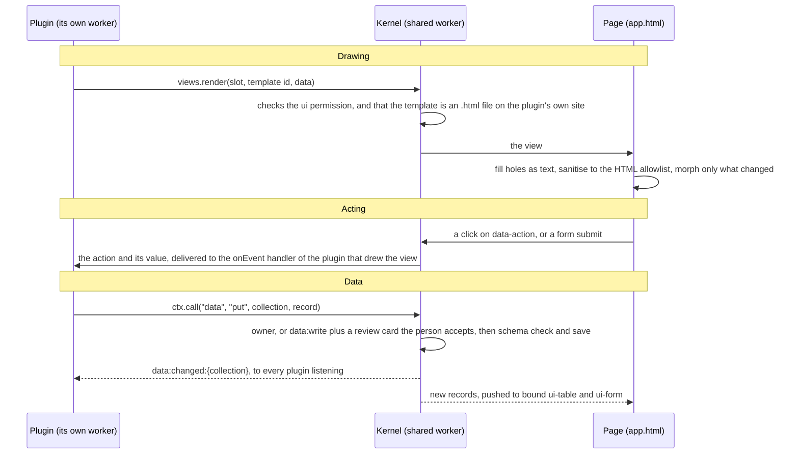

# Extensible Web Apps

A platform for malleable web apps: a small kernel, and everything else is a plugin. That includes the UI shell, storage, sync and the AI agents. Plugins run in their own workers, can only do what their manifest asks for, and draw their UI as plain HTML. An app needs no server, and can open in a **space** that a group of people share, where the same kernel runs on a server too, with plugins of its own.

**Try it:** https://extensibleweb.app/ explains the platform with a page made of plugins you can switch off and change ([`site/`](site/README.md)). The workbench, with every plugin, the trace and the benchmarks, is at [`/workbench/`](site/workbench/index.html). The demo apps are in [`demos/`](demos/README.md): a reading list, spending, recipes, contacts, a calendar, habits, a survey and a feed reader with plugins on the server, a household app made for a space, a debugger, and more. The docs are at [`/docs/`](https://extensibleweb.app/docs/), from [`docs/`](docs/README.md).


## Start here

| If you want to… | Read |
| --- | --- |
| Build an app or a plugin | The [developer guide](docs/guide/README.md), or [`AGENTS.md`](AGENTS.md) for the short version |
| See what writing an app looks like | [`demos/`](demos/), starting with [`demos/README.md`](demos/README.md), and the homepage in [`site/home/`](site/home/README.md) |
| Look up an API | [`docs/api.md`](docs/api.md), generated from the running kernel |
| Understand how the kernel works | [`docs/kernel.md`](docs/kernel.md) and [`docs/architecture.md`](docs/architecture.md) |
| Share an app between people, or run plugins on a server | [`docs/guide/spaces-and-servers.md`](docs/guide/spaces-and-servers.md), then [`docs/server.md`](docs/server.md) |
| Know why it is built this way | [`docs/spike.md`](docs/spike.md) and the [plan](https://claude.ai/artifact/S7NdMrp2PkNSqHZFNdqGrC) |

## What's in this repo

The top of the repo is the platform; everything else has a folder that says what it is.

| Folder | What it is |
| --- | --- |
| **The platform** | What every app is made of. An app loads it with two lines. |
| [`src/`](src/) | The host (the page's side), the kernel, the plugin sandbox, the server and its seams, in TypeScript |
| [`elements/`](elements/README.md) | The `ui-*` custom elements views are built from (`ui-card`, `ui-table`, `ui-form`…), one file each, served at `/elements/` |
| [`std/`](std/README.md) | Standard plugins any app can link: the debug console, undo, import and export, sync, model providers, agents… |
| [`sw/`](sw/) and [`sw.js`](sw.js) | The service worker, one file per job |
| [`account/`](account/index.html) | The sign-in and spaces page every deployment serves at `/account/` |
| [`vendor/`](vendor/) | Third-party code served as is (Mermaid, for `ui-diagram`) |
| **Learning from it** | |
| [`demos/`](demos/README.md) | Apps written to show the programming model, one folder per app |
| [`starter/`](starter/) | The app `npm run new-app` copies to begin a new one |
| [`docs/`](docs/README.md) | The guide and reference, drawn at `/docs/` |
| [`AGENTS.md`](AGENTS.md) | The short version, for AI agents and people building apps |
| **This website** | |
| [`site/`](site/README.md) | The site's own pages, served at its root: the front page and its chapters (`site/home/`), and the workbench with its demo plugins (`site/workbench/`). Not part of the platform. |
| **Tooling** | |
| [`scripts/`](scripts/), [`tests/`](tests/), [`public/`](public/) | Commands (`check`, `new-app`, `deploy:app`, create), the checks, and files copied to the site as they are (`404.html`, `_headers`, `llms.txt`) |

## How it fits together

An app is a folder with an `app.html`: an ordinary page that lays out `<slot name>` elements and lists its plugins with `<link rel="plugin" href="…">`. Each plugin is one file. The page loads the platform with two lines (`/platform/host.css` and `/platform/host.js`); the host fetches the linked plugins, the kernel runs each in its own worker, and their views appear in the slots they name.

A person can extend any app, even one with no slots. **Customize**, on every app page, adds their own plugins, kept on their device. A plugin that has no slot names a *place*: a CSS selector on the page and what to do there (add before or after, replace, hide). The author can mark parts of the page `review` or `locked`. See [places](docs/guide/places.md) and the [trip](demos/trip/), [menu](demos/menu/) and [invoice](demos/invoice/) demos.

### How a view and its data move

A plugin never touches the page. It sends messages, the kernel checks each one against the plugin's manifest, and the page draws what's left. Each arrow below is a message between workers.



Bound elements update on their own. A plugin's own views update the same way when it draws them with `live`: `views.live(slot, id, (ctx) => data)` notes which collections and settings the function reads, and runs it again when any of them changes. A plugin can also listen to `data:changed:<collection>` itself and draw again.

Each kind of code has its own place:

- **The host** (`src/host/`) is the page. It draws what plugins render, turns clicks and typing into events, and runs no plugin code. Read [`main.ts`](src/host/main.ts) first, then:
  - [`sanitize.ts`](src/host/sanitize.ts) keeps only the HTML listed in [`src/shared/html.ts`](src/shared/html.ts)
  - [`morph.ts`](src/host/morph.ts) updates a view in place
  - [`templates.ts`](src/host/templates.ts) fills a plugin's view templates with its data
  - [`workbench.ts`](src/host/workbench.ts) is the trace and benchmarks on the workbench page (`site/workbench/index.html`)
  - [`elements.ts`](src/host/elements.ts) loads the `ui-*` elements from [`elements/`](elements/)
  - [`bindings.ts`](src/host/bindings.ts) connects `<ui-form>` and `<ui-table>` to collections
  - [`service-worker.ts`](src/host/service-worker.ts) starts the service worker and passes its questions to the kernel
- **The elements** ([`elements/`](elements/)) are the `ui-*` custom elements views are built from, one `.html` file each, run as written with no build. See [`elements/README.md`](elements/README.md).
- **The kernel** (`src/kernel/`) is a shared worker that every tab talks to (another for each space a tab opens), and the same code runs as a space's kernel on a server. [`kernel.ts`](src/kernel/kernel.ts) wires everything together and is the place to start. It reads what differs between hosts from [`env.ts`](src/kernel/env.ts), which an entry sets first: [`browser.ts`](src/kernel/browser.ts) in the browser, and a server entry for a space (see [docs/server.md](docs/server.md)). The other files, by job:
  - **Talking to plugins:**
    - [`remote.ts`](src/kernel/remote.ts) is the bridge to plugin workers
    - [`manifest.ts`](src/kernel/manifest.ts) reads a manifest without running the plugin
    - [`gate.ts`](src/kernel/gate.ts) checks every call against the manifest
    - [`hooks.ts`](src/kernel/hooks.ts) defines the events plugins can listen to
    - [`apps.ts`](src/kernel/apps.ts) runs the plugins an open app links, while a tab has it open
    - [`routes.ts`](src/kernel/routes.ts) answers requests for plugin routes, which the service worker passes on
    - [`hosts.ts`](src/kernel/hosts.ts) keeps the open tabs and picks the spawner, the tab that starts plugin workers
    - [`services/`](src/kernel/services/) holds one file per core service (`files`, `hooks`, `kernel`, `storage`), found by name; optional services are kernel modules in `std/<name>/module.ts`
    - [`agents/`](src/kernel/agents/) runs an agent's Markdown file as a plugin
  - **Data:**
    - [`store.ts`](src/kernel/store.ts) is the data folder
    - [`records.ts`](src/kernel/records.ts) and [`schema.ts`](src/kernel/schema.ts) hold collections
    - [`paths.ts`](src/kernel/paths.ts) checks file paths
    - [`user-plugins.ts`](src/kernel/user-plugins.ts) keeps a person's own plugins for each app
    - [`secrets.ts`](src/kernel/secrets.ts) and [`net.ts`](src/kernel/net.ts) keep keys and put them into requests a plugin can't read
  - **Spaces and servers:**
    - spaces are a kernel module, [`std/spaces/`](std/spaces/module.ts): [`hub.ts`](std/spaces/hub.ts) is a space's side of sync, [`device.ts`](std/spaces/device.ts) a device's, and [`server-apps.ts`](std/spaces/server-apps.ts) starts the server plugins of the apps opened in a space
    - [`isolate-host.ts`](src/kernel/isolate-host.ts) stands in for a tab on a server, starting each plugin in an isolate
  - **Keeping the person in charge:**
    - [`review.ts`](src/kernel/review.ts) shows a diff before a plugin changes data it doesn't own
    - [`changes.ts`](src/kernel/changes.ts) is the log of what changed
    - [`catalog.ts`](src/kernel/catalog.ts) is the plugins panel
    - [`switches.ts`](src/kernel/switches.ts) is the `plugins` service, which lets a plugin list and switch the plugins in its own app
  - **Built in:**
    - [`reference.ts`](src/kernel/reference.ts) is the API reference
    - [`trace.ts`](src/kernel/trace.ts) is the trace you see at the bottom of the page
- **The service worker** ([`sw.js`](sw.js)) sits between pages and the network. It serves an app's folder address, keeps what it served for offline use, and sends requests for plugin routes to the kernel through a tab. Each job is a file in [`sw/routes/`](sw/routes/); see [Routes and the service worker](docs/guide/routes.md).
- **The server** ([`src/server/`](src/server/)) runs spaces: [`serve.ts`](src/server/serve.ts) on Node, [`cloudflare/`](src/server/cloudflare/) as a Durable Object per space with its kernel in a Dynamic Worker, [`auth/`](src/server/auth/) for passkeys, OAuth providers, spaces and members, and [`routes.ts`](src/server/routes.ts) for server plugins' public routes. What a host provides (a folder, isolates) is a seam in [`src/seams/`](src/seams/). See [docs/server.md](docs/server.md).
- **The sandbox** ([`src/sandbox/runtime.ts`](src/sandbox/runtime.ts)) runs inside each plugin's worker, in a browser or in a server plugin's isolate. It builds the `ctx` a plugin is given, and every call on `ctx` becomes a message to the kernel.

[`src/shared/`](src/shared/) holds what both sides agree on:
- the message protocol
- the plugin API's types
- the HTML allowlist

Plugins live in three places:
- [`demos/`](demos/) holds apps written to show the programming model, one folder per app.
- [`std/`](std/) holds standard plugins any app can link, such as the [debug console](std/README.md): a bug button that shows errors and the trace, ready to copy into a bug report.
- [`site/workbench/plugins/`](site/workbench/plugins/) holds the demo plugins the [workbench](site/workbench/index.html) links (no other page runs them; the kernel has no plugins of its own):
  - `word-count.js` and `edit-times.js`, which listen to the notes plugin's hooks (the whole [Markdown editor](https://github.com/PaulKinlan/MarkdownEdiitor) is ported natively in [`demos/markdown-editor/`](demos/markdown-editor/))
  - `tidy.js` (change review), `tone.js` (audio) and `bars.js` (canvas)
  - test plugins that check the security rules

## Running it

```sh
npm install
npm run dev        # http://localhost:5173 is the homepage, /workbench/ the workbench; /demos/reading-list/app.html is a demo app; ?kernel=dedicated runs the kernel in a dedicated worker
npm test           # build, then every check in Chromium, and the measurements (needs Playwright: npm i -g playwright && npx playwright install chromium)
npm run reference  # rewrite docs/api.md from the running kernel (CI also does this on every PR branch and on main)
npm run check      # find mistakes in every app in demos/ (or the folders you name) without a browser; --json for tools
npm run new-app -- my-app   # copy starter/ to demos/my-app/, a small app to begin from
npm create extensible-app my-app   # no checkout needed (or npx github:PaulKinlan/ExtensibleWebApps my-app): a my-app/ folder with the platform, installed, and the app in demos/my-app/
npm run deploy:app -- demos/my-app   # deploy just that app as its own Cloudflare Worker (docs/guide/deploying-an-app.md)
npm run serve      # the site and its spaces on this machine, at http://127.0.0.1:8787 (sign in at /account/)
npm run test:server  # the server checks, on Node and wrangler dev
npm run typecheck
```

The trace panel at the bottom of the page shows every dispatch, remote call, denial and lifecycle event.

A core rule for every change: add files rather than edit shared ones, and leave existing demos and other people's work merging cleanly. [`AGENTS.md`](AGENTS.md#changing-the-platform-without-getting-in-anyones-way) says how.

Every push to `main` is deployed to Cloudflare, at https://extensibleweb.app/, through Cloudflare's Git integration: the static assets, and a Worker ([`wrangler.jsonc`](wrangler.jsonc)) with the `Space` and `Accounts` Durable Objects for spaces and sign-in. Cloudflare applies [`public/_headers`](public/_headers), so plugin workers there get the same content security policy as under `vite preview`: no network unless the plugin's manifest asks for it.

## Background

- Built on [Cordis](https://github.com/cordiverse/cordis), the plugin framework under [DeepSeek Harness](https://github.com/deepseek-ai/DeepSeek-Harness).
- It also learns from:
  - the [Markdown editor](https://github.com/PaulKinlan/MarkdownEdiitor)'s extension system
  - [Pi](https://github.com/badlogic/pi-mono)'s extensions
  - Ink & Switch's [Malleable software](https://www.inkandswitch.com/essay/malleable-software/) essay

## License

[Apache License 2.0](LICENSE).
