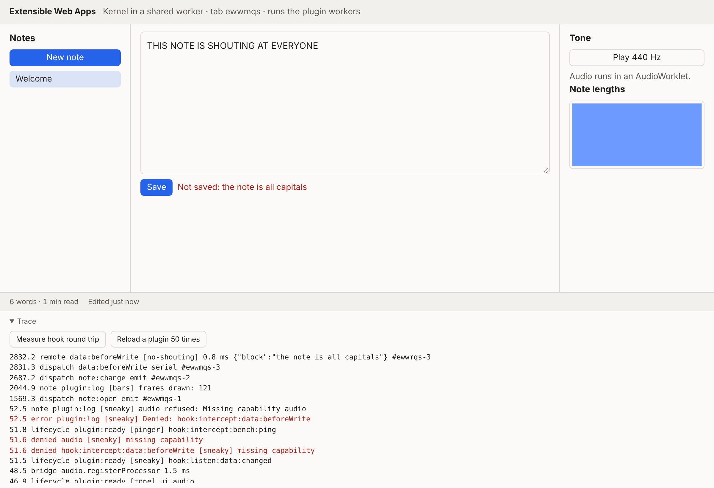

# Extensible Web Apps

An exploration of malleable web applications: a small kernel where everything else, including the UI shell, storage and the AI app builder, is a plugin.

- Research and plan: https://claude.ai/artifact/S7NdMrp2PkNSqHZFNdqGrC
- Built on [Cordis](https://github.com/cordiverse/cordis), the plugin framework under [DeepSeek Harness](https://github.com/deepseek-ai/DeepSeek-Harness).
- Learns from the [Markdown editor](https://github.com/PaulKinlan/MarkdownEdiitor)'s extension system, [Pi](https://github.com/badlogic/pi-mono)'s extensions and Ink & Switch's [Malleable software](https://www.inkandswitch.com/essay/malleable-software/) essay.

## What's here

A notes app where every feature is a plugin and no plugin runs on the main thread. The phase 0 spike and what it showed are in [docs/spike.md](docs/spike.md); the kernel as it stands is described in [docs/kernel.md](docs/kernel.md).



```
page (host)  <-- port -->  kernel (shared worker)  <-- port -->  plugin (dedicated worker, one each)
```

- **Host** (`src/host/`): draws the declarative views plugins send, turns clicks and typing into events, creates plugin workers when it is the spawner tab, and bridges page-only APIs (Web Audio). Runs no plugin code.
- **Kernel** (`src/kernel/`): Cordis core, plus the bridge to plugin workers (`remote.ts`), the capability gate (`gate.ts`), hook specs (`hooks.ts`) and the trace tap (`trace.ts`). Two trusted demo plugins live here too: the store and the notes app.
- **Sandbox runtime** (`src/sandbox/runtime.ts`): loads one plugin in a worker and gives it a `ctx` whose calls are messages the gate checks. Markdown editor extensions get an `editor` shim instead.
- **Plugins** (`plugins/`): `word-count.js` and `edit-times.js` copied unchanged from the Markdown editor; `no-shouting.js` (blocks a write), `tone.js` (AudioWorklet), `bars.js` (OffscreenCanvas, one per tab), `pinger.js` (benchmark), `sneaky.js` (asks for more than it may have), `fetcher.js` and `offline.js` (network allowed and blocked).

## Running it

```sh
npm install
npm run dev        # http://localhost:5173 ; add ?kernel=dedicated to run the kernel in a dedicated worker
npm test           # build, then 40 checks in Chromium, and the measurements (needs Playwright: npm i -g playwright && npx playwright install chromium)
npm run typecheck
```

The trace panel at the bottom of the page shows every dispatch, remote call, denial and lifecycle event, and has buttons to measure the hook round trip and run the reload test.
