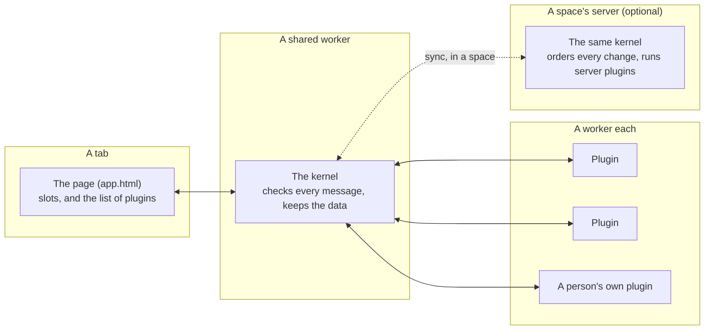

# Extensible Web Apps docs

Extensible Web Apps are web apps that the people using them can change. An app is a small kernel and a list of plugins. Each plugin is one JavaScript file that says what it needs, runs in its own Web Worker, and can do nothing it didn't ask for. Anyone can add, remove or rewrite a plugin: the developer who built the app, a person using it, or an AI agent working for them.

These pages are the same Markdown files you can read [on GitHub](https://github.com/PaulKinlan/ExtensibleWebApps/tree/main/docs), drawn by an app built on the platform: [`docs.js`](docs.js) is its one plugin.

An app works with no server at all. A **space** lets a group of people share its data, each device keeping a copy that syncs with the space's server, where plugins can also run with no app open: answering public links, running on a schedule, sending email.

## Where to start

| You want to | Read |
| --- | --- |
| Build your first app | [How an app works](guide/how-an-app-works.md), then [Writing a plugin](guide/writing-a-plugin.md) |
| Read the whole guide, in order | [The developer guide](guide/README.md) |
| See how the pieces fit | [Architecture](architecture.md) |
| Know which layer a piece of code belongs in, from Cordis up to apps | [The layers](layers.md) |
| Know what a plugin can and can't do | [The security model](security.md), and [every permission](permissions.md) in plain words |
| Add a ready-made feature to an app | [Standard plugins](plugins.md) |
| Share an app's data with other people, or run a plugin on a server | [Spaces, and plugins on a server](guide/spaces-and-servers.md), then [Servers and spaces](server.md) for how it's built |
| Start a project of your own | `npm create extensible-app my-app`, then [Deploying one app on its own](guide/deploying-an-app.md) |
| Look up a word | [The glossary](glossary.md) |
| Look up a service, hook or permission | [The API reference](api.md), which the kernel prints about itself |
| See how the kernel works inside, and where it runs | [The kernel](kernel.md) |
| Know why it is built this way | [What the first spike found](spike.md) |
| Try it, without reading | [The homepage](/), where every part is a plugin you can switch off |

If you are an AI agent building an app, start with [`AGENTS.md`](../AGENTS.md).
