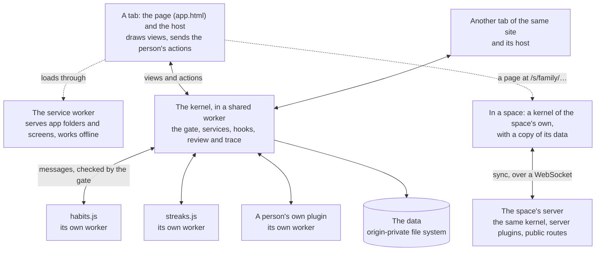
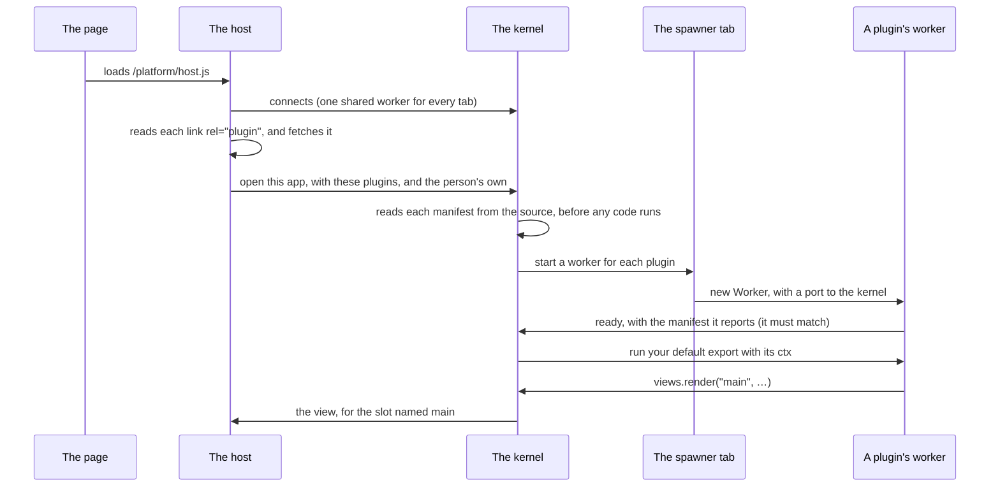
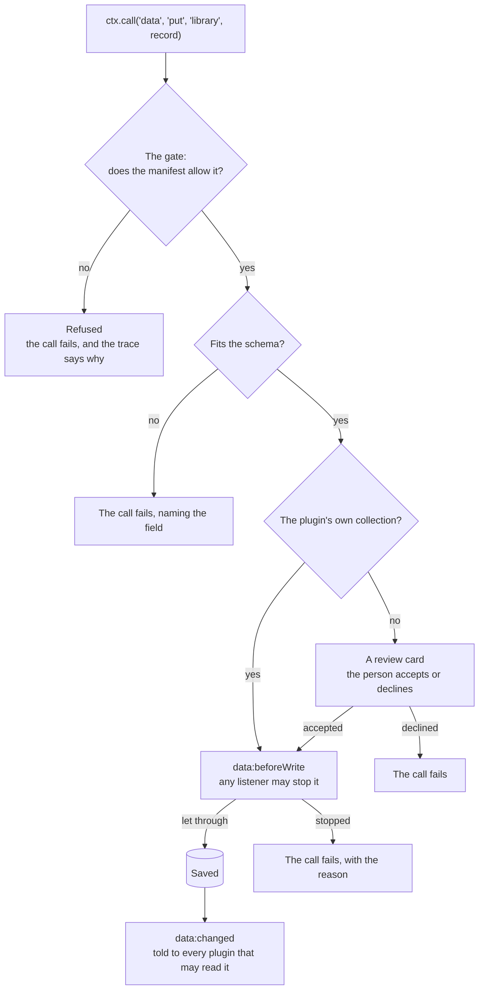

# Architecture

An app built on Extensible Web Apps is a page, a kernel and plugins. Each runs in its own place, and they talk only by sending messages. This page shows how the pieces fit, what happens when a page opens, and the path every message takes. The [developer guide](guide/README.md) builds on it, one feature at a time.

## The pieces

| Piece | Where it runs | What it is |
| --- | --- | --- |
| **The page** | The tab | Your `app.html`: plain HTML with named `<slot>` elements for plugins to draw in, and a `<link rel="plugin">` for each plugin. |
| **The host** | The tab's main thread | The platform's only code on the page ([`src/host/`](../src/host/)). It draws the views plugins send, sanitised to an allowlist, and sends back what the person clicks and types. It runs no plugin code. |
| **The kernel** | A shared worker, one for every tab of the site | [Cordis](https://github.com/cordiverse/cordis) plus the platform's own pieces ([`src/kernel/`](../src/kernel/)): the gate, the services, the hooks, the change review and the trace. It keeps the data. Where shared workers are missing, each tab gets a dedicated one. |
| **Plugins** | A dedicated worker each | One JavaScript file each, with a manifest saying what it may do. A plugin can't touch the page, the network (unless it asks) or another plugin. |
| **The service worker** | Between the pages and the network | Serves an app's folder at its address, and any screen inside it ([`sw/routes/`](../sw/routes/)), the same app inside a space, and a person's own plugins; keeps what it served for offline use, and sends requests for plugin routes to the kernel. |
| **A space's server** (optional) | Node (`npm run serve`) or Cloudflare (a Durable Object per space) | The same kernel again, one per space: it orders every change the members' devices send, runs the plugins that say `runs: "server"`, answers their public routes at `/s/<space>/…`, and wakes for their scheduled jobs. Sign-in and members are in [`src/server/`](../src/server/). See [Servers and spaces](server.md). |

## Opening a page

- **One kernel for every tab.** Two tabs of the same app share the plugins' data and see each other's changes as they happen.
- **The spawner.** A shared worker can't create workers, so one tab, the spawner, creates them and hands the kernel a port to each. If that tab closes, the next one takes over and the plugins start again there. See [What the first spike found](spike.md).
- **Scope.** A plugin with `scope: "shared"` (the default) runs once for every tab. One with `scope: "tab"` runs once in each open tab, and its views go only there. That suits a plugin that keeps view state, or follows the tab's address.

## A message's path

Everything a plugin does is a message to the kernel. The gate checks each one against the plugin's manifest first, and the trace records it, refused or not.

The same shape holds for every service: the gate, then the service's own rules and checks, then hooks that let other plugins take part. The [security model](security.md) explains why each step is there.

## Where things are kept

- **Data** lives in the browser's [origin-private file system](https://developer.mozilla.org/docs/Web/API/File_System_API/Origin_private_file_system), kept by the kernel: collections, each plugin's own storage and settings, the person's grants, their own plugins and the change log. Every app on the same site shares it, which is how one app can read another's collection (see [Sharing data between apps](guide/sharing-data-between-apps.md)).
- **A space's data** is kept apart, in `spaces/<space>/` on each device, by the space's own kernel (`kernel:<space>`), and on the space's server, which orders every change so all the copies agree. Apps opened in the same space share it, as apps on the site share the person's own. See [Spaces, and plugins on a server](guide/spaces-and-servers.md).
- **Plugins** are fetched from the app's folder each time it opens. A person's own plugins are kept with the data, under `user/<app folder>/`.
- **Keys** are kept in a file no plugin can read. A plugin only names a key in a request; the kernel fills it in (see [API keys and web requests](guide/keys-and-requests.md)).

## Reading further

- [The kernel](kernel.md): where it runs, manifests, views, collections, change review and hooks, in more depth.
- [Servers and spaces](server.md): the kernel on a server, sign-in, sync and server plugins.
- [The security model](security.md): what a plugin can and can't do, and why.
- [Permissions](permissions.md): every permission, in plain words.
- [The API reference](api.md): every call, hook and manifest field, printed by the kernel.
