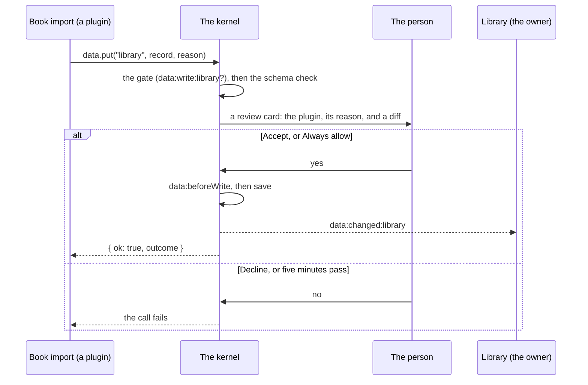

# Data and permissions

Plugins keep data in **collections**: typed records the kernel stores, checks and shares. A plugin owns the collections its manifest declares. Everyone else asks.

## Declaring a collection

```js
export const manifest = {
  id: "cookbook",
  name: "Cookbook",
  permissions: ["ui"],
  collections: {
    recipes: {
      title: "Recipes",
      schema: {
        type: "object",
        required: ["title", "serves"],
        properties: {
          title: { type: "string", title: "Recipe", maxLength: 120 },
          serves: { type: "integer", minimum: 1, maximum: 100, default: 4 },
          ingredients: {
            type: "array",
            items: {
              type: "object",
              title: "Ingredient",
              required: ["item"],
              properties: { amount: { type: "number" }, unit: { type: "string" }, item: { type: "string" } },
            },
          },
          method: { type: "string", "x-multiline": true },
        },
      },
    },
  },
};
```

Schemas are a JSON Schema subset: `type` (string, number, integer, boolean, array, object), `title`, `description`, `default`, `enum`, `properties`, `required`, `items`, `minimum`, `maximum`, `minLength`, `maxLength`, `format` (date, date-time, email, uri) and `x-multiline`. The full table is in the [API reference](../api.md#collections).

Which plugin owns a collection is kept with the data, so the first plugin to declare a name owns it from then on, even when it isn't running.

## Reading and writing

```js
await ctx.call("data", "list", "recipes");                 // every record, newest change first
await ctx.call("data", "get", "recipes", id);              // one record, or null
await ctx.call("data", "put", "recipes", { title: "Soup", serves: 2 });        // add; { ok, id }
await ctx.call("data", "put", "recipes", { ...recipe, serves: 6 });             // replace (has an id)
await ctx.call("data", "delete", "recipes", id);
await ctx.call("data", "collections");                    // every collection, with its schema
```

- Every record gets `id`, `createdAt` and `updatedAt` from the kernel.
- `put` replaces the whole record: spread the old one in to change a field.
- A write the schema rejects returns `{ ok: false, errors: [{ path, message }] }`, with paths like `ingredients[0].item`. Nothing is written.
- Fields set to `null` or `""` are dropped, which is how a field is cleared.

## Forms and tables

Two elements bind to a collection and do the reading and writing themselves, with the rights of the plugin whose view they sit in:

```html
<ui-table collection="recipes" columns="title,serves" sort="title" row-action="open" deletable></ui-table>
<ui-form collection="recipes" fields="title,serves,ingredients" submit="Add recipe"></ui-form>
<ui-form collection="recipes" record="{{open}}" submit="Save" action="saved"></ui-form>
```

`ui-form` builds its fields from the schema:

| Schema | Control |
| --- | --- |
| `string` | A text field; `format` picks date, date-and-time, email or URL inputs; `x-multiline` or a `maxLength` over 200 makes a text area |
| `number`, `integer` | A number field, with `minimum` and `maximum` |
| `boolean` | A checkbox |
| `enum` | A menu |
| `object` | A fieldset of its fields |
| `array` | A row per item, each with Remove, and an Add button. Items can be plain values or objects, two levels deep. |

Errors from the kernel appear beside the field they're about, even inside a list. Fields the form doesn't show keep their saved values. `row-action` and `action` send an action with the record's id, so the plugin can open or follow up on it.

## Permissions

A plugin asks for what it needs in `permissions`, and the kernel refuses everything else, recording each refusal in the trace.

| Permission | Lets a plugin |
| --- | --- |
| `ui` | Draw views |
| `data:read:<collection>` | List and get another plugin's records, and hear when they change (`data:changed:<collection>`) |
| `data:write:<collection>` | Put and delete another plugin's records, **after the person accepts each change** |
| `network` | Use `fetch` and WebSockets to `https:` hosts. Without it, the plugin's worker can't connect anywhere. |
| `hook:listen:<hook>`, `hook:intercept:<hook>` | Listen to a hook, or take part in one that can change or stop an action |
| `files:<folder>` | Read and write text files in one folder of the data, reviewed |

A trailing `*` grants everything starting with what comes before it, but ask for exactly what you use: the person sees the list.

## Reviews

When a plugin writes data it doesn't own, the kernel shows the person a card with the change as a diff, and the plugin's reason:

```js
await ctx.call("data", "put", "library", { title, author }, "Imported from your pasted list");
```

The person accepts it once, allows that plugin to make such changes from then on, or declines. The call resolves when they answer (`{ ok: true, outcome }`), or fails if they decline or don't answer within five minutes. Review cards always show, even in an app with no slot for them. Writes to a plugin's own collections are never reviewed.



## Hooks

Every write runs two hooks:

- `data:beforeWrite:<collection>` (serial): a listener can return `{ block: reason }` to stop it. Needs `hook:intercept:data:beforeWrite:<collection>`.
- `data:changed:<collection>` (emit): every reader hears `{ collection, id, before?, after? }` afterwards. `data:read:<collection>` is enough to listen.

Most views don't need either: a [live view](views-and-templates.md#live-views) follows the collections it reads.

## A plugin's own data

For state that isn't a collection, such as which month is showing:

```js
await ctx.storage.set("offset", 2);   // a JSON value, up to 1 MB in all; never reviewed
await ctx.storage.get("offset");
```

And for settings the person changes, declare them in the manifest and the plugins panel builds the form:

```js
settings: { days: { type: "number", title: "Days ahead", default: 60 } },
// …
const { days } = await ctx.settings.get();
ctx.settings.onChange((values) => …);   // or read them in a live view, which follows them
```

Next: [Styling](styling.md).
