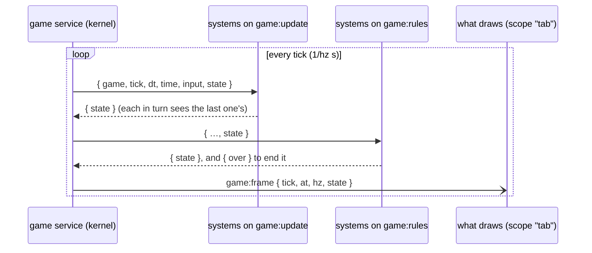
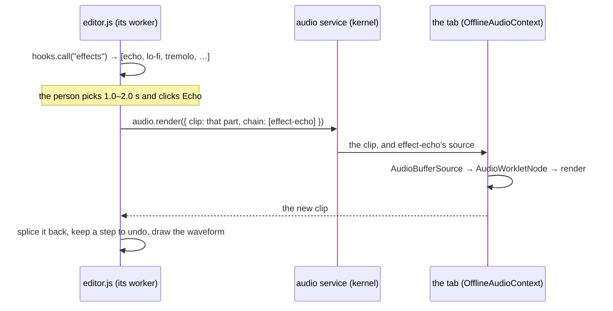

# Games and sound

Two kinds of app push a platform hard: a game, which has to do something
many times a second, and a sound editor, which moves a lot of numbers and
has to sound right. Both are built here the same way as a reading list: a
small engine, and everything else in plugins, so a new rule or a new effect
is one more plugin and the engine never changes.

| | Engine | What a plugin adds | Demo |
| --- | --- | --- | --- |
| A game | the `game` service: a loop in the kernel ([`std/game/module.ts`](../../std/game/module.ts)) | a *system*: a rule that runs every tick | [Glowfall](../../demos/glowfall/) |
| Sound | the `audio` service: clips rendered through AudioWorklet processors ([`std/audio/module.ts`](../../std/audio/module.ts)) | an *effect*: a processor | [Sound editor](../../demos/audio-editor/) |

## A game loop whose rules are plugins

A game is a state, a plain object its plugins agree on, and a clock. The
`game` service keeps both. A plugin starts a game with its first state, and
the service ticks it, 20 times a second unless asked for another rate:

```js
await ctx.call("game", "start", { game: "glowfall", hz: 20, state: { lanes: 5, jar: 2, things: [], score: 0, lives: 3 } });
```

Each tick runs three hooks, one after the other:



- **`game:update`** is a waterfall: each system gets the state, and answers
  `{ state }` with its changes. The next system sees them. This is where
  things move: Glowfall's [`sky.js`](../../demos/glowfall/sky.js) drops and
  moves what falls, and [`jar.js`](../../demos/glowfall/jar.js) moves the
  jar for each key press.
- **`game:rules`** runs once everything has moved, for systems that judge:
  [`catch.js`](../../demos/glowfall/catch.js) scores what lands in the jar
  and counts the rain that does. Answering `{ over: "why" }` ends the game.
- **`game:frame`** tells whatever draws the game what the state is now.

A system is an ordinary plugin with `hook:intercept:game:update` (or
`:rules`):

```js
export const manifest = {
  id: "glowfall-wind",
  name: "Wind",
  permissions: ["hook:intercept:game:update"],
  services: ["game"],
};

export default function (ctx) {
  ctx.on("game:update", ({ game, dt, time, state }) => {
    if (game !== "glowfall" || state.done) return;
    const gust = time % 6 < 2 ? 1 : 0;
    return { state: { ...state, things: state.things.map((t) => ({ ...t, x: Math.min(state.lanes - 1, t.x + gust * dt)) })) } };
  });
}
```

That is [`samples/wind.js`](../../demos/glowfall/samples/wind.js), more or
less; Customize offers it on Glowfall. Turn it on and the wind blows; turn it
off and it stops. Nothing else changed.

**What the person presses** goes to the loop with
`ctx.call("game", "input", { game, type: "left" })`, and arrives on the next
tick as `input`, in order, each with `from`, the plugin that sent it.
Glowfall's [`controls.js`](../../demos/glowfall/controls.js) sends a press
for each button and each key (as commands, so the palette lists them).

**Drawing.** A canvas goes to the worker that draws on it, so the plugin
that draws is `scope: "tab"`, and each tab draws its own. It listens to
`game:frame` (with `hook:listen:game:frame`), keeps the last two frames, and
draws at the screen's rate between them: Glowfall ticks 20 times a second
and still moves smoothly. [`meadow.js`](../../demos/glowfall/meadow.js) does
this, with the page's colours from `ctx.ui.onCanvas` and `ctx.ui.onTheme`
([views](views-and-templates.md)).

**Sound.** A system can do more than change the state. Glowfall's
[`samples/chime.js`](../../demos/glowfall/samples/chime.js) listens to
`game:frame` and plays a note through the `audio` service whenever the
frame's state says something was caught on that tick.

### What the loop promises

- **Ticks are quiet.** `game:update`, `game:rules` and `game:frame` are
  *quiet* hooks: they run many times a second, so they aren't traced, or a
  running game would push everything else out of the trace. A listener that
  fails or times out is still traced. `game:started` and `game:ended` are
  traced as usual. (A kernel module marks a hook quiet with `quiet: true` in
  its spec.)
- **A slow system slows the game down; it doesn't pile up.** Each system has
  250 ms to answer a tick, or that tick goes on without it. A tick that
  isn't finished when the next is due makes the next one wait its turn, and
  the game's `late` count goes up.
- **A game ends when its plugin does.** The plugin that started a game owns
  it; if it stops (its tab closes, someone turns it off), so does the game.
- **The state stays small.** It goes to every system every tick, so it is
  held to 200,000 characters of JSON.
- **Several games, by name.** A game is `"main"` unless named, and up to four
  run at once. Systems are told the game's name, and leave alone the games
  they don't know.

`ctx.call("game", "state", { game })` reads a game as it is now, and the
page command `game-state` lists every game, for tests and developer tools.

## Clips, and effects that are plugins

The `audio` service has played sound since the
[Beat pad](../../demos/beats/): a plugin registers an AudioWorklet
processor and plays it. For sound that is edited rather than played, it also
has **clips**: a recording as `{ rate, pcm }`, where `pcm` is base64 of
16-bit samples, one channel. A clip is plain JSON, so a plugin can keep one
in a collection, send it in a hook, or hand it to the service:

| Method | Does |
| --- | --- |
| `audio.render({ clip, chain, tail? })` | Runs a clip through a chain of processors in an `OfflineAudioContext`, faster than real time, and gives back the new clip. `tail` adds silence for an echo to ring into. With `source` instead of `clip`, a processor makes the clip. |
| `audio.playClip({ clip, from?, to?, chain?, group? })` | Plays a clip, or a part of it, through a chain if given. Answers `{ at, ms }`, when it starts and how long it lasts, for a playhead. |
| `audio.stop({ group })` | Stops a group's sounds, even those already sounding. |
| `audio.open()` | Opens the file chooser for a sound file and decodes it into a clip (only right after a click). |
| `audio.save({ clip, name })` | Downloads a clip as a WAV file. |

An **effect** is a processor some plugin registered. The service sends each
processor's source with the sound that uses it, so a processor registered by
one plugin works in any tab another plugin plays in. A processor's name is
the first plugin's to register it.

The [sound editor](../../demos/audio-editor/) knows no effects. It defines a
hook of its own, `sound-editor:effects` (a waterfall,
[hooks of your own](plugin-hooks.md)), and offers whatever answers it.
An effect plugin registers its processor and adds itself:

```js
export const manifest = {
  id: "effect-echo",
  name: "Echo",
  permissions: ["audio", "hook:intercept:sound-editor:effects"],
  services: ["audio"],
};

const PROCESSOR = `registerProcessor("effect-echo", class extends AudioWorkletProcessor {
  constructor(options) { super(); this.line = new Float32Array(Math.round(0.25 * sampleRate)); this.i = 0; }
  process(inputs, outputs) {
    const input = inputs[0][0], out = outputs[0][0];   // input is missing once the sound has ended
    for (let n = 0; n < out.length; n++) {
      const dry = input ? input[n] : 0, wet = this.line[this.i];
      this.line[this.i] = dry + wet * 0.45;
      this.i = (this.i + 1) % this.line.length;
      out[n] = dry + wet * 0.5;
    }
    return true;
  }
});`;

export default async function (ctx) {
  await ctx.call("audio", "registerProcessor", "effect-echo", PROCESSOR);
  ctx.on("sound-editor:effects", ({ effects }) => ({
    effects: [...effects, { id: "echo", name: "Echo", processor: "effect-echo", tail: 1500 }],
  }));
}
```

To apply one, the editor renders the part the person picked through it:



The editor's own edits (cut, trim, fade, reverse, normalise) are done on the
samples in its worker; they need no effect.

### The waveform

[`<ui-waveform>`](../../elements/ui-waveform.html) draws a sound's shape
from `peaks` (a low and a high, from -100 to 100, for each column; a few
hundred pairs) and its `duration`. The person drags across it to pick a
part, or uses Shift and the arrow keys; it sends `action` with
`{ from, to }` in seconds, and the plugin sets `select` to show it. While
something plays, `playing="at,from,to"` runs a playhead from the time
`audio.playClip` answered, so the plugin doesn't redraw for each frame. The
element never gets the sound itself.

## Building on them with the app maker

Because the engines don't change for a new rule or a new effect, the
[app maker](making-apps.md) can build on them: asked for "Glowfall with a
magnet that pulls the fireflies to the jar", it makes an app whose page links
Glowfall's plugins from `/demos/glowfall/` as they are, and writes one plugin,
the magnet, a system on `game:update`. Asked for "the sound editor with a
robot voice", it links the editor and writes a robot-voice effect. The
check [`tests/checks/game-audio-maker.mjs`](../../tests/checks/game-audio-maker.mjs)
does both, with a scripted model, and plays each.

## What isn't there yet

- **The canvas doesn't take input.** A game's controls are buttons and keys
  (commands); a tap or drag on the canvas itself doesn't reach the plugin.
- **No game on a server.** The loop runs in the browser's kernel; a game
  several people play together would need it in a space's server, and a
  frame sent to each member.
- **Clips are one channel, and short.** About 30 seconds at 22,050 samples a
  second; no stereo, no tracks to mix.
- **Effects can't be tuned in the editor.** An effect offers one setting of
  its options; a knob for each would need the effect to describe them.
