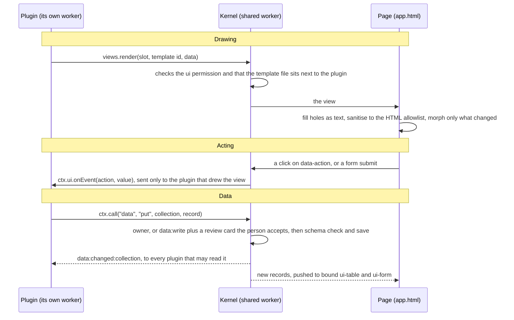

# How an app works

An app is three kinds of thing, each in its own place:

| Piece | Where it runs | What it does |
| --- | --- | --- |
| **The page** (`app.html`) | The tab | Your HTML: the layout, the named slots plugins draw in, and the list of plugins. It loads the platform's host, which draws views and turns clicks into events. It runs no plugin code. |
| **The kernel** | A shared worker, one for every tab | Runs the plugins, checks every message against the plugin's manifest, keeps the data, and shows the person a review before a plugin changes data it doesn't own. |
| **Plugins** | Their own worker each | Your code: one `.js` file per plugin, with a manifest saying what it may do. A plugin can't touch the page, the network (unless it asks), or another plugin. It sends messages. |

## The page

```html
<!doctype html>
<html lang="en">
<head>
  <meta charset="utf-8">
  <meta name="viewport" content="width=device-width, initial-scale=1">
  <title>Habits</title>
  <link rel="stylesheet" href="/platform/host.css">   <!-- the platform: the same two lines in every app -->
  <script type="module" src="/platform/host.js"></script>
  <link rel="plugin" href="habits.js">                 <!-- each plugin, one file -->
</head>
<body>
  <header><h1>Habits</h1></header>
  <main><slot name="main"><p>Loading your habits…</p></slot></main>
</body>
</html>
```

- `<link rel="plugin" href>` names a plugin, relative to the page. The kernel starts it when the first tab opens the app and stops it when the last one closes.
- `<slot name>` is where plugins draw. What you put inside it shows until a plugin draws there. A plugin picks the slot by name (`main`, `side`, `nav`, `status`, or any name your page uses).
- The page is yours: any HTML and CSS. Plugins fill the slots; they never change the rest.

## What moves between them

A plugin never touches the page. It sends messages; the kernel checks each one; the page draws what's left. Each arrow is a message between workers.



Three things follow from this:

- **Drawing is declarative.** A plugin says what a view should hold; the page works out what changed and updates only that, so focus, typing and scroll survive. Draw again whenever your state changes.
- **Actions come back as data.** A button with `data-action="save"` sends `"save"` to the plugin that drew it, and to no one else.
- **Data changes are broadcast.** Every plugin that may read a collection hears when it changes. A live view (`views.live`) redraws on its own when that happens.

## Where things live

- **Data** is kept by the kernel in the browser's origin-private file system: collections, each plugin's own storage, its settings and the change log. Every app on the same origin shares it, which is how one app can read another's collection.
- **Plugins** are fetched from the app's folder each time. A plugin installed at run time is kept with the data instead.
- **The trace** (on the workbench at `/`) shows every message, check and refusal, with timings. When something doesn't draw, look there first.

Next: [Writing a plugin](writing-a-plugin.md).
