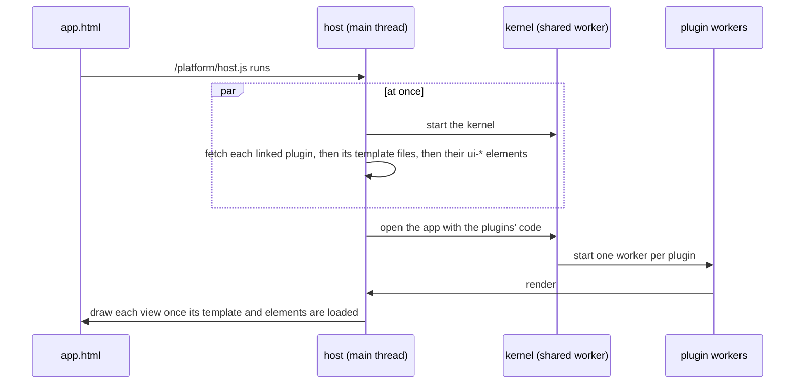

# Loading fast, without jumping

An app's page is mostly empty when it arrives: its plugins draw it. This page says what the host and the service worker do so that drawing starts early and the page doesn't jump while it fills in, and the little an app author can do to help. None of it needs anything in a plugin.

## What happens on a visit

- **The platform's scripts are kept.** The kernel and the plugin runtime are built with their content's hash in their names (`/assets/runtime-…js`), and [`public/_headers`](../../public/_headers) tells browsers they never change. Every plugin worker loads the same runtime file, and a browser asks a server about one address one request at a time, so before this a page with twenty plugins waited twenty round trips before it drew anything.
- **Nothing every app needs waits on another file.** On a first visit, a file the page can only ask for after another has arrived costs a round trip. The page's script is one file with nothing of its own to wait for, the module every kernel starts is inside the kernel's file, the plugin workers' script is asked for while the kernel is on its way, and an element's file names what its script imports (`<link rel="modulepreload">`) so both are asked for together.
- **Files load while the kernel starts** ([`src/host/prefetch.ts`](../../src/host/prefetch.ts)). The host fetches the plugins an app links as soon as it runs, reads each one for the template files it names (`ctx.ui.views("board.html")`), and fetches those and the `ui-*` elements they use. By the time a plugin draws, its files are usually there. Write the file name as a plain string so the host can see it.
- **A view is drawn once its elements are defined.** A `<ui-card>` drawn before its file has loaded shows its children unstyled, then jumps when the element takes over, so the host holds a view back until the elements it uses are defined, or for a second and a half at most.
- **Each slot keeps its room** ([`src/host/reserve.ts`](../../src/host/reserve.ts)). The host remembers how tall each of the page's slots was once its views settled, in this browser, for this app and about this window width. On the next visit it holds that height open after the slot until the views reach it, so what is below doesn't move down as they arrive. On a visit the service worker serves, the host runs before the first paint ([`sw/render-blocking.js`](../../sw/render-blocking.js)), so the room is there from the first frame.
- **Repeat visits come from the service worker's cache** ([`sw.js`](../../sw.js)). A file it has kept is answered at once and fetched again behind it, so the next visit has any newer copy. What the space's server answers (`/s/`) and sign-in (`/auth/`) always ask the network, though an app's own files inside a space come from the cache as they do outside it. Everything on `localhost` asks the network first, so a change you make while developing shows at once.
- **Links are fetched before they're followed** ([`src/host/speculation.ts`](../../src/host/speculation.ts)). When the pointer rests on a link to this site, or a finger presses one, the browser fetches the page (speculation rules, prefetch only). Put `data-no-prefetch` on a link that shouldn't be, such as one whose address does something.
- **A plugin behind a button waits for its first use** ([`src/kernel/remote.ts`](../../src/kernel/remote.ts)). A plugin's manifest can name a `standIn`: `{ slot, key, html }`, the view that holds its place. The kernel draws it, and starts the plugin the first time the person does something there; the plugin hears what they did and draws over the stand-in. Customize does this on every app: its button is there at once, and its worker, its panel's file and the elements the panel uses are fetched when the button is first pressed. It is still one of the app's plugins, listed and switched like the rest.

## What an app author can do

- Put fixed things in the page, not in a plugin: the header, the title and the layout are in the HTML, so they paint at once.
- Give a slot a fallback that is about the size of what will be drawn there, like `<slot name="main">
Loading your books…
</slot>`. It shows until a plugin draws, and on a first visit nothing is remembered yet.
- Give images their size: ``. The views' styles keep the ratio, so the image's room is kept before it loads.
- If your plugin is a panel behind a button, give its manifest a `standIn` with the closed button, so apps that link it pay for the panel only when it is opened.
- Don't put an `<aside>` straight in the body unless you want a second column: an app page's layout gives the body a side column when it has one.

## Measuring

`npm run first-draw` (after `npm run build`) opens every demo as a first visit and as the next one, with every response held back one round trip, and prints for each the files and bytes asked for before the first view and how long it took ([`scripts/first-draw.mjs`](../../scripts/first-draw.mjs)). A request that waits on another shows as a round trip more. Every pull request gets the same report against main, as warnings that never fail it.

The numbers in the pull request that added this came from loading pages in Chromium, a fresh profile and then a second visit, and timing when the first plugin view appeared, when the page stopped changing, and the layout shift score (`PerformanceObserver` with `layout-shift`). Chrome's DevTools Performance panel shows the same: look for requests to one address that wait for each other, and for shifts after the first paint.
