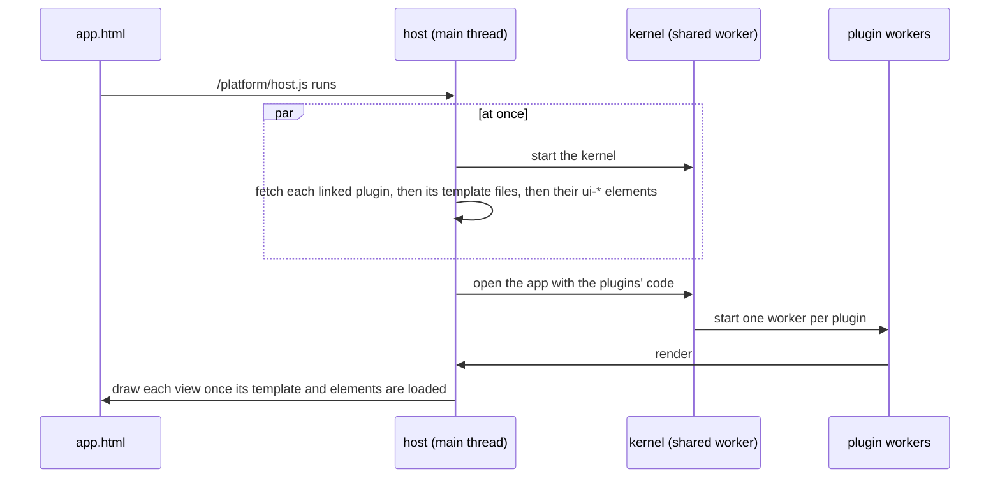

# Loading fast, without jumping

An app's page is mostly empty when it arrives: its plugins draw it. This page says what the host and the service worker do so that drawing starts early and the page doesn't jump while it fills in, and the little an app author can do to help. None of it needs anything in a plugin.

## What happens on a visit

- **The platform's scripts are kept.** The kernel and the plugin runtime are built with their content's hash in their names (`/assets/runtime-…js`), and [`public/_headers`](../../public/_headers) tells browsers they never change. Every plugin worker loads the same runtime file, and a browser asks a server about one address one request at a time, so before this a page with twenty plugins waited twenty round trips before it drew anything.
- **Nothing every app needs waits on another file.** On a first visit, a file the page can only ask for after another has arrived costs a round trip. The page's script is one file with nothing of its own to wait for, the module every kernel starts is inside the kernel's file, the plugin workers' script is asked for while the kernel is on its way, and an element's file names what its script imports (`<link rel="modulepreload">`) so both are asked for together.
- **The page names the files its first view needs** ([`sw/preload-hints.js`](../../sw/preload-hints.js)). The build reads each app page as the host would: the plugins it links, the template files they name, the `ui-*` elements in those templates and inside those elements, each element's script, the kernel, the plugin workers' script and the kernel modules the plugins' manifests name in `services`. It writes them into the built page as `<link rel="preload">` and `<link rel="modulepreload">` lines after the host's script, so the browser asks for all of them as the page arrives. Before this a first view was four to seven requests deep; now it is two (the page, then everything). The lines are made, never written by hand and never committed: the build adds them to every page in `dist/` ([`vite.preload.ts`](../../vite.preload.ts)), `extensible-app dev` and `deploy` add them to a project of your own, and for an app made in the browser the service worker fetches the same files as it serves the page. A wrong hint costs one request; a missing one costs what it did before.
- **Files load while the kernel starts** ([`src/host/prefetch.ts`](../../src/host/prefetch.ts)). The host fetches the plugins an app links as soon as it runs, reads each one for the template files it names (`ctx.ui.views("board.html")`), and fetches those and the `ui-*` elements they use. By the time a plugin draws, its files are usually there. Write the file name as a plain string so the host can see it.
- **A view is drawn once its elements are defined.** A `<ui-card>` drawn before its file has loaded shows its children unstyled, then jumps when the element takes over, so the host holds a view back until the elements it uses are defined, or for a second and a half at most.
- **Each slot keeps its room** ([`src/host/reserve.ts`](../../src/host/reserve.ts)). The host remembers how tall each of the page's slots was once its views settled, in this browser, for this app and about this window width. On the next visit it holds that height open after the slot until the views reach it, so what is below doesn't move down as they arrive. On a visit the service worker serves, the host runs before the first paint ([`sw/render-blocking.js`](../../sw/render-blocking.js)), so the room is there from the first frame.
- **Repeat visits come from the service worker's cache** ([`sw.js`](../../sw.js)). A file it has kept is answered at once and fetched again behind it, so the next visit has any newer copy. Such a visit is bound by the device's processor, not its network, so the worker keeps out of the way: the page is asked for again at once (a deploy is seen as early as ever), the other files two and a half seconds later, and built files (`/assets/`, whose names change when they do, where the server says they are immutable) not at all. A page the worker serves comes without its preload hints: Chrome won't give a file preloaded through a service worker to the `fetch()` that asks for it next, so there each hint would be a second request. When the page isn't kept yet (another app, opened for the first time), the worker fetches what the hints named itself and answers the page's requests with those. What the space's server answers (`/s/`) and sign-in (`/auth/`) always ask the network, though an app's own files inside a space come from the cache as they do outside it. Everything on `localhost` asks the network first, so a change you make while developing shows at once.
- **Two plugin workers start with the page** ([`src/host/main.ts`](../../src/host/main.ts)). Starting a worker takes ten milliseconds or more after the kernel asks for it. The host starts up to two as it runs, while the kernel is still on its way, and hands them to the first plugins that need one; any left over are stopped once the app is open. A plugin with `network` gets a worker of its own kind, started when asked for.
- **The kernel reads side by side** ([`src/kernel/kernel.ts`](../../src/kernel/kernel.ts)). Opening an app, it reads what the person added to it (four reads of the data folder) together, and starts fetching the modules the app's own plugins name while it does.
- **Links are fetched before they're followed** ([`src/host/speculation.ts`](../../src/host/speculation.ts)). When the pointer rests on a link to this site, or a finger presses one, the browser fetches the page (speculation rules, prefetch only). Put `data-no-prefetch` on a link that shouldn't be, such as one whose address does something.
- **A plugin behind a button waits for its first use** ([`src/kernel/remote.ts`](../../src/kernel/remote.ts)). A plugin's manifest can name a `standIn`: `{ slot, key, html }`, the view that holds its place. The kernel draws it, and starts the plugin the first time the person does something there; the plugin draws over the stand-in, and hears what they did once it has. Its manifest can also name a `code` file beside it (`code: "panel.code.js"`): the plugin's own file is then only `export const manifest = {…}`, the other file has `export default function (ctx) {…}` and everything it uses, and the page reads the two as one file when it starts the plugin's worker ([`src/host/plugin-code.ts`](../../src/host/plugin-code.ts)). Only a plugin the app itself links can do this: a plugin a person adds is reviewed as one file. Customize does both on every app: its button is there at once from a 1 KB manifest, its worker starts when the button is first pressed, and its code, its panel's file and the elements the panel uses are fetched a few seconds into the visit, after the app has drawn, so they are there offline too. It is still one of the app's plugins, listed and switched like the rest, and its source is shown and copied whole.

## What an app author can do

- Put fixed things in the page, not in a plugin: the header, the title and the layout are in the HTML, so they paint at once.
- Give a slot a fallback that is about the size of what will be drawn there, like `<slot name="main">
Loading your books…
</slot>`. It shows until a plugin draws, and on a first visit nothing is remembered yet.
- Give images their size: ``. The views' styles keep the ratio, so the image's room is kept before it loads.
- If your plugin is a panel behind a button, give its manifest a `standIn` with the closed button, so apps that link it pay for the panel only when it is opened. If its code is large, keep the manifest in the plugin's own file and the rest in a `code` file beside it, so those apps fetch only the manifest until then. A page reads a `code` file once, with the templates it names, so a change to it shows the next time the page loads.
- Don't put an `<aside>` straight in the body unless you want a second column: an app page's layout gives the body a side column when it has one.

## Measuring

`npm run first-draw` (after `npm run build`) opens every demo as a first visit and as the next one, with every response held back one round trip, and prints for each the files and bytes asked for before the first view and how long it took ([`scripts/first-draw.mjs`](../../scripts/first-draw.mjs)). A request that waits on another shows as a round trip more, and the "requests deep" column counts them: how many times a file had to arrive before the next could be asked for. Every pull request gets the same report against main, as warnings that never fail it.

### Where a next visit's time goes

Measured on Habits, Contacts and Trip with every response held back 100 ms, before the changes above. The first visit back took 230, 295 and 215 ms to the first view; later ones 109, 149 and 92 ms.

| Where | What it cost | What was done |
| --- | --- | --- |
| The first visit back waited a whole round trip for the folder's page: a first visit is at `app.html`, and nothing had kept `/demos/habits/` or `/` | 100 ms and more, once | The worker keeps the site's front page as it starts, and answers an app's folder from its kept `app.html` |
| The worker fetched every file again, and stored it again, while the page was starting; with hints in the page, thirty more requests arrived at once | 30 to 70 ms on Contacts (149 ms without hints, 216 ms with) | Kept pages come without hints; files are fetched again after the page has drawn, built files never |
| The kernel read the data folder four times, one read after another, and only then fetched the modules the app names | about 20 ms (the first plugin was installed 39 ms after the kernel started, now 19 ms) | Read together, modules fetched meanwhile |
| A plugin's worker took 11 to 14 ms to start after the kernel asked | about 10 ms | Two workers start with the page |

After: the first visit back is 137 ms on Habits, 153 ms on Contacts and 92 ms on Trip. What is left is mostly the browser starting the page's script, the kernel's worker and the plugins' workers, one after another.

The numbers in the pull request that added this came from loading pages in Chromium, a fresh profile and then a second visit, and timing when the first plugin view appeared, when the page stopped changing, and the layout shift score (`PerformanceObserver` with `layout-shift`). Chrome's DevTools Performance panel shows the same: look for requests to one address that wait for each other, and for shifts after the first paint.
