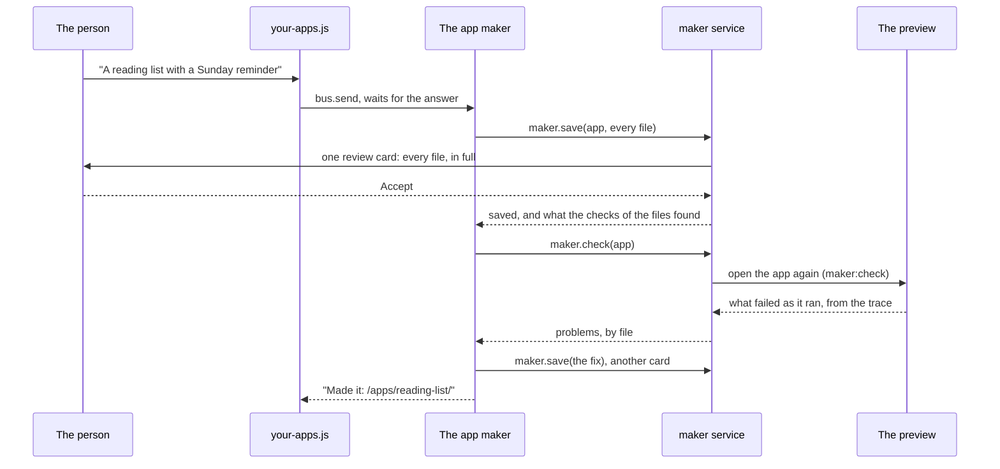

# Making an app by describing it

A person types the app they want, "a reading list with a Sunday reminder",
and gets one that works: an `app.html` and its plugins, like any app in
[`demos/`](../../demos/), that they can open, change, add their own plugins
to, and switch parts of off. The site's page for this is
[`/new/`](../../site/new/app.html). It is built from three standard pieces in
[`std/maker/`](../../std/maker/), which any app can link:

| Piece | What it does |
| --- | --- |
| [`app-maker.agent.md`](../../std/maker/app-maker.agent.md) | The agent. It reads what the person wrote, plans a small app (one plugin per job, each with its template), writes every file, checks the app and fixes what fails. Its only rights are `apps:make`, `apps:read` and `bus:ask`, so its tools are the maker service and a question to the person. |
| [`module.ts`](../../std/maker/module.ts) | The `maker` kernel module: the `maker` service, which keeps the person's apps in their data folder, saves files only after a review, keeps each file's versions, and checks an app. |
| [`your-apps.js`](../../std/maker/your-apps.js) | The box to describe an app (or a change to one), what the agent is doing, the person's apps, a live preview of the one picked (`<ui-preview>`), and each file's history. |



## Where a made app lives

A made app is kept on the person's device, in their data folder at
`made/apps/<name>/`, and the service worker serves it at `/apps/<name>/`
([`sw/routes/made.js`](../../sw/routes/made.js)). `made` is one of the
platform's folders, so no plugin can write there; only the maker service
can, after the person accepts.

Its page was written by a model, so it may be layout and nothing else
([`sw/made-page.js`](../../sw/made-page.js)): the platform's script and
stylesheet, a `<title>`, slots, plain HTML, a `<style>`, and `<link
rel="plugin">` lines to files on this site. No other script, no `on…=`
handlers, no frames, no `javascript:` links. The maker refuses a page that
breaks a rule, saying which and where, before the person is asked; the
service worker checks it again before it serves it, and sends a policy under
which no inline script runs. The app's code is in its plugins, which run in
workers with the permissions they ask for, like any app's.

A made app links only its own files and the standard plugins it chose, never
the model or the app maker. Switch both off, or close `/new/`, and it keeps
working.

## Saving, versions and going back

`maker.save(app, files, note)` writes several files at once, after one
review card that shows every changed file in full, before and after. The
first save of an app must hold its `app.html`. Each file keeps its last 50
versions, with who saved each and why: `maker.history(app, file)` lists them
and `maker.version(app, file, n)` reads one. `maker.restore(app, file, n)`
puts one back, after a review; it becomes the newest version, so a restore
can be undone the same way. Your apps lists every file with its versions and
a "Put this back" button on each.

## Checks

`maker.check(app)` runs the checks `npm run check` makes on an app in a
checkout ([`checks.js`](../../std/maker/checks.js), with the kernel's own
manifest reader, gate, HTML allowlist and API reference): the page's rules,
every linked file there, manifests that read, unique ids that no other
running plugin has, collections no other plugin owns, every `ctx` call
allowed by the plugin's permissions, templates that exist and use the
allowlist, and a slot for everything a plugin draws.

Then it asks for the app to be opened again (the `maker:check` hook; the
preview in Your apps reloads) and reads the trace for what failed as it ran:
a plugin that didn't start, an error it threw, a permission it was refused.
Each problem names the file to fix. If the app isn't open anywhere, `ran` is
false and only the files were checked.

## Adding it to another app

```html
<link rel="agent" href="/std/maker/app-maker.agent.md">
<link rel="plugin" href="/std/maker/your-apps.js">
<link rel="plugin" href="/std/llm/anthropic.js">
<link rel="plugin" href="/std/board.js">
…
<slot name="make"></slot>
<slot name="apps"></slot>
<slot name="board"></slot>
```
