# How the Markdown editor is built

The [Markdown editor](../../demos/markdown-editor/) is a whole writing app
made of small plugins: the editor from
[MarkdownEdiitor](https://github.com/PaulKinlan/MarkdownEdiitor), ported to
this platform. This page takes it apart. It covers:

- what each file does;
- how the plugins hear the post and change it;
- what happens when you type, paste, save or ask the assistant;
- how to add a feature of your own.

Read [Editors, and a folder of files](editors.md) first if you haven't: it
covers the three platform pieces the editor stands on. Those are editor
events, the `<ui-editor>` element and the `folder` service.

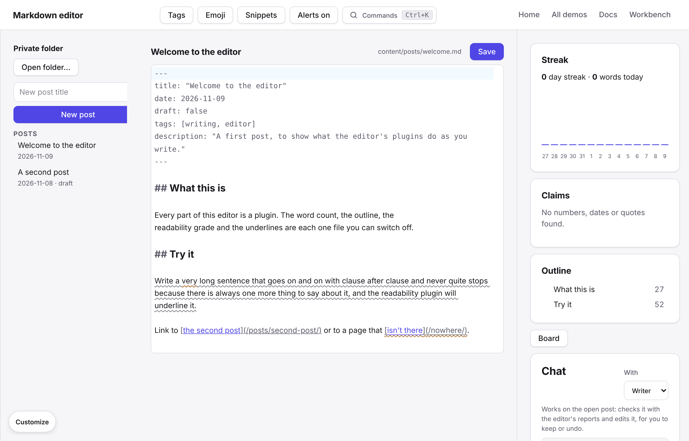

## The idea: one owner, many listeners

Exactly one plugin, `posts.js`, owns the post:
- it reads the post from the folder;
- it holds the text while you write;
- it draws the editor;
- it writes the file when you save.

Every other feature is a separate file that never touches the folder's posts
or the editor directly. Each one learns what you do through **hooks**
that `posts.js` runs, and changes the post through a **service** that
`posts.js` provides, called `document`. Because they only meet through
those two seams, any feature can be switched off in Customize, replaced, or
added without the others noticing.

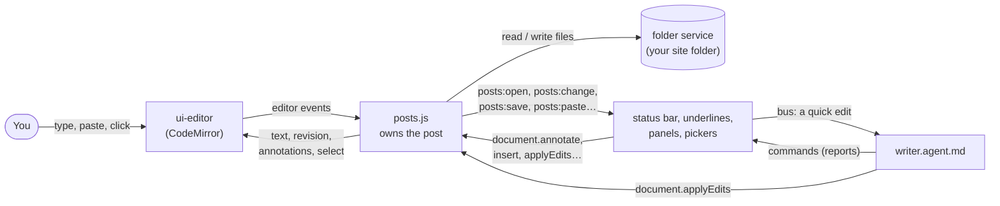

## The layers

The editor uses the same layers as every app on the platform
([layers](../layers.md)). Only the bottom row is new for the editor; the rest
is what every app gets.

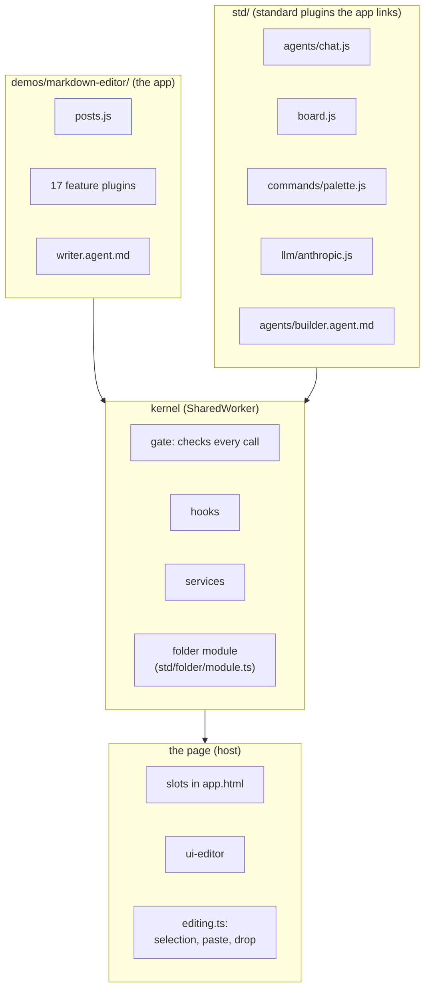

Each plugin runs in its own worker and can only do what its manifest's
`permissions` allow. The gate checks every hook it listens to and every
service call it makes. A plugin that asks for nothing can do nothing.

## The page: app.html

[`app.html`](../../demos/markdown-editor/app.html) is an ordinary page. It
lays out the editor and links the plugins:

```html
<link rel="plugin" href="posts.js">          <!-- the owner -->
<link rel="plugin" href="post-words.js">     <!-- one line per feature -->
…
<link rel="plugin-sample" href="repetition.js" title="Repetition">  <!-- off until added in Customize -->
<link rel="agent" href="writer.agent.md">
```

It leaves named **slots** where plugins draw:

| Slot | Who draws there |
| --- | --- |
| `files` | `posts`: the folder, the post list and the new-post form |
| `main` | `posts`: the post's title, Save, and the `<ui-editor>` |
| `toolbar` | `emoji`, `snippets`, `tag-suggester`, `alerts`: a button each |
| `commands` | the command palette (std) |
| `status` | `post-words`, `word-goal`, `post-times`, `writing-streak`, `readability`, `repetition`, `style-guide`, `seo-check`, `data-checker`, `link-checker`, `autosave` |
| `panels` | `outline`, `writing-streak`, `data-checker`, and the pickers of `emoji`, `snippets`, `tag-suggester`, `word-goal` |
| `notices` | `alerts` |
| `board`, `chat` | std's board and chat, where the writer agent talks to you |

Each plugin's `order` in its manifest sets where its item sits in a shared
slot. That is why the word count comes first in the status bar.

## The owner: posts.js

[`posts.js`](../../demos/markdown-editor/posts.js) is the only plugin with
`folder:write`. Its manifest declares everything the others can rely on:
eight hooks, the `document` service, and the permissions it needs.

```js
export const manifest = {
  id: "posts",
  permissions: ["ui", "folder:read", "folder:write", "folder:choose", "provide:document"],
  services: ["folder"],           // wait for the folder module
  hooks: { open, change, save, close, selection, paste, drop, "before-save" },
  provides: { document: { methods: { read, list, annotate, select, applyEdits, insert, setFrontMatter, save } } },
};
```

### The hooks it runs

Other plugins listen to a hook with `ctx.on("posts:<name>", handler)`. They
need `hook:listen:posts:<name>` to hear it, or `hook:intercept:posts:<name>`
to change a waterfall's result.

| Hook | Mode | When | What a listener can do |
| --- | --- | --- | --- |
| `posts:open` | emit | A post opened | Read it (the post's snapshot) |
| `posts:change` | emit | You typed (after a 300 ms pause), or a plugin edited it | Read it |
| `posts:save` | emit | The file was written | Read it |
| `posts:close` | emit | No post is open | Clear what it shows |
| `posts:selection` | emit | The selection settled | Read `{ from, to, text }` |
| `posts:paste` | waterfall | You pasted | Return `{ text }` to put in something else, or `{ block }` |
| `posts:drop` | waterfall | You dropped text or files | Same as paste |
| `posts:before-save` | waterfall | Before the file is written | Return `{ text }` to save something else, or `{ block: reason }` |

Every hook except `selection`, `paste` and `drop` carries the post's
**snapshot**:

```js
{ path, url, title, siteName, text, bodyStart, frontMatter, selection, unsaved }
```

`bodyStart` is where the Markdown starts after the front matter, so a word
count can skip it. `frontMatter` is the parsed fields, with keys in lower
case, whether the file uses YAML, TOML or JSON front matter.

### The document service

A plugin calls a method with `ctx.call("document", "<method>", ...)`. It must
list `services: ["document"]` so it waits for `posts` to start, and needs the
capability shown.

| Method | Needs | Does |
| --- | --- | --- |
| `read()` | `document:read` | The snapshot of the open post, or null |
| `list()` | `document:read` | Every post in the site, from its front matter (for tags, links) |
| `annotate(set, notes)` | `document:read` | Underlines ranges; each plugin's `set` replaces its last |
| `select(from, to)` | `document:read` | Moves the selection there and scrolls to it |
| `insert(text)` | `document:write` | Puts text in at the selection |
| `applyEdits([{ find, replace }])` | `document:write` | Edits, each `find` occurring exactly once |
| `setFrontMatter(key, value)` | `document:write` | Sets one front matter field |
| `save()` | `document:write` | Saves, as the Save button does |

Notice that `annotate` and `select` only need `document:read`: they change
what you see, not the post. A plugin that should only look at the post
(word count, readability) never gets `document:write`.

### How the editor and posts.js stay in step

`posts.js` keeps the post's text and redraws the editor from a template
([`posts.html`](../../demos/markdown-editor/posts.html)):

```html
<ui-editor name="text" action="edit" selection-action="select"
  paste-action="paste" drop-action="drop" document="{{path}}"
  revision="{{revision}}" select="{{select}}" annotations="{{annotations}}">{{text}}</ui-editor>
```

Three rules keep your typing and the plugins' edits from fighting:

1. **Your typing goes one way.** The editor sends the text after a pause
   (`edit`). `posts.js` stores it and runs `posts:change`, but doesn't bump
   `revision`, so the redraw leaves the editor alone.
2. **A plugin's edit bumps `revision`.** That covers an insert, applyEdits,
   setFrontMatter or a pasted answer. The editor then takes the new text as a
   diff, so your undo history, cursor and scroll position survive.
3. **Another post starts afresh.** `document` is the post's path. When it
   changes, the editor takes the new text with an undo history of its own, so
   Undo never brings back the last post's text.

Typing still waiting to be sent goes at once when you leave the editor or
press a shortcut, so Save (the button or Mod+S) always has your last
keystrokes. `posts.js` also keeps the unsaved draft in its storage, so it
outlives the worker starting again when the tab that started it closes.

The underlines work the same way. Each plugin's notes are kept under its
own `set` name, and the merged list goes to the editor's `annotations`
attribute.

## What happens when…

### …you type

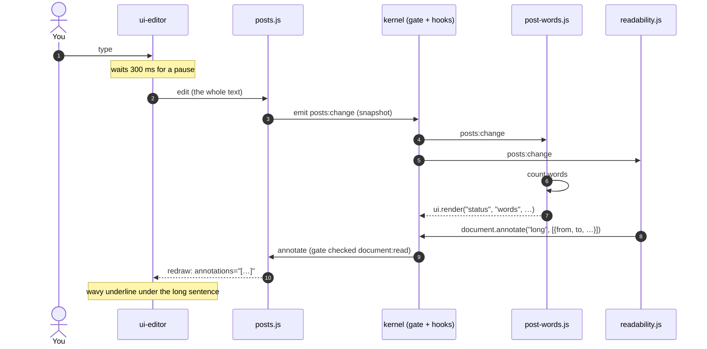

Every listener hears the change at the same time, each in its own worker.
A slow plugin can't hold up your typing, because the editor never waits
for them.

### …you paste

A paste doesn't go straight into the post. `posts.js` hears it first and runs
it through a waterfall, so a plugin could turn a pasted URL on a selected
word into a Markdown link, or save a pasted image to `static/`.

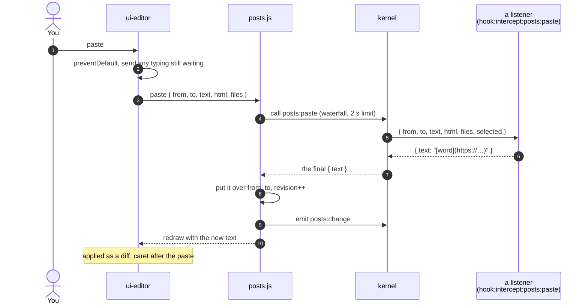

If no plugin answers, the pasted text goes in as it is. If a listener
returns `{ block }`, nothing goes in.

### …you save

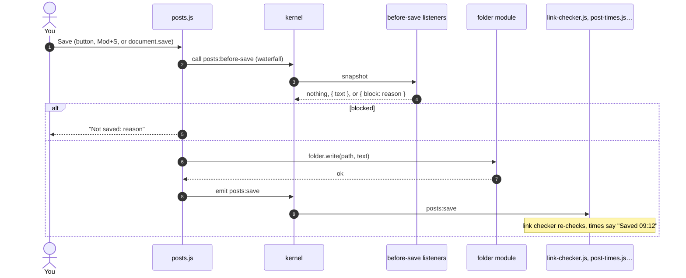

`autosave.js` (off until you add it) just calls `document.save` after a pause
in `posts:change`. It follows exactly the same path.

### …you ask for a quick edit

The quick edits ("Shorten long sentences", "Fix SEO issues", "Apply style
guide", "Check numbers", "Suggest tags") don't edit the post themselves.
Each is a command that sends the writer agent a message over the **bus**.
The agent then uses the editor's own reports, which are commands too, and
edits the post through `document`.

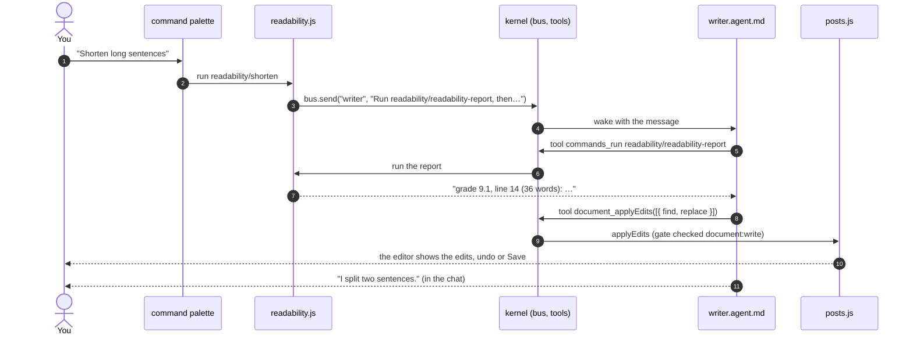

The agent never saves: you read its edits in the editor and save or undo
them. Its manifest lists exactly what it may touch:

```yaml
permissions: [commands, document:read, document:write, folder:read, bus:ask]
```

### …you open a folder

The folder starts as a private one in the browser, with a sample site in it.
"Open folder…" swaps in a folder on your disk. The files stay where they are
and are written in place.

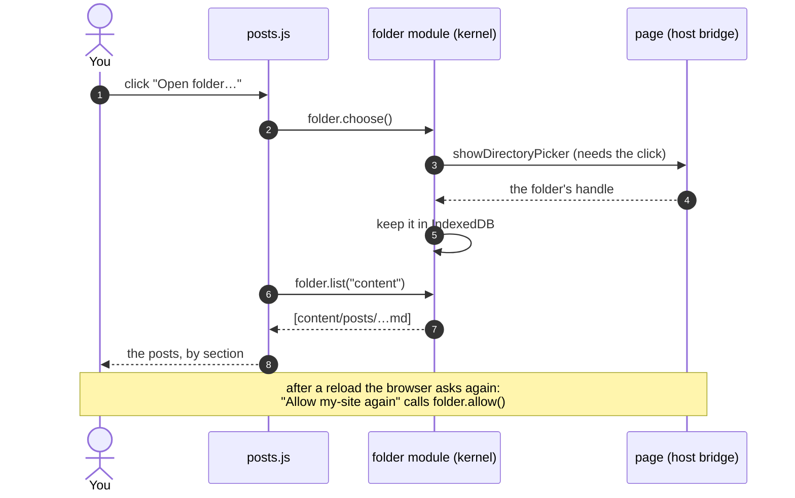

## The plugins, one by one

Each is one file, plus a template file when it draws more than a line. The
**Hears** column is its `hook:listen:posts:*` permissions; **Calls** is the
services it uses.

| Plugin | Shows | Hears | Calls | Commands |
| --- | --- | --- | --- | --- |
| [`posts`](../../demos/markdown-editor/posts.js) | Post list, editor | (runs the hooks) | `folder` | Save the post, Open a site folder… |
| [`post-words`](../../demos/markdown-editor/post-words.js) | "84 words · 1 min read" | open, change, save, close | `document.read` | |
| [`word-goal`](../../demos/markdown-editor/word-goal.js) | Progress to a goal; a goal form | open, change, close | `document.read` | Set word goal… |
| [`post-times`](../../demos/markdown-editor/post-times.js) | "Edited just now · Saved 09:12" | open, change, save, close | `document.read` | |
| [`writing-streak`](../../demos/markdown-editor/writing-streak.js) | Streak, 14-day chart | open, change | `document.read` | |
| [`readability`](../../demos/markdown-editor/readability.js) | Grade; long sentences underlined | open, change, close | `document.annotate`, `bus` | Toggle, Readability report (tool), Shorten (quick edit) |
| [`repetition`](../../demos/markdown-editor/repetition.js) (sample) | Repeated words underlined | open, change, close | `document.annotate` | Toggle, Repeated words (tool) |
| [`style-guide`](../../demos/markdown-editor/style-guide.js) | Breaks of `.editor/style-guide.json` | open, change, close | `folder.read`, `document.annotate`, `bus` | Style guide issues (tool), Apply style guide |
| [`seo-check`](../../demos/markdown-editor/seo-check.js) | "SEO ✓" or problems | open, change, close | `document.annotate`, `bus` | SEO report (tool), Fix SEO issues |
| [`data-checker`](../../demos/markdown-editor/data-checker.js) | Claims panel: numbers, dates, quotes | open, change, close | `folder.read`, `bus` | List claims, Read site data (tools), Check numbers |
| [`link-checker`](../../demos/markdown-editor/link-checker.js) | "1 broken links"; broken ones underlined | open, save, close | `document.list`, `folder.read`, `document.annotate`, network | Check links, Check links (tool) |
| [`tag-suggester`](../../demos/markdown-editor/tag-suggester.js) | Tags button; tags that fit | open, close | `document.list`, `document.setFrontMatter`, `bus` | Suggest tags…, (tool), quick edit |
| [`outline`](../../demos/markdown-editor/outline.js) | Headings; click to jump | open, change, close | `document.select` | |
| [`emoji`](../../demos/markdown-editor/emoji.js) | Emoji button and picker | close | `document.insert` | Insert emoji… (Mod+Shift+E) |
| [`snippets`](../../demos/markdown-editor/snippets.js) | Snippets button and picker | close | `folder.read`, `document.insert` | Insert, save, remove snippet |
| [`autosave`](../../demos/markdown-editor/autosave.js) (sample) | "Autosave" | change, close | `document.save` | (a setting: when) |
| [`alerts`](../../demos/markdown-editor/alerts.js) | "Writer is done" notices | `agent:done` | | (toolbar toggle) |
| [`writer.agent.md`](../../demos/markdown-editor/writer.agent.md) | Replies in the chat | messages on the bus | `document`, `commands`, `folder.read` | |

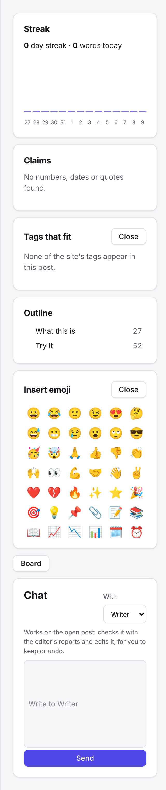

### Reports are tools; quick edits are messages

A feature offers what it knows in two forms, both through `ctx.commands`:

- **A report** is a command with `args`. Agents can run it as a tool, and
  it is hidden from the palette, because it returns text for a model to read.

  ```js
  ctx.commands.add(
    { id: "readability-report", title: "Readability report", group: "Tools",
      description: "Reading grade and every sentence over 25 words, with line numbers.",
      args: { type: "object", properties: {} } },
    async () => { const post = await ctx.call("document", "read"); /* … */ return lines.join("\n"); },
  );
  ```

- **A quick edit** is a command with no args. It shows in the palette and
  hands the job to the writer:

  ```js
  ctx.commands.add({ id: "shorten", title: "Shorten long sentences", group: "Quick edits" }, () =>
    ctx.call("bus", "send", "writer", "Run readability/readability-report, then edit the post to split or shorten each sentence over 25 words."));
  ```

So the agent has no special knowledge of readability. It runs the same
report you could, and edits through the same `document` service the emoji
picker uses.

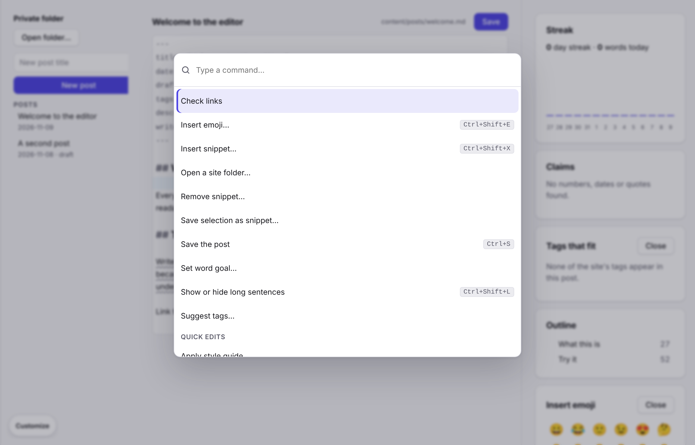

## Who may do what

Every arrow in the diagrams above goes through the gate, which checks the
caller's manifest. In practice:

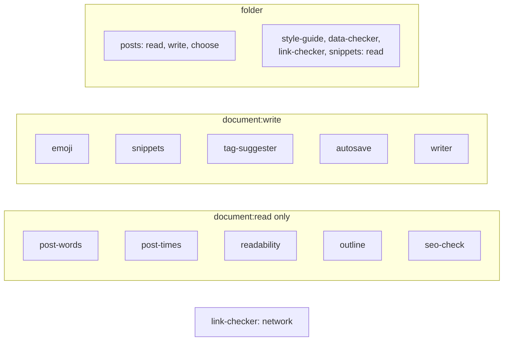

- Only `posts` writes files. Another plugin that wants a file changed would
  ask with `folder.propose`, which shows you a diff to allow.
- Only `link-checker` may use the network, to see whether external links
  answer.
- The writer agent can edit the post but not save it, and can read the
  folder but not write it.

## Adding a feature of your own

A feature is one file that listens to the hooks and calls `document`. This
one counts headings and warns when a post has none:

```js
// headings.js: warns when a post has no headings.
export const manifest = {
  id: "headings",
  name: "Headings",
  permissions: ["ui", "document:read", "hook:listen:posts:open", "hook:listen:posts:change", "hook:listen:posts:close"],
  services: ["document"],
  order: 25,
};

export default async function (ctx) {
  const show = (post) => {
    if (!post) return ctx.ui.render("status", "headings", null);
    const count = (post.text.slice(post.bodyStart).match(/^#{1,6} /gm) ?? []).length;
    ctx.ui.render("status", "headings", { type: "text", text: count ? `${count} headings` : "No headings", tone: count ? "muted" : "error" });
  };
  ctx.on("posts:open", show);
  ctx.on("posts:change", show);
  ctx.on("posts:close", () => show(null));
  show(await ctx.call("document", "read"));
}
```

There are two ways to add it:

- As the app's author, add `<link rel="plugin" href="headings.js">` to
  `app.html`.
- As someone using the editor, paste it into Customize, or ask the builder
  agent in the chat to write it. It runs as your own private plugin.

`npm run check` reads the file and tells you if it calls a method or hears a
hook its permissions don't grant.

## How it differs from the original editor

The original editor gave each extension an `editor` object with its own API,
in the same page as the editor. Here:

- each feature runs in its own worker, with only the permissions it lists;
- the post's events are ordinary plugin hooks (`posts:*`), and changes go
  through an ordinary plugin service (`document`);
- panels are templates in slots, not iframes, and dialogs are panels;
- the assistant is an agent file that uses the features' commands as tools;
- files come from the `folder` service: your own folder, or a private one.

The original editor's dictation, Hugo preview, spell check, WebMCP and image
modules are not ported yet.
