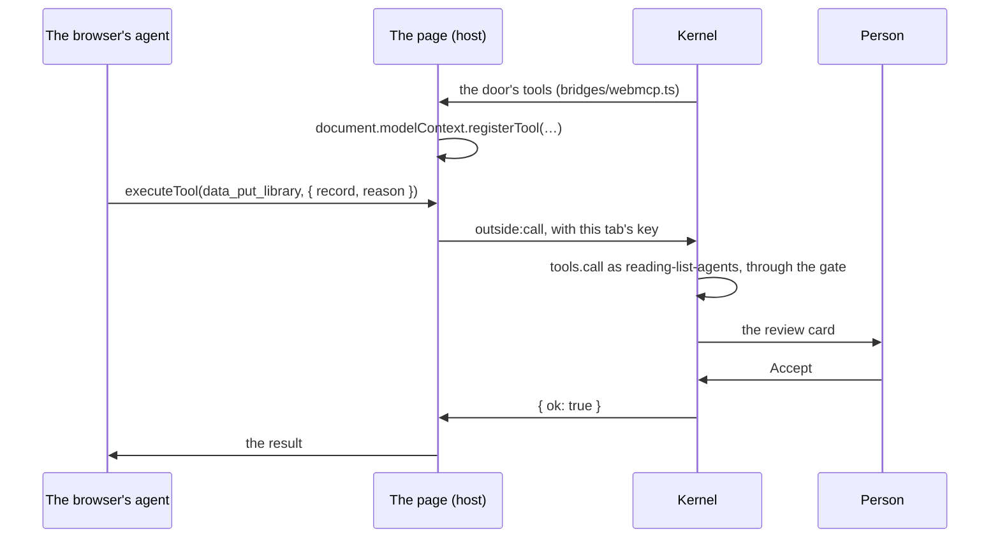
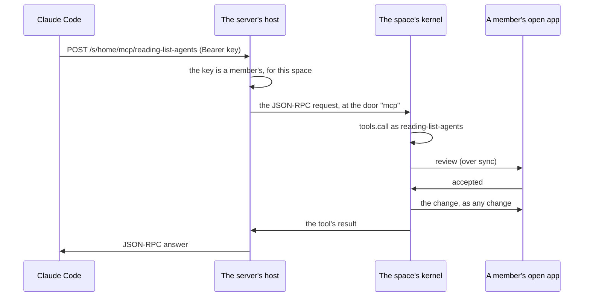

# Outside agents: WebMCP and MCP

The [agents](agents.md) an app links live inside it. Many agents don't: the assistant built into a browser, Claude Code on someone's laptop, or any other MCP client. This page shows how an app lets them in. They get the same tools an agent inside the app gets ([tools for language models](tools.md)), and the same permission checks and reviews.

## Opening the door

An app opts in by linking a plugin that opens the door. The plugin does nothing else. An outside agent then acts *as that plugin*, so its manifest decides what outside agents may reach. This is the reading list's [`outside-agents.js`](../../demos/reading-list/outside-agents.js):

```js
export const manifest = {
  id: "reading-list-agents",
  name: "Outside agent",
  runs: "both",
  permissions: ["outside", "data:read:library", "data:write:library"],
  services: ["outside", "tools"],
};

export default async function (ctx) {
  await ctx.call("outside", "open", { instructions: "This is a reading list. …" });
}
```

- **`outside`** lets it open the door. **`services: ["outside", "tools"]`** says it needs the [kernel modules](../layers.md) that do the work, so it fails to start on a site that doesn't run them.
- **The rest of `permissions`** is everything outside agents may do. Here that's reading the library and asking to change it. The library belongs to `library.js`, so the person reviews every change, the same way they review any plugin's change to data it doesn't own.
- **`runs: "both"`** opens the door in the browser and on a space's server.
- **`instructions`** tells the agents what the app is for. WebMCP puts them in front of each tool's description. MCP sends them as the server's `instructions` when an agent connects.

The tools are exactly what [`tools.list`](tools.md) gives the plugin: `data_list_library`, `data_put_library` with the library's own fields, and so on. A method the manifest doesn't grant isn't there. `llm` and `tools` are never offered.

## In the page: WebMCP

In a tab, the host registers each tool with the page's [WebMCP](https://webmachinelearning.github.io/webmcp/) context. That's `document.modelContext.registerTool`, or `navigator.modelContext` in browsers that put it there. An agent in the browser then finds the tools with `getTools()` and calls them with `executeTool()`. Each call goes back to the kernel and runs as the plugin, and a review shows its card on that page. A browser without WebMCP just doesn't get them.



## On a space's server: MCP

Opened in a [space](spaces-and-servers.md), the plugin also runs on the space's server. The server offers the same tools at

```
https://<site>/s/<space>/mcp/<plugin id>
```

as an MCP server. It uses the Streamable HTTP transport without streaming: every POST gets a JSON answer. Only a member's agent gets in. A member makes an **agent key** for the space on [`/account/`](../../account/), names it after the agent, and pastes it into the agent. The agent sends it as `Authorization: Bearer <key>`. For Claude Code:

```sh
claude mcp add --transport http reading-list https://<site>/s/<space>/mcp/reading-list-agents \
  --header "Authorization: Bearer <key>"
```

The agent acts as that member, and only in that space. Revoking the key or leaving the space shuts it out at once. The server keeps only a hash of each key.

The space's server has no screen of its own, so a review goes to the members whose devices have the space open. They see the usual card, marked "on the space's server", and the first answer settles it. "Always allow" is kept by the space. An MCP tool call waits up to 100 seconds for an answer. If nobody answers in time, the tool's result says the change is still waiting. If nobody ever answers, the review is cancelled after five minutes, as any review is.



The space starts the plugin when a member first opens the app there, as it does any server plugin. Until then, the address answers that no such door is open.

## What's checked

- An outside agent can never do more than the door's plugin. Every call goes through the same gate as the plugin's own `ctx.call`, and the same reviews.
- In a page, a tool call has to carry the key the kernel gave that tab, so a tool from one door can't run as another.
- On a server, the host lets in only a member's key for that space, and refuses a call a browser makes from another site's page.
- A door takes 600 tool calls an hour from all its agents together.
- The `outside:called` hook says each time an outside agent called a tool: which tool, whether through WebMCP or MCP, the member on a server, and whether it worked. It never carries the arguments or the answer.

The checks are [`tests/checks/outside-agents.mjs`](../../tests/checks/outside-agents.mjs) for WebMCP and [`tests/server/mcp.mjs`](../../tests/server/mcp.mjs) for MCP on both hosts.
