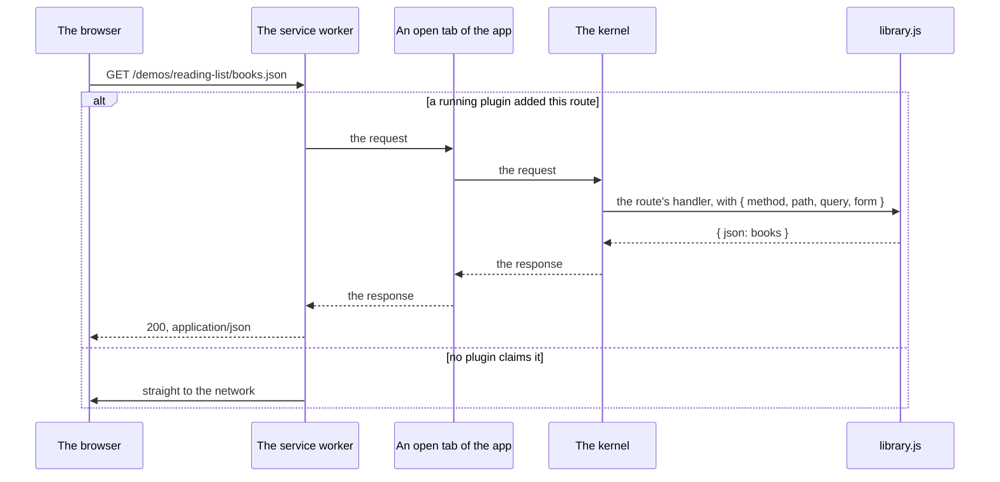

# Routes and the service worker

A plugin can answer requests, not only draw views. A plain link or a form in a page can reach it, and anything that fetches a URL can read its data. The platform's service worker, [`sw.js`](../../sw.js), makes this work on a static host, with no server.

## Answering a request

Ask for the `routes` permission, then add a route for a path next to the plugin's file. The reading list's [`library.js`](../../demos/reading-list/library.js) has two:

```js
export const manifest = { id: "library", name: "Library", permissions: ["ui", "routes"], /* … */ };

export default async function (ctx) {
  // /demos/reading-list/books.json
  ctx.routes.add("GET", "books.json", async () => ({ json: await ctx.call("data", "list", "library") }));

  // <form method="post" action="add-book"><input name="title"> …</form>
  ctx.routes.add("POST", "add-book", async ({ form }) => {
    const result = await ctx.call("data", "put", "library", { title: String(form?.title ?? "") });
    return result.ok ? { redirect: "./" } : { status: 400, text: JSON.stringify(result.errors) };
  });
}
```

The handler gets `{ method, path, query, form }`. `form` holds a posted form's fields, or a JSON body. It returns one of these, with an optional `status`:

| Return | The response |
| --- | --- |
| `{ redirect: "./" }` | A 303 to that page, which must be on this site. Use it after a form post. |
| `{ html: "<p>…</p>" }` | A page in which no script runs and nothing loads from elsewhere. |
| `{ json: value }` | JSON. |
| `{ text: "…" }` | Plain text. |
| nothing | Another plugin may answer the same route; if none does, a 404. |

## The rules

- A path is read relative to the plugin's file, and must stay inside its folder. `books.json` from `/demos/reading-list/library.js` is `/demos/reading-list/books.json`. `../x` and the folder itself are refused.
- Only a plugin an app links has a folder, so only those can add routes.
- A route works while the app is open in a tab, because the service worker reaches the kernel through a tab. With no tab open, a route answers 503. A plugin that runs on a space's server answers its routes from there, for anyone, with no tab open anywhere: see [Spaces, and plugins on a server](spaces-and-servers.md).
- A request no running plugin claims never reaches the kernel. The service worker keeps the table of routes and sends everything else straight to the network.



## What else the service worker does

Each job is a file in [`sw/routes/`](../../sw/routes/), listed in [`sw/routes/index.js`](../../sw/routes/index.js). To add one, add a file and one line there.

- [`apps.js`](../../sw/routes/apps.js): an app's folder address (`/demos/habits/`) serves its `app.html`.
- [`headers.js`](../../sw/routes/headers.js): plugin workers get their security policy (no network without `network`) on any host, not only where the server sends it.
- [`plugins.js`](../../sw/routes/plugins.js): plugin routes, above.
- [`spaces.js`](../../sw/routes/spaces.js): an app inside a space (`/s/<space>/demos/habits/`) serves the app's own page, with a `<base>` that keeps its links in the space. A server plugin's public route there goes to the network, to the space's server.
- [`user.js`](../../sw/routes/user.js): a person's own plugins, from their data folder, at `/user/<app folder>/`.
- Everything it serves is kept, so an app opened once still opens offline. On a repeat visit a kept file is answered at once and fetched again behind it, so a deploy shows on the visit after; a request the space's server answers (its kernel, a server plugin's route) and sign-in (`/auth/`) always ask the network, while an app's own files inside a space come from the cache like the same files outside it; on `localhost` everything asks the network first.

The first visit to a site isn't controlled by the service worker, and nothing depends on it to start: an app works without it, and gains these once it's running.
