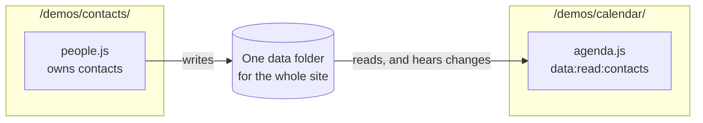

# Sharing data between apps

Every app on the same origin shares one kernel and one data folder. So a collection one app's plugin owns can be read by a plugin in another app, with the same permission it would need in the same app. Nothing else is needed: no API, no sync. Inside a space it works the same way: apps opened in the same space share that space's data ([Spaces, and plugins on a server](spaces-and-servers.md)).



The calendar and contacts demos show it. The contacts app's `people.js` owns `contacts`. The calendar's `agenda.js` shows birthdays from it:

```js
export const manifest = {
  id: "agenda",
  name: "Agenda",
  permissions: ["ui", "data:read:events", "data:read:contacts"],
};

export default async function (ctx) {
  ctx.ui.views("agenda.html").live("side", "agenda", async (ctx) => {
    const events = await ctx.call("data", "list", "events");
    const contacts = await ctx.call("data", "list", "contacts");
    const haveContacts = (await ctx.call("data", "collections")).some((c) => c.name === "contacts");
    return { days: upcoming(events, contacts), contacts: haveContacts };
  });
}
```

## What happens, in order

1. **Before the contacts app has ever run**, no plugin has declared `contacts`. Reading it gives an empty list rather than an error, and `data.collections()` doesn't list it, so the agenda says "Open the Contacts app once". The live view is already following `contacts`.
2. **The contacts app runs once**, in any tab. `people.js` declares `contacts` and adds its records. The kernel records `people` as the owner, with the data. The agenda hears the writes and redraws with the birthdays, without a reload.
3. **The contacts app is closed.** The calendar still reads the contacts: the owner doesn't have to be running, because the kernel keeps the collection and who owns it.
4. **The calendar writes a contact?** It can't: it has only `data:read:contacts`. With `data:write:contacts` it could, and the person would review each change, because the calendar doesn't own them.

## Designing for sharing

- **Name collections for what they hold**, not for the app: `contacts`, `events`, `recipes`. Another app will ask for `data:read:contacts`.
- **The owner's schema is the contract.** Readers should cope with fields being missing, since the owner can add optional fields later.
- **Ownership is first come.** The first plugin to declare a collection owns it, and a later plugin that declares the same name doesn't. Pick names that won't collide.
- **Readers need nothing from the owner.** Don't add a "share" call; ask for `data:read:<name>`.
- **Writers go through the person.** A plugin that writes another's collection should give a reason with each write, since that's what the review card shows.

## The workbench

The workbench at `/workbench/` shows every running plugin's views at once, whatever app they came from, with the trace and the plugins panel. It's the place to see what the kernel sees: which collections exist, who owns them, and what each plugin was refused.

Back to the [guide's contents](README.md).
