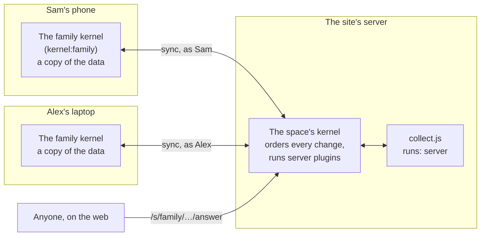

# Spaces, and plugins on a server

Everything so far runs in one browser: the kernel keeps the data on the device, and an app needs no server at all. A **space** is how several people share an app's data, and how a plugin keeps working when nobody has the app open. This page shows how to use one as an app author. [Servers and spaces](../server.md) describes how it is built.

## What a space is

A space is a named group of people and their data: collections and plugins. Any app can open in one. The same reading list is your own at `/demos/reading-list/`, and the family's at `/s/family/demos/reading-list/`.



- **The same kernel, on each device and the server.** In a tab, a space gets a kernel of its own, a shared worker named after it (`kernel:family`), with its own folder on the device (`spaces/family/`). The space's server runs the same kernel code again ([`src/kernel/env.ts`](../../src/kernel/env.ts) says what differs). Your own kernel, outside any space, is untouched.
- **Each device keeps a copy** and works on it offline. The server orders every change, so all the copies agree, and a change based on an older version is kept as a draft rather than lost.
- **Only members join.** People sign in with a passkey (or a provider such as GitHub or Bluesky, where the site turns one on) at [`/account/`](/account/), make a space, and invite others with a link.

## Opening an app in a space

Nothing in the app changes. A plugin reads and writes its collections as before, and `data:changed:<collection>` fires for changes from other people's devices too, with `by`: the member's id, or `plugin:<id>` for a server plugin. A live view follows them like any write.

To show who that was, ask for the names: `await ctx.call("sync", "members")` gives `{ space, you, members: [{ id, name }] }`, each member with the name on their account and `you` the member this page is signed in as (it needs the `members` permission). The space sends the names when a page connects, and the page keeps them for when it's offline; `members:changed` says when they arrive or change. A plugin that stamps a record with who did something should use `you` rather than a name the person types: the space vouches for it. [`demos/household`](../../demos/household/) works this way.

To show people whether their copy is in step, link the standard sync plugin and give it a slot:

```html
<link rel="plugin" href="/std/sync.js">
…
<slot name="sync"></slot>
```

It says when the page is offline or behind, and lists the drafts kept when two people changed the same record while apart, with **Use mine** and **Keep theirs**. A plugin can ask the same things itself with the `sync` permission (`sync.state`, `sync.keep`, `sync.dismiss`, and the `sync:changed` event). The [household demo](../../demos/household/app.html) is made to be opened in a space.

## A plugin that runs on the server

A plugin says where it runs with `runs` in its manifest: `"browser"` (the default), `"server"`, or `"both"`. A server plugin is the same kind of file, read by the same manifest parser and checked by the same gate. It has no page to draw on, so it doesn't ask for `ui`.

The survey demo's [`collect.js`](../../demos/survey/collect.js) runs only on the server:

```js
export const manifest = {
  id: "collect",
  name: "Survey answers",
  runs: "server",
  permissions: ["routes", "schedule", "email", "data:read:surveys"],
  collections: { answers: { schema: { type: "object", required: ["survey", "values"], properties: { /* … */ } } } },
};

export default async function (ctx) {
  // Public: /s/<space>/demos/survey/answer?survey=<id>, for anyone, signed in or not.
  ctx.routes.add("GET", "answer", async ({ query }) => ({ html: formFor(await ctx.call("data", "get", "surveys", query?.survey)) }));
  ctx.routes.add("POST", "answer", async ({ query, form }) => {
    await ctx.call("data", "put", "answers", { survey: query.survey, values: form });
    return { html: "<p>Thank you.</p>" };
  });

  // Once a day, even with no app open anywhere.
  ctx.schedule.every("digest", 24 * 60 * 60 * 1000, async () => {
    await ctx.call("email", "send", { to: ["owner@example.com"], subject: "New answers", text: "…" });
  });
}
```

The app links it like any other plugin, beside the browser one: `<link rel="plugin" href="collect.js">`. The browser leaves out a plugin that runs only on the server.

What a server plugin can do that a browser plugin can't:

| With | It can | Notes |
| --- | --- | --- |
| `routes` | Answer public requests at `/s/<space>/<its folder>/<path>` | Anyone may call one, from any site, and the plugin isn't told who. A request wakes the space if it was asleep. The answers are the same as in a browser ([Routes](routes.md)). |
| `schedule` | Run a job every so often (repeating at most once a second), or once at a given time | Jobs outlive a restart, and one that came due while the space was stopped runs once when it starts. In a browser a job runs only while the kernel does. |
| `email` | Send a message to up to 10 addresses | At most 50 a day per plugin. Until the site sets up delivery, each message is written to the space's outbox, not sent. |
| `hook:intercept:data:beforeWrite:<collection>` | Check every change any member's device sends, and stop it | It hears which member sent it. For a collection it doesn't own, it also needs `data:read:<collection>`. |
| `network` | Fetch from the internet | Never the server's own network: loopback, private and metadata addresses are refused where the connection is made. |

What it writes reaches every member's device as a change by `plugin:<id>`.

## The rules a server plugin runs under

- **Only the app's own files run there.** When a device opens an app in a space, the space reads that app's `app.html` from the site and starts the plugins it links that run on the server. It never runs code a member's browser sent: a plugin a member adds in the space is their own, and one they share with the space goes to the other members' browsers, turned off until each of them turns it on, never to the server. So a server plugin is always the author's, as the site serves it.
- **Each runs in an isolate of its own.** On Node, a process under Node's permission model, with no file system, no child processes and none of the server's environment. On Cloudflare, a Dynamic Worker with no bindings and no network unless it asks for `network`.
- **They start again by themselves.** The space remembers the apps opened in it and starts their server plugins whenever its kernel starts.

## Trying it on your machine

```sh
npm run serve      # builds, then serves the site and its spaces at http://127.0.0.1:8787
```

Open `http://127.0.0.1:8787/account/`, make an account with a passkey (the browser's own, or a phone), make a space, and open any app inside it: `/s/<space>/demos/reading-list/`, say. `/s/<space>/demos/survey/` is the survey builder; make a survey, and its **Share link** opens the public form, which works in another browser, signed out.

To check a server plugin without a browser, copy [`tests/fixtures/server-app/`](../../tests/fixtures/server-app/) and the checks for it in [`tests/server/run.mjs`](../../tests/server/run.mjs), which run against Node and against `wrangler dev` (`npm run test:server`).

## Moving a space to another server

On `/account/`, the owner of a space can **Download a copy** of it and **Load a copy** into an empty space on another server: from the hosted site to `npm run serve` on your own machine, say. Everything in the space goes, and its server plugins start again there by themselves. The people don't: they have accounts on the old server, so invite them again. See [Moving a space between hosts](../server.md#moving-a-space-between-hosts).

## What isn't there yet

- **Only collections sync.** A person's own plugins for an app, and an app's other files, stay on each device.
- **Email isn't delivered** yet; it waits in the outbox.
- **Keys the site provides**, so a person needn't bring their own API key, aren't there yet. A server plugin with `secret:<name>` has no one to ask for a key.
- **The debugger can't see a space's server kernel.** Opened inside a space (`/s/<space>/demos/debugger/`), it sees that space's kernel in your browser; opened outside, your own.

Back to the [guide's contents](README.md).
