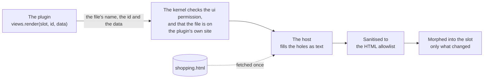

# Views and templates

A plugin never touches the page. It sends a view, and the host draws it: it checks the HTML against an allowlist, then updates the page in place, so focus, typing and scroll survive. Draw again whenever your state changes. There are three ways to send a view, from most to least declarative.

| Way | Use it for |
| --- | --- |
| `ctx.ui.views("file.html").render(slot, id, data)` | Most views: HTML in a template file, filled with data. |
| `ctx.ui.render(slot, key, ctx.ui.html\`…\`)` | Views computed in code, such as a chart of `<meter>`s. |
| `…live(…)` | Either of the above, kept up to date with the data it reads. |

## Template files

A plugin linked from an `app.html` can keep its views in `.html` files next to it, as `<template id>` elements:

```html
<template id="list">
  <h3>Shopping list</h3>
  <template if="items.length">
    <ul>
      <template for="i of items">
        <li key="{{i.id}}">
          <label><input type="checkbox" checked="{{i.done}}" data-action="tick:{{i.id}}"> {{i.item}}</label>
        </li>
      </template>
    </ul>
  </template>
  <template if="!items.length"><p><small>Nothing to buy.</small></p></template>
</template>
```

```js
const views = ctx.ui.views("shopping.html");
views.render("side", "list", { items });             // slot, template id, data
views.render("side", "list", { items: other }, { key: "other" }); // a second copy, under its own key
```

Only the data crosses from the plugin's worker. The page does the rest:



The template language is deliberately small:

| Syntax | Does |
| --- | --- |
| `{{path}}` in text | Inserts the value as text. A path is names joined by dots (`book.title`, `books.length`), optionally starting with `!`. Objects show as JSON; `null`, `undefined` and `false` show as nothing. |
| `{{path}}` inside an attribute | Inserts the value as text: `data-action="tick:{{i.id}}"`. |
| An attribute that is only `{{path}}` | Comes and goes with the value: missing when it is `false`, `null` or missing; present with no value when `true`; otherwise the value as text. `checked="{{done}}"`, `hidden="{{!open}}"`, `aria-current="{{current}}"`. |
| `<template for="x of path">` | Repeats its content for each item, with `x` set to the item. Loops nest. |
| `<template if="path">` | Keeps its content when the value is truthy. `if="!path"` for the opposite. |

There are no other expressions, so there's no code in a template. Work values out in the plugin: send `"3 days"`, not `3` and a plural rule. A template that would make more than 20,000 nodes isn't drawn, so two nested loops can't freeze the page.

A template file may also hold a `<style>`, outside the templates, that styles only this plugin's views. See [Styling](styling.md).

## HTML built in code

`ctx.ui.html` is a tagged template that escapes every value, and nests other `html` results and arrays of them as they are:

```js
const html = ctx.ui.html;
ctx.ui.render("side", "categories", html`
  <h3>By category</h3>
  <dl>${rows.map(([name, amount]) => html`
    <dt>${name}</dt>
    <dd><meter min="0" max="${total}" value="${amount}"></meter></dd>`)}
  </dl>`);
```

Never build HTML by adding strings together: a value with a `<` in it would become markup. (The sanitiser would still strip anything dangerous, but the view would be wrong.)

## Live views

`live` runs a function, draws what it returns, and runs it again whenever something it read changes:

```js
const agenda = views.live("side", "agenda", async (ctx) => {
  const events = await ctx.call("data", "list", "events");     // followed
  const contacts = await ctx.call("data", "list", "contacts"); // followed, even before it exists
  const { days } = await ctx.settings.get();                   // followed
  return { days: upcoming(events, contacts, days) };
});

ctx.ui.live("side", "quick", async (ctx) => ctx.ui.html`…`);   // the same, for HTML built in code
```

- The function gets its own `ctx`. Reads made through it (`data.list`, `data.get`, `settings.get`) are what the view follows. Reads through the outer `ctx` aren't followed.
- Changes made by any plugin, in any tab, redraw the view. Several changes in a row draw it at most twice.
- For state the kernel can't see, such as which month a calendar shows, call `refresh()` after changing it. `stop()` stops following.
- If the function throws, the view keeps what it last drew and the error goes to the trace.

A plugin can still listen itself, with `ctx.on("data:changed:<collection>", handler)`, when it needs to know *which* record changed.

## Actions

The person's actions come back to the plugin that drew the view, and to no other:

| In the view | The plugin gets |
| --- | --- |
| `<button data-action="save">` | `"save"`, with `data-value` if the button has one |
| `<input data-action="rename">` (or `select`, `textarea`) | `"rename"` and the new value when the change is committed: a boolean for a checkbox, a number for a number input. Add `data-live` to send it as the person types, after a 300 ms pause. |
| `<form data-action="add">` | `"add"` and `{ name: value }` for every named field |
| `<li data-drag="card-7">` dropped on `<ul data-drop="move" data-value="doing">` | `"move"` and `{ item: "card-7", value: "doing", before }`: `before` is the `data-drag` of the item it was dropped on, if any, so a list can be put in order |

```js
ctx.ui.onEvent((action, value) => {
  if (action === "add") …;
  if (action.startsWith("tick:")) …; // put an id in the action when there are many of one control
});
```

A drag stays inside the view that drew it: nothing from another plugin's view, another tab or another app is dropped there. While something is dragged it has `data-dragging`, and the drop place under it has `data-over`, for the plugin's CSS (`[data-drop][data-over] { outline: 2px dashed var(--accent) }`). A drag needs a pointer, so offer the same move with a button or a command too.

## Components

The host's `ui-*` elements cover layout and data. Each is one file in [`elements/`](../../elements/).

| Element | For |
| --- | --- |
| `ui-stack`, `ui-grid`, `ui-toolbar`, `ui-spacer` | Layout: a column or row, a responsive grid, a row of controls |
| `ui-card`, `ui-badge`, `ui-stat`, `ui-empty` | A surface, a status word, a number with a label, an empty state |
| `ui-table collection="…"` | A sortable table of a collection, kept up to date |
| `ui-form collection="…"` | A form built from a collection's schema, with lists and groups; see [Data and permissions](data-and-permissions.md#forms-and-tables) |
| `ui-markdown src="…"`, `ui-diagram` | A Markdown file drawn as a page (these docs are one), and a Mermaid diagram from its text |
| `ui-code` | A plain code editor, with line numbers, that a form sends by `name` |
| `ui-commands` | A command palette; see [Commands](commands.md#the-palette) |
| `ui-debug` | A bug button that opens a panel; what the [debug console](../../std/debug-console.js) draws |

Attributes for each are in the [API reference](../api.md#components).

## What HTML is allowed

The host keeps only listed elements and attributes ([`src/shared/html.ts`](../../src/shared/html.ts)), and drops the rest:

- No `<script>`, `<style>` (inside a view), `<iframe>`, `<object>`, `<svg>`, or event attributes (`onclick`).
- A `style` attribute keeps only custom properties set to numbers, such as `style="--pct: {{pct}}"` or `--w: 12.5rem`, up to 8. That's how data sizes things: the plugin's stylesheet uses them (`width: calc(var(--pct) * 1%)`). Anything else in it is dropped. For everything else use `class` with the plugin's stylesheet, or `data-*` and `aria-*` attributes the page's CSS can target.
- Links open in a new tab and must be `https:`, `http:`, `mailto:` or `#`. Images must be `data:` images, or `https:` for plugins with the `network` permission.
- Unknown elements are unwrapped, so their text stays.
- `id` and `for` are prefixed per plugin, so a plugin's `<label for>` can't point at another's input. The page's `id` isn't the one you wrote (`board_<tab>--cover-x`, not `cover-x`), so CSS and tests should find things by class or a `data-*` attribute instead.

Next: [Data and permissions](data-and-permissions.md).
