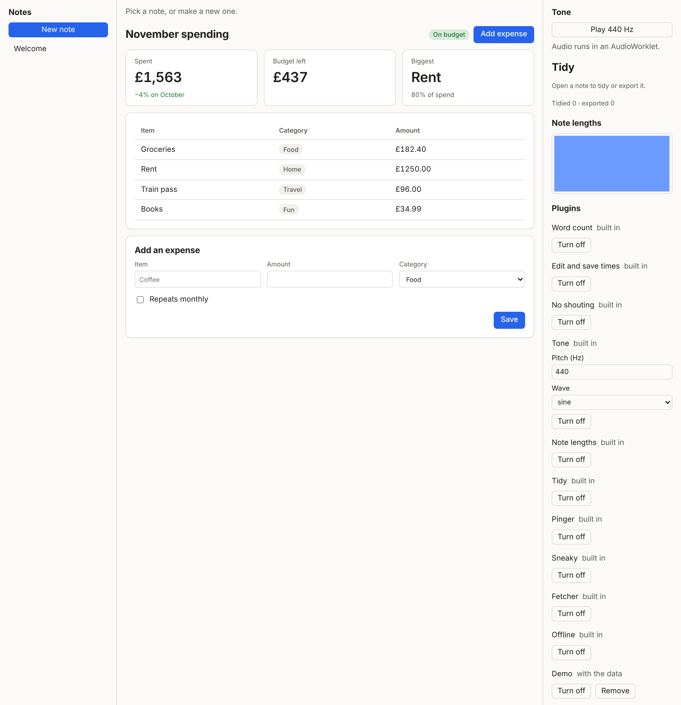
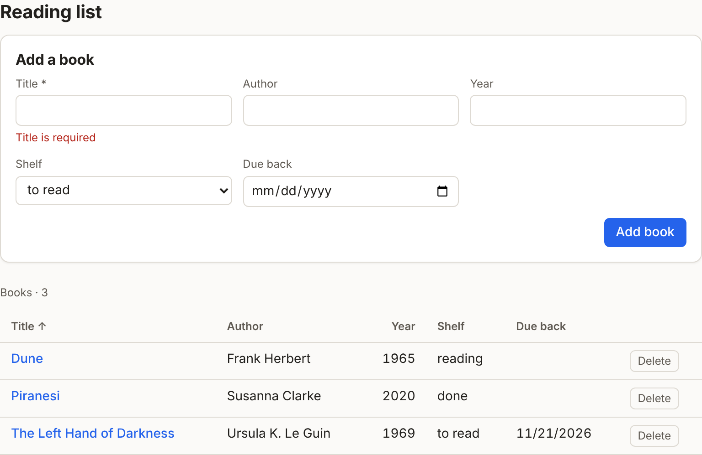

# The kernel

The kernel is Cordis core plus a few pieces of our own, running in a shared worker (or a dedicated one where shared workers are missing). This page describes what it does today; [the plan](https://claude.ai/artifact/S7NdMrp2PkNSqHZFNdqGrC) says where it is going.

## Plugins

A sandboxed plugin is one JavaScript module with a literal manifest and a default export:

```js
export const manifest = {
  id: "bars",                 // lowercase letters, digits, dashes
  name: "Note lengths",
  permissions: ["ui", "hook:listen:data:changed", "data:read:notes"],
  scope: "tab",               // "shared" (default) or "tab"
  order: 30,                  // optional: place in lists
  settings: { ... },          // optional: { key: { type, title?, default?, enum? } }
};

export default function (ctx) { ... }
```

- **The manifest is read before any code runs** (`src/kernel/manifest.ts`). `export const manifest = { ... }` must be the module's first statement, with only comments before it, so a manifest in a comment or a string can't stand in for the real one. Its value must be a plain literal: strings, numbers, booleans, null, arrays and objects, and nothing may follow it but the end of the statement. Anything else, such as a spread, a call, a template string or `.valueOf()` on the end, is refused with the line it failed on. When the plugin starts, the manifest it reports must match; one that changes itself is uninstalled.
- **Scope.** A `shared` plugin runs once, in the spawner tab, for every tab. A `tab` plugin runs once in every open tab; its views go only to that tab, and it is the only kind that can draw on a canvas (a canvas cannot be handed to another tab's worker).
- **Workers and network.** Each plugin instance gets its own dedicated worker. The worker's content security policy allows only its own module (`script-src 'self' blob:`), no workers of its own (`worker-src 'none'`, or a plugin could start the network runtime as a child) and no network (`connect-src 'none'`). Plugins with the `network` permission get a second copy of the runtime served with `connect-src 'self' https: wss:`. The policies are set in `vite.config.ts` for development and in `public/_headers` for Cloudflare.

## Where plugins come from, and settings

Built-in plugins ship with the app. A plugin installed at run time is kept in the data folder as `plugins/<id>.js`, so it travels with the data, and the next kernel to open that folder loads it again. A plugin in the data folder replaces the built-in one with the same id. Ids the kernel uses for its own views and services (`kernel`, `host`, `notes`, `plugins`, `store`, `settings`, `audio`) are refused, so a plugin can't pass for the kernel's own panels.

The plugins panel (`src/kernel/catalog.ts`, in the side bar) lists every plugin and where it came from. Any plugin can be turned off, which stops its workers but keeps it installed. Plugins kept with the data can also be removed, which deletes their file. A plugin stopped for changing its manifest is removed the same way.

A manifest's `settings` become a form in the panel:

```js
settings: {
  frequency: { type: "number", title: "Pitch (Hz)", default: 440 },
  wave: { type: "string", title: "Wave", enum: ["sine", "square"], default: "sine" },
},
```

`boolean` becomes a checkbox, `number` a number field, and `string` a text field, or a menu when it has an `enum`. The kernel checks each value against its spec before keeping it. Which plugins are off, and every plugin's settings, are kept in `plugins.json` in the data folder. A plugin reads its own settings with `await ctx.settings.get()` and hears changes through `ctx.settings.onChange(handler)`. No capability is needed, because a plugin can only read its own. Editor extensions get the same values from `editor.settings.get()`.

## The `ctx` a plugin gets, and the rest of the API

The full API is in [api.md](api.md), which the kernel prints about itself: every `ctx` call, every service method and what it needs, every hook and its contract, the capabilities, the manifest fields, the views and slots. It is built at run time from the same tables the kernel enforces:

- hooks come from the hook registry, with their mode, time limit, failure policy and arguments;
- each service lists its methods, and a method that isn't listed can't be called, so nothing is callable that the reference leaves out;
- the `ctx` API, views, slots and manifest fields are tables typed against their TypeScript types, so adding a member without describing it doesn't compile.

`npm run reference` rewrites api.md, and `npm test` fails when it falls behind. Plugins get the same thing as data from `ctx.call("kernel", "reference")`, which is what a plugin builder will read. In the app, **API reference** in the trace panel shows it with what is installed and which hooks each running plugin listens to.

## Views: plain HTML

Plugins describe their UI as plain HTML, because that is what models and people already write well:

```js
const html = ctx.ui.html; // escapes every value
ctx.ui.render("main", "spending", html`
  <ui-grid min="10rem"><ui-stat label="Spent" value="${total}"></ui-stat></ui-grid>
  <form data-action="add"><label>Item <input name="item" required></label><button type="submit">Add</button></form>`);
```

The host parses the HTML inertly and keeps only the elements and attributes in `src/shared/html.ts`: no script, no style or class attributes, no frames, no event attributes, no `javascript:` links. An `https:` image is a request, so only plugins with the `network` capability may show one. Styling comes from the design tokens in `styles.css`, so plain HTML already looks like the app, and the elements in [`elements/`](../elements/) (`ui-stack`, `ui-grid`, `ui-card`, `ui-stat`, `ui-badge`, `ui-empty`, `ui-toolbar`) cover layout. Controls report through `data-action`; a form with `data-action` sends all its named fields, typed. Drawing again morphs the old DOM into the new one, so focus, typing, scroll and open `<details>` survive. The JSON views from phase 1 still work and are drawn the same way. The full list is in [api.md](api.md#html-views).



A plugin that an app links can also keep its views in an `.html` file next to it, as `<template id>` elements, and send only data: `ctx.ui.views("library.html").render("main", "books", { open })`. The kernel resolves the file against the plugin's own URL and refuses any other origin; the host fills `{{path}}` holes as text, repeats `<template for="x of path">` and keeps `<template if="path">`, then sanitises the result like any HTML view ([`src/host/templates.ts`](../src/host/templates.ts)).

## Collections: data with a schema

A plugin declares the records it keeps in its manifest, with a small JSON Schema subset (no `pattern`, so a plugin can't stall the kernel with a regular expression):

```js
collections: {
  books: { schema: { type: "object", required: ["title"], properties: {
    title: { type: "string", title: "Title" },
    year: { type: "integer", title: "Year", minimum: 0 },
  } } },
},
```

Records live in `collections/<name>.json` in the data folder, with `id`, `createdAt` and `updatedAt` added by the kernel. Every write is checked against the schema, so a bad record never reaches disk. The owner reads and writes through the `data` service (`ctx.call("data", …)`) without asking; another plugin needs `data:read:<name>` or `data:write:<name>`, and its writes go through change review. Hooks `data:changed:<name>` and `data:beforeWrite:<name>` let plugins react to or adjust writes.

Which plugin owns each collection, and its schema, is kept with the data too, in `collections/_registry.json`. So a collection outlives the run that declared it: the calendar demo's agenda reads the contacts app's `contacts` (with `data:read:contacts`) even when the contacts app isn't open and its plugin isn't running. The ownership is kept as well, so another plugin can't later declare the same name and take the records over.

Two host components draw a collection without any plugin code: `<ui-table collection="books" columns="title,year" deletable>` is a sortable table that stays up to date, and `<ui-form collection="books" fields="title,year">` is a form built from the schema, with labels, input types, required fields and the kernel's errors. Both act with the rights of the plugin whose view they sit in; the host tracks that itself, so a plugin can't borrow another's rights with an attribute.



## Change review

A write outside a plugin's own data is shown to the person before it happens (`src/kernel/review.ts`). Notes belong to the notes app, and files are in the data folder, so a plugin's `store.put` or `files.write` opens a card above the editor. The card shows the plugin's name, its reason, and a line diff of the change, with three choices:

- **Accept:** this write only (`allowed-once`).
- **Always allow in …:** this write, and any later one by the same plugin to the same place (`notes`, or a folder such as `exports/`), without asking. The grant is kept with the data in `grants.json`, so it belongs to this app only. The plugins panel lists each grant with a Forget button.
- **Decline:** nothing is written, and the plugin's call fails with "The person declined the change" (`rejected`).

A card nobody answers within five minutes is `cancelled`. Turning a plugin off or removing it cancels its open cards. A write that changes nothing is not shown.

**Path checks** (`src/kernel/paths.ts`) run before any file is read or written, whatever capabilities the plugin has. Paths must be relative, use `/`, and sit inside a folder. They can't contain empty, `.` or `..` segments or hidden names, and they can't touch the platform's own files (`plugins/`, `plugin-data/`, `plugins.json`, `grants.json`, `changes.json`, `notes.json`). That last rule means a plugin can never install or approve plugins by writing files.

**The change log** (`src/kernel/changes.ts`) records every install, removal, on/off switch, settings change, grant, revoke and reviewed write, with its outcome and trace id. It keeps the most recent 500 in `changes.json` in the data folder. `window.__host.command("changes")` returns it.

## Hooks

Every hook is defined with `defineHook(name, { mode, timeoutMs, onFailure })` in `src/kernel/hooks.ts`. Listeners in other workers are held to the spec: `emit` and `parallel` hooks are posted and forgotten; the others wait for the answer for `timeoutMs`, then either skip the listener (`onFailure: "open"`) or treat the silence as a block (`"closed"`).

## Trace ids

Every action from a tab gets a trace id. The kernel passes `{ trace }` as Cordis's `thisArg` on every dispatch, which Cordis hands both to listeners and to the `internal/dispatch` tap, so the id survives awaits inside the kernel. It travels to plugin workers on every hook message, and calls or renders a plugin makes while handling it carry it back. In a plugin, `ctx` carries the id only during the synchronous part of a handler, because workers have no async context to carry it past an `await`. For work after an `await`, a handler takes a copy of the API pinned to its trace:

```js
ctx.ui.onEvent(async (action) => {
  const here = ctx.traced(); // pinned to this event's trace
  await here.call("audio", "play", { processor: "tone-sine" });
  here.log("played"); // still carries the click's trace
});
```

A handler written as a `function` also gets the pinned copy as `this`. Logs carry the trace too. The trace panel at the bottom of the page shows the events; `window.__host.traces` has them in the console.
