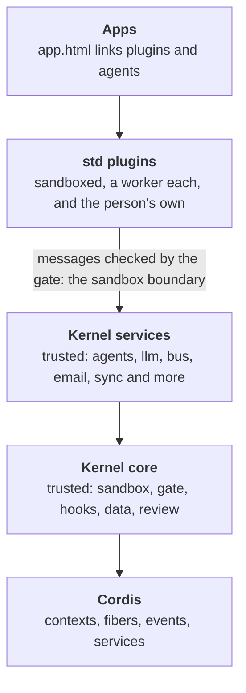

# The layers

Extensible Web Apps is built in layers, and each layer uses only the ones below it. This page says what each layer is, what lives in it today, who chooses what goes in it, and where the line between trusted and sandboxed code runs. It is the map to read before adding anything to the platform: a new piece of code belongs in exactly one layer.

| Layer | Where it lives | Runs | Chosen by |
| --- | --- | --- | --- |
| Apps | `demos/`, `site/`, your own folder | The page, plus its plugins' workers | The app's author (`app.html`), and the person (Customize) |
| std plugins | [`std/`](../std/) | A sandboxed worker each | Each app, with `<link rel="plugin">` |
| Kernel services | [`src/kernel/services/`](../src/kernel/services/), and a few files beside them | Inside the kernel, trusted | Nobody yet: every one is built into every kernel, which is [being changed](#where-this-is-going) |
| Kernel core | [`src/kernel/`](../src/kernel/) | Inside the kernel, trusted | Always there |
| Cordis | `node_modules/cordis` ([cordiverse/cordis](https://github.com/cordiverse/cordis)) | Inside the kernel | Pinned in `package.json` |

The shape is close to [DeepSeek Harness](https://github.com/deepseek-ai/DeepSeek-Harness)'s: a small framework (Cordis), a harness on top of it with the services every extension can count on, and extensions that are everything else. Our harness is bigger than Cordis on purpose, because it also runs untrusted code safely, and the rest of this page says exactly what that adds.

## Cordis

[Cordis](https://github.com/cordiverse/cordis) is a small plugin framework. The kernel uses it for:

- **Contexts and fibers.** Every plugin instance is a Cordis fiber, so stopping it disposes every listener it added, all at once ([`remote.ts`](../src/kernel/remote.ts)).
- **Events.** Hooks are Cordis events, dispatched in Cordis's modes: `emit`, `serial`, `bail`, `parallel`, `waterfall`.
- **The dispatch tap.** Cordis reports every dispatch, which is how the trace sees everything ([`trace.ts`](../src/kernel/trace.ts)).

What the kernel does not use yet is Cordis's own way of making services: in Cordis, a service is a plugin that `provide`s a name and other plugins `inject` it. Our services are plain objects the kernel builds, which is why they can't be left out today. Making each kernel service a real Cordis plugin is the first step of the split below.

## The kernel core

The core is what every app and every space server needs to run any plugin at all. Take one piece away and no app works, or a plugin could do something it didn't ask for.

| Piece | Files | What it does |
| --- | --- | --- |
| Where it runs | [`env.ts`](../src/kernel/env.ts), [`browser.ts`](../src/kernel/browser.ts), [`browser-env.ts`](../src/kernel/browser-env.ts) | The same kernel in a shared worker, a dedicated worker or a server ([The kernel](kernel.md#where-it-runs)) |
| Tabs and isolates | [`hosts.ts`](../src/kernel/hosts.ts), [`isolate-host.ts`](../src/kernel/isolate-host.ts) | The open tabs, the spawner tab that starts plugin workers, and its stand-in on a server |
| The sandbox | [`remote.ts`](../src/kernel/remote.ts), [`manifest.ts`](../src/kernel/manifest.ts), [`gate.ts`](../src/kernel/gate.ts), [`hooks.ts`](../src/kernel/hooks.ts) | Plugins in workers, their manifests read before they run, every message checked, hook contracts held |
| Seeing what happened | [`trace.ts`](../src/kernel/trace.ts), [`changes.ts`](../src/kernel/changes.ts) | The trace of every dispatch, and the change log |
| The data | [`store.ts`](../src/kernel/store.ts), [`paths.ts`](../src/kernel/paths.ts), [`records.ts`](../src/kernel/records.ts), [`schema.ts`](../src/kernel/schema.ts) | The data folder, path checks, collections and their schemas |
| Asking the person | [`review.ts`](../src/kernel/review.ts), [`diff.ts`](../src/kernel/diff.ts) | Review cards for writes outside a plugin's own data, with a line diff |
| Keys and the network | [`secrets.ts`](../src/kernel/secrets.ts), [`net.ts`](../src/kernel/net.ts) | Secrets a plugin can use but never read, and the requests made with them |
| Which plugins run | [`apps.ts`](../src/kernel/apps.ts), [`catalog.ts`](../src/kernel/catalog.ts), [`switches.ts`](../src/kernel/switches.ts) | An app's linked plugins, installed plugins, and their on/off switches |
| The person's own plugins | [`user-plugins.ts`](../src/kernel/user-plugins.ts), [`authoring.ts`](../src/kernel/authoring.ts) | Plugins a person (or their agent) adds to an app, and the help to write them |
| Describing itself | [`reference.ts`](../src/kernel/reference.ts) | The [API reference](api.md), built from the tables the kernel enforces |
| Wiring | [`kernel.ts`](../src/kernel/kernel.ts) | Puts the pieces together |

And the services every plugin relies on: `kernel`, `settings`, `plugins`, `storage`, `files`, `data`, `secrets`, `net` and `hooks`.

## Kernel services

These are capabilities with trusted code in the kernel: an app may use them, but not every app does. Each is a file in [`src/kernel/services/`](../src/kernel/services/) (some with helpers beside it), and today **every one is built into every kernel**, in the browser and on a server, whether an app uses it or not. They do no work until a plugin calls them, but nobody can leave one out.

| Service | Files | Why it is trusted code |
| --- | --- | --- |
| `agents` | `services/agents.ts`, `agents/file.ts`, `agents/runner.js` | Counts each agent's runs and tokens, so an agent can't misreport its own use |
| `tools` | `services/tools.ts` | Reads the whole API reference to offer tools to a model |
| `bus` | `services/bus.ts` | Inboxes between agents, plugins and the person |
| `llm` | `services/llm.ts` | The one interface to every model; the vendors are std plugins ([`std/llm/`](../std/llm/)) |
| `transfer` | `services/transfer.ts`, `csv.ts` | Import and export, reviewed once for the whole file |
| `email` | `services/email.ts` | Mail from a space's server, with daily limits |
| `schedule` | `services/schedule.ts` | Wakes plugins that aren't running |
| `history` | `services/history.ts` | Undo across every plugin's writes |
| `commands` | `services/commands.ts` | Commands from any plugin, run from a palette or a key |
| `router`, `share`, `audio`, `page` | `services/router.ts`, `services/share.ts`, `services/audio.ts`, `services/page.ts` | Bridges to what only a page can do |
| `reflect`, `debug` | `services/reflect.ts`, `services/debug.ts` | Read-only views of the whole kernel, for debuggers |
| spaces | `sync.ts`, `sync-device.ts`, `server-apps.ts`, `routes.ts`, `services/sync.ts` | Sync with a space, plugins on its server, public routes |

### Where this is going

The plan, being reviewed now, splits this layer out of the core:

1. Each kernel service becomes a Cordis plugin of its own that `provide`s its service and `inject`s what it needs (agents injects `llm`, `tools` and `bus`).
2. A site lists the ones it runs, in one file. Only those are built into its kernel, in the browser and on its servers. The default lists them all, so nothing changes for an app until its site asks.
3. A plugin's manifest says which services it calls. An app whose plugins need a service the site doesn't run fails to open, with a message naming the service, rather than failing later on the first call.
4. A sandboxed plugin can provide a service too. Then much of what is trusted code today can be a std plugin, and a plugin a person or their agent writes can add a service as first-class as one the platform ships.

[`tests/checks/kernel-layers.mjs`](../tests/checks/kernel-layers.mjs) keeps the lists on this page honest: it fails when a file in `src/kernel/` is on neither the core list nor the services list, so a new file has to say which layer it is in.

## std plugins

[Standard plugins](plugins.md) are ordinary sandboxed plugins: a JavaScript file each, in its own worker, held to its manifest, linked by an app that wants it. They can only do what the layers below let them. Anything a person or their agent writes is in this layer too, and has exactly the same powers as a std plugin.

## Apps

An app is a folder with an `app.html` that links its plugins (`<link rel="plugin">`) and agents (`<link rel="agent">`). The person using it can add their own plugins to it through Customize, and switch any of its plugins off. [How an app works](guide/how-an-app-works.md) starts there.

## The trust line

The one boundary that matters for safety runs between std plugins and the kernel. Below it, code runs unsandboxed inside the kernel, so whoever deploys the site chooses it. Above it, code runs in a worker with no network and no access to anything its manifest didn't ask for, so anyone can add it: the app's author, the person, or an agent working for them. [The security model](security.md) has the details.

## Outside the kernel

Some of the platform isn't in any of these layers, because it never runs in the kernel:

- **The host** ([`src/host/`](../src/host/)): the code in each page that draws views and passes the person's actions on.
- **The service worker** ([`sw/`](../sw/)): serves app folders and screens, and plugin routes.
- **The `ui-*` elements** ([`elements/`](../elements/)): custom elements a page loads only if it uses them.
- **The servers** ([`src/server/`](../src/server/)): the front door for spaces, including sign-in ([`src/server/auth/`](../src/server/auth/)), which decides who may reach a space's plugins at all, so it can't be a plugin. Which sign-in providers a server offers is configuration ([Servers and spaces](server.md)).
