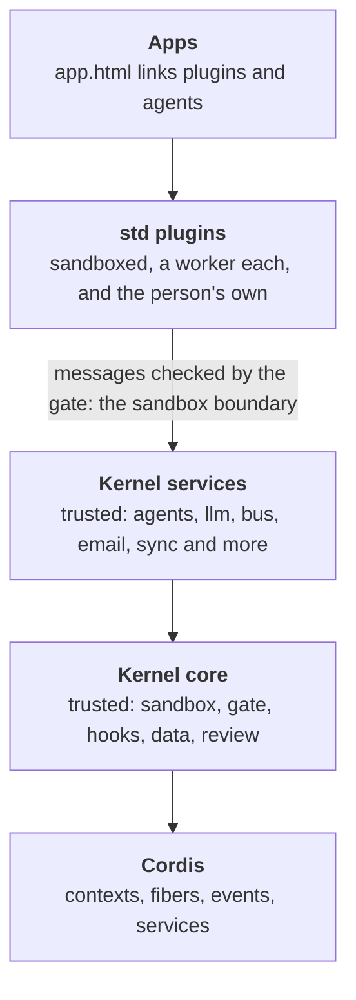

# The layers

Extensible Web Apps is built in layers, and each layer uses only the ones below it. This page says what each layer is, what lives in it today, who chooses what goes in it, and where the line between trusted and sandboxed code runs. It is the map to read before adding anything to the platform: a new piece of code belongs in exactly one layer.



| Layer | Where it lives | Runs | Chosen by |
| --- | --- | --- | --- |
| Apps | `demos/`, `site/`, your own folder | The page, plus its plugins' workers | The app's author (`app.html`), and the person (Customize) |
| std plugins | [`std/`](../std/) | A sandboxed worker each | Each app, with `<link rel="plugin">` |
| Kernel services | Kernel modules in `std/<name>/module.ts`, and spaces in [`src/kernel/`](../src/kernel/) | Inside the kernel, trusted | Modules: the site, in [`kernel.json`](../kernel.json). Spaces: built into every kernel for now ([where this is going](#where-this-is-going)) |
| Kernel core | [`src/kernel/`](../src/kernel/) | Inside the kernel, trusted | Always there |
| Cordis | `node_modules/cordis` ([cordiverse/cordis](https://github.com/cordiverse/cordis)) | Inside the kernel | Pinned in `package.json` |

The shape is close to [DeepSeek Harness](https://github.com/deepseek-ai/DeepSeek-Harness)'s: a small framework (Cordis), a harness on top of it with the services every extension can count on, and extensions that are everything else. Our harness is bigger than Cordis on purpose, because it also runs untrusted code safely, and the rest of this page says exactly what that adds.

### Where an app's plugins come from

The plugins in the top two layers reach an app at three levels. The level says who added a plugin, where it runs and who has it, never what it may do: every plugin, at every level, runs sandboxed with only the permissions its manifest asks for.

| Level | Who adds it | Where it runs | Who has it |
| --- | --- | --- | --- |
| **Developer plugins** | The app's author, linked from `app.html` (std plugins or the app's own) | Browsers, and a space's server for `runs: "server"` or `"both"` | Everyone who opens the app |
| **Space plugins** | A member, sharing one of their own with a space | Browsers only, never the server | Every member of that space, turned off until each turns it on |
| **User plugins** | A person, in Customize, or their agent ([the registry](guide/plugin-registry.md) is one place to find them) | Their browser only | Them, on that device |

Customize ([`std/customize.js`](../std/customize.js), a standard plugin the host adds to every app) works on them through the core `authoring` service. The kernel keeps user plugins ([`user-plugins.ts`](../src/kernel/user-plugins.ts)), and a space keeps its space plugins ([`shared-plugins.ts`](../src/kernel/shared-plugins.ts)). [Servers and spaces](server.md#space-plugins) says how a plugin is shared, turned on and removed.

## Cordis

[Cordis](https://github.com/cordiverse/cordis) is a small plugin framework. The kernel uses it for:

- **Contexts and fibers.** Every plugin instance is a Cordis fiber, so stopping it disposes every listener it added, all at once ([`remote.ts`](../src/kernel/remote.ts)).
- **Events.** Hooks are Cordis events, dispatched in Cordis's modes: `emit`, `serial`, `bail`, `parallel`, `waterfall`.
- **The dispatch tap.** Cordis reports every dispatch, which is how the trace sees everything ([`trace.ts`](../src/kernel/trace.ts)).

- **Services, for kernel modules.** In Cordis, a service is a plugin that `provide`s a name and other plugins `inject` it. Each kernel module (below) is such a plugin: its service is a Cordis service, and the modules it `uses` are its `inject`. The services still in the core are plain objects the kernel builds, until they move into modules too.

## The kernel core

The core is what every app and every space server needs to run any plugin at all. Take one piece away and no app works, or a plugin could do something it didn't ask for.

| Piece | Files | What it does |
| --- | --- | --- |
| Where it runs | [`env.ts`](../src/kernel/env.ts), [`browser.ts`](../src/kernel/browser.ts), [`browser-env.ts`](../src/kernel/browser-env.ts) | The same kernel in a shared worker, a dedicated worker or a server ([The kernel](kernel.md#where-it-runs)) |
| Tabs and isolates | [`hosts.ts`](../src/kernel/hosts.ts), [`isolate-host.ts`](../src/kernel/isolate-host.ts) | The open tabs, the spawner tab that starts plugin workers, and its stand-in on a server |
| The sandbox | [`remote.ts`](../src/kernel/remote.ts), [`manifest.ts`](../src/kernel/manifest.ts), [`gate.ts`](../src/kernel/gate.ts), [`hooks.ts`](../src/kernel/hooks.ts) | Plugins in workers, their manifests read before they run, every message checked, hook contracts held |
| Seeing what happened | [`trace.ts`](../src/kernel/trace.ts), [`changes.ts`](../src/kernel/changes.ts) | The trace of every dispatch, and the change log |
| The data | [`store.ts`](../src/kernel/store.ts), [`paths.ts`](../src/kernel/paths.ts), [`records.ts`](../src/kernel/records.ts), [`schema.ts`](../src/kernel/schema.ts) | The data folder, path checks, collections and their schemas |
| Asking the person | [`review.ts`](../src/kernel/review.ts), [`diff.ts`](../src/kernel/diff.ts) | Review cards for writes outside a plugin's own data, with a line diff |
| Keys and the network | [`secrets.ts`](../src/kernel/secrets.ts), [`net.ts`](../src/kernel/net.ts), [`address.ts`](../src/kernel/address.ts) | Secrets a plugin can use but never read, the requests made with them, and what counts as an email address (for the `email` module and the servers' accounts) |
| Which plugins run | [`apps.ts`](../src/kernel/apps.ts), [`catalog.ts`](../src/kernel/catalog.ts), [`switches.ts`](../src/kernel/switches.ts) | An app's linked plugins, installed plugins, and their on/off switches |
| The person's own plugins | [`user-plugins.ts`](../src/kernel/user-plugins.ts), [`authoring.ts`](../src/kernel/authoring.ts) | Plugins a person (or their agent) adds to an app, and the help to write them |
| Describing itself | [`reference.ts`](../src/kernel/reference.ts) | The [API reference](api.md), built from the tables the kernel enforces |
| Wiring | [`kernel.ts`](../src/kernel/kernel.ts) | Puts the pieces together |
| Kernel modules | [`modules.ts`](../src/kernel/modules.ts), [`kernel-modules.d.ts`](../src/kernel/kernel-modules.d.ts) | Runs the modules the site lists in `kernel.json` (below) |
| Services plugins provide | [`provided.ts`](../src/kernel/provided.ts) | Passes calls to a service a sandboxed plugin provides on to that plugin (below) |

And the services every plugin relies on: `kernel`, `settings`, `plugins`, `storage`, `files`, `data`, `secrets`, `net` and `hooks`. Most are made beside the module they belong to; four are a file each, which [`services/index.ts`](../src/kernel/services/index.ts) finds by name: [`services/files.ts`](../src/kernel/services/files.ts), [`services/hooks.ts`](../src/kernel/services/hooks.ts), [`services/kernel.ts`](../src/kernel/services/kernel.ts) and [`services/storage.ts`](../src/kernel/services/storage.ts).

## Kernel services

These are capabilities with trusted code in the kernel: an app may use them, but not every app does. Most are now kernel modules (below), which a site picks. What is left here is still **built into every kernel**, in the browser and on a server, whether an app uses it or not: the agent file reader, and spaces. Spaces are core-adjacent (sync is wired into the store and the data layer), so they move last, once the core reads them through hooks.

| Service | Files | Why it is trusted code |
| --- | --- | --- |
| agent files | [`agents/file.ts`](../src/kernel/agents/file.ts) | Turns an app's `rel="agent"` file into the plugin that runs the agent loop. The loop itself isn't core: it is a file the site serves, [`std/agents/runner.js`](../std/agents/runner.js) unless the agent's frontmatter names another with `runner:` ([`src/shared/agent-runner.ts`](../src/shared/agent-runner.ts)). The `agents` service is a module (below); `file.ts` stays until the core reads links through a hook, so it needn't know about agent files |
| spaces | [`sync.ts`](../src/kernel/sync.ts), [`sync-device.ts`](../src/kernel/sync-device.ts), [`server-apps.ts`](../src/kernel/server-apps.ts), [`shared-plugins.ts`](../src/kernel/shared-plugins.ts), [`routes.ts`](../src/kernel/routes.ts), [`services/sync.ts`](../src/kernel/services/sync.ts) | Sync with a space, space plugins (shared to members' browsers), plugins on its server, public routes |

### Kernel modules

Most services have moved out of the core into **kernel modules**. A module is a Cordis plugin in `std/<name>/module.ts`, and the site lists the ones it runs in [`kernel.json`](../kernel.json), one per line:

```json
{
  "modules": [
    "agents",
    "audio",
    "bus",
    "commands",
    "debug",
    "email",
    "folder",
    "history",
    "llm",
    "page",
    "reflect",
    "router",
    "schedule",
    "share",
    "tools",
    "transfer"
  ]
}
```

Only the listed modules are built into the kernel, in the browser and on the site's servers ([`vite.kernel-modules.ts`](../vite.kernel-modules.ts)). A name with no `module.ts` stops the build, and a module that `uses` another the site doesn't list stops the kernel: neither quietly goes without. [`src/kernel/modules.ts`](../src/kernel/modules.ts) says how to write one.

A module keeps the promise any Cordis plugin keeps. Everything it adds goes through the `kernel` it is given (`provide`, `command`, `hook`, `cleanup`, and `kernel.root`, which is the module's own Cordis context), and each is a Cordis effect on that context. What the core tells modules (a tab's address, a plugin instance stopping) it emits as `internal/*` events, which only trusted code hears, so a module's listeners go with it too. So stopping a module takes back its service, commands and hooks, and ends whatever waits on it. The modules that use it stop first, and they start again when it does. The page command `restart-module` does this to one module, and [`tests/checks/module-restart.mjs`](../tests/checks/module-restart.mjs) restarts each one the site runs and checks the kernel looks the same afterwards. A module that calls `defineHook` itself, or sets one of the core's callbacks (`remote.onDispose = …`), fails the layer check, since either would outlive it.

| Module | File | What it adds |
| --- | --- | --- |
| `agents` | [`std/agents/module.ts`](../std/agents/module.ts) | The `agents` service: counts each agent's runs and tokens, so an agent can't misreport its own use, and tells the app what agents do (`agent:*` hooks). Uses `tools` |
| `audio` | [`std/audio/module.ts`](../std/audio/module.ts) | The `audio` service: sound for plugins, played by the tab that runs their workers |
| `bus` | [`std/bus/module.ts`](../std/bus/module.ts) | The `bus` service: inboxes between agents, plugins and the person, with replies and topics |
| `commands` | [`std/commands/module.ts`](../std/commands/module.ts) | The `commands` service: commands from any plugin, run from a palette, a key or an agent (the palette is [`std/commands/palette.js`](../std/commands/palette.js)) |
| `debug` | [`std/debug/module.ts`](../std/debug/module.ts) | The `debug` service (the trace, for developer tools such as the debug console), and the `bench` and `reload-test` commands the tests run |
| `email` | [`std/email/module.ts`](../std/email/module.ts) | The `email` service: mail from a space's server to its members, with daily limits |
| `folder` | [`std/folder/module.ts`](../std/folder/module.ts) | The `folder` service: a folder of files the person works on (a Hugo site), picked on their disk or private in the browser; plugins other than its keeper propose writes, which the person reviews |
| `history` | [`std/history/module.ts`](../std/history/module.ts) | The `history` service: undo and redo across every plugin's writes |
| `llm` | [`std/llm/module.ts`](../std/llm/module.ts) | The `llm` service: the one interface to every model; the vendors are std plugins beside it ([`std/llm/`](../std/llm/)) |
| `maker` | [`std/maker/module.ts`](../std/maker/module.ts) | The `maker` service: apps a person makes in the browser (by describing them to the app maker agent), kept on their device and served at /apps/<name>/, saved after a review, with each file's versions and checks |
| `page` | [`std/page/module.ts`](../std/page/module.ts) | The `page` service: the app's own page, as far as a plugin's places reach into it, and the slots plugins declare |
| `reflect` | [`std/reflect/module.ts`](../std/reflect/module.ts) | The `reflect` service: a read-only view of the whole kernel, for debuggers |
| `router` | [`std/router/module.ts`](../std/router/module.ts) | The `router` service: a screen for every address, from the tab's address (the core passes it on as `internal/url`) |
| `schedule` | [`std/schedule/module.ts`](../std/schedule/module.ts) | The `schedule` service behind `ctx.schedule`: keeps plugins' jobs and wakes them, even a sleeping space |
| `share` | [`std/share/module.ts`](../std/share/module.ts) | The `share` service: sharing out with the system's share sheet, and sharing in to an app installed as a share target |
| `tools` | [`std/tools/module.ts`](../std/tools/module.ts) | The `tools` service: reads the whole API reference to offer a plugin's service methods to a model as tools |
| `transfer` | [`std/transfer/module.ts`](../std/transfer/module.ts), [`std/transfer/csv.ts`](../std/transfer/csv.ts) | The `transfer` service: import and export, reviewed once for the whole file |

### Saying which services a plugin needs

A plugin's manifest lists the services it calls that not every site runs, so the plugin fails when it starts, with a message naming what is missing, rather than on its first call:

```js
export const manifest = {
  id: "palette",
  name: "Command palette",
  permissions: ["ui", "commands"],
  services: ["commands"],
};
```

The kernel's own services (`data`, `storage`, `settings` and the rest above) are always there and needn't be listed. The standard plugins list theirs, and so does every agent, which needs `agents`, `bus` and `tools`.

### Where this is going

The plan, being reviewed now, splits this layer out of the core:

1. Every optional service is a kernel module except spaces and the agent file reader, which need the core to read them through hooks first. This repo's `kernel.json` lists every module, so no demo changes.
2. A smaller site lists fewer, and has less built in.
3. Services that don't need trusted code become std plugins that provide them (below), such as email delivery.

[`tests/checks/kernel-layers.mjs`](../tests/checks/kernel-layers.mjs) keeps the lists on this page honest: it fails when a file in `src/kernel/` is on neither the core list nor the services list, so a new file has to say which layer it is in.

## Plugins that provide services

A sandboxed plugin can provide a service, as a Cordis plugin can. A std plugin, a person's own plugin, or one their agent wrote can add a service the site didn't build in, and other plugins call it like any other:

```js
export const manifest = {
  id: "mailer",
  name: "Mailer",
  permissions: ["provide:mail", "network:api.example.com"],
  provides: {
    mail: {
      description: "Sends mail.",
      methods: {
        send: {
          args: "({ to, subject, text })",
          returns: "{ id }",
          description: "Sends one message.",
          // Optional: the arguments, in the collections' schema subset, so the tools service offers the method to agents.
          params: [{ name: "message", schema: { type: "object", required: ["to"], properties: { to: { type: "string" }, subject: { type: "string" }, text: { type: "string" } } } }],
        },
      },
    },
  },
};

export default (ctx) =>
  ctx.provide("mail", {
    send: async ({ to, subject, text }, { caller }) => ({ id: "…" }),
  });
```

- A plugin with the permission `mail` calls it: `await ctx.call("mail", "send", { to, subject, text })`. A method's `needs` can ask for a different permission.
- Each call goes to the provider through a hook named after it, so no other plugin can answer in its place. The provider hears which plugin called, and what it throws fails the call ([`provided.ts`](../src/kernel/provided.ts)).
- Its methods go into the [API reference](api.md). A method whose manifest entry has `params` is also offered by the `tools` service, so an agent can call it.
- A name the kernel, a kernel module or another plugin already has is refused, never shadowed. Plugins that list the service in `services` and open in the same app as its provider (or start from the same data folder, or on the same space server) wait for it to start. If the provider is then refused, they are stopped too, saying which service is missing.
- It runs in its own worker like any plugin, so providing a service gives it no rights beyond its own manifest.

The site's [plugin registry](guide/plugin-registry.md) (`/packages/`) is where such plugins are offered: a person adds one to any app from Customize, with whatever provides the services it needs.

## std plugins

[Standard plugins](plugins.md) are ordinary sandboxed plugins: a JavaScript file each, in its own worker, held to its manifest, linked by an app that wants it. They can only do what the layers below let them. Anything a person or their agent writes is in this layer too, and has exactly the same powers as a std plugin.

## Apps

An app is a folder with an `app.html` that links its plugins (`<link rel="plugin">`) and agents (`<link rel="agent">`). The person using it can add their own plugins to it through Customize, and switch any of its plugins off. [How an app works](guide/how-an-app-works.md) starts there.

## The trust line

The one boundary that matters for safety runs between std plugins and the kernel. Below it, code runs unsandboxed inside the kernel, so whoever deploys the site chooses it. Above it, code runs in a worker that can reach nothing its manifest didn't ask for: no network unless it asks for `network` (and then only through a separate runtime, which [the security model](security.md) describes), no data but its own unless it is granted more, and no other plugin's worker. So anyone can add it: the app's author, the person, or an agent working for them. [The security model](security.md) has the details.

## Outside the kernel

Some of the platform isn't in any of these layers, because it never runs in the kernel:

- **The host** ([`src/host/`](../src/host/)): the code in each page that draws views and passes the person's actions on.
- **The service worker** ([`sw/`](../sw/)): serves app folders and screens, and plugin routes.
- **The `ui-*` elements** ([`elements/`](../elements/)): custom elements a page loads only if it uses them.
- **The servers** ([`src/server/`](../src/server/)): the front door for spaces, including sign-in ([`src/server/auth/`](../src/server/auth/)), which decides who may reach a space's plugins at all, so it can't be a plugin. Which sign-in providers a server offers is configuration ([Servers and spaces](server.md)).
