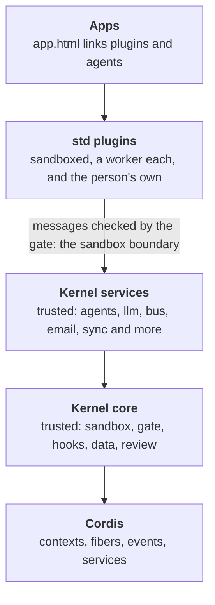

# The layers

Extensible Web Apps is built in layers, and each layer uses only the ones below it. This page says what each layer is, what lives in it today, who chooses what goes in it, and where the line between trusted and sandboxed code runs. It is the map to read before adding anything to the platform: a new piece of code belongs in exactly one layer.



| Layer | Where it lives | Runs | Chosen by |
| --- | --- | --- | --- |
| Apps | `demos/`, `site/`, your own folder | The page, plus its plugins' workers | The app's author (`app.html`), and the person (Customize) |
| std plugins | [`std/`](../std/) | A sandboxed worker each | Each app, with `<link rel="plugin">` |
| Kernel services | Kernel modules in `std/<name>/module.ts` | Inside the kernel, trusted | The site, in [`kernel.json`](../kernel.json) |
| Kernel core | [`src/kernel/`](../src/kernel/) | Inside the kernel, trusted | Always there |
| Cordis | `node_modules/cordis` ([cordiverse/cordis](https://github.com/cordiverse/cordis)) | Inside the kernel | Pinned in `package.json` |

The shape is close to [DeepSeek Harness](https://github.com/deepseek-ai/DeepSeek-Harness)'s: a small framework (Cordis), a harness on top of it with the services every extension can count on, and extensions that are everything else. Our harness is bigger than Cordis on purpose, because it also runs untrusted code safely, and the rest of this page says exactly what that adds.

### Where an app's plugins come from

The plugins in the top two layers reach an app at three levels. The level says who added a plugin, where it runs and who has it, never what it may do: every plugin, at every level, runs sandboxed with only the permissions its manifest asks for.

| Level | Who adds it | Where it runs | Who has it |
| --- | --- | --- | --- |
| **Developer plugins** | The app's author, linked from `app.html` (std plugins or the app's own) | Browsers, and a space's server for `runs: "server"` or `"both"` | Everyone who opens the app |
| **Space plugins** | A member, sharing one of their own with a space | Browsers only, never the server | Every member of that space, turned off until each turns it on |
| **User plugins** | A person, in Customize, or their agent ([the registry](guide/plugin-registry.md) is one place to find them) | Their browser only | Them, on that device; signed in, on each device they sign in on ([`follow`](server.md#what-follows-a-person-between-devices)) |

Customize ([`std/customize.js`](../std/customize.js), a standard plugin the host adds to every app) works on them through the core `authoring` service. The kernel keeps user plugins ([`user-plugins.ts`](../src/kernel/user-plugins.ts)), and a space keeps its space plugins ([`plugins.ts`](../std/spaces/plugins.ts)). [Servers and spaces](server.md#space-plugins) says how a plugin is shared, turned on and removed.

## Cordis

[Cordis](https://github.com/cordiverse/cordis) is a small plugin framework. The kernel uses it for:

- **Contexts and fibers.** Every plugin instance is a Cordis fiber, so stopping it disposes every listener it added, all at once ([`remote.ts`](../src/kernel/remote.ts)).
- **Events.** Hooks are Cordis events, dispatched in Cordis's modes: `emit`, `serial`, `bail`, `parallel`, `waterfall`.
- **The dispatch tap.** Cordis reports every dispatch, which is how the trace sees everything ([`trace.ts`](../src/kernel/trace.ts)).

- **Services, for kernel modules.** In Cordis, a service is a plugin that `provide`s a name and other plugins `inject` it. Each kernel module (below) is such a plugin: its service is a Cordis service, and the modules it `uses` are its `inject`. The services still in the core are plain objects the kernel builds, until they move into modules too.

## The kernel core

The core is what every app and every space server needs to run any plugin at all. Take one piece away and no app works, or a plugin could do something it didn't ask for.

| Piece | Files | What it does |
| --- | --- | --- |
| Where it runs | [`env.ts`](../src/kernel/env.ts), [`browser.ts`](../src/kernel/browser.ts), [`browser-env.ts`](../src/kernel/browser-env.ts) | The same kernel in a shared worker, a dedicated worker or a server ([The kernel](kernel.md#where-it-runs)) |
| Tabs and isolates | [`hosts.ts`](../src/kernel/hosts.ts), [`isolate-host.ts`](../src/kernel/isolate-host.ts) | The open tabs, the spawner tab that starts plugin workers, and its stand-in on a server |
| The sandbox | [`remote.ts`](../src/kernel/remote.ts), [`manifest.ts`](../src/kernel/manifest.ts), [`gate.ts`](../src/kernel/gate.ts), [`hooks.ts`](../src/kernel/hooks.ts) | Plugins in workers, their manifests read before they run, every message checked, hook contracts held |
| Seeing what happened | [`trace.ts`](../src/kernel/trace.ts), [`changes.ts`](../src/kernel/changes.ts) | The trace of every dispatch, and the change log |
| The data | [`store.ts`](../src/kernel/store.ts), [`paths.ts`](../src/kernel/paths.ts), [`records.ts`](../src/kernel/records.ts), [`schema.ts`](../src/kernel/schema.ts), [`legacy.ts`](../src/kernel/legacy.ts) | The data folder, path checks, collections and their schemas, and data kept in an older layout carried over |
| Asking the person | [`review.ts`](../src/kernel/review.ts), [`review-batch.ts`](../src/kernel/review-batch.ts), [`diff.ts`](../src/kernel/diff.ts) | Review cards for writes outside a plugin's own data, with a line diff, and grouped batch actions (`review-batch.ts`, fetched when two or more changes wait in the same place) |
| Keys and the network | [`secrets.ts`](../src/kernel/secrets.ts), [`secrets-card.ts`](../src/kernel/secrets-card.ts), [`net.ts`](../src/kernel/net.ts), [`address.ts`](../src/kernel/address.ts) | Secrets a plugin can use but never read, the requests made with them, and what counts as an email address (for the `email` module and the servers' accounts). The card that asks the person for a key (`secrets-card.ts`) is fetched the first time one is asked for |
| Which plugins run | [`apps.ts`](../src/kernel/apps.ts), [`catalog.ts`](../src/kernel/catalog.ts), [`switches.ts`](../src/kernel/switches.ts) | An app's linked plugins, installed plugins, and their on/off switches |
| Plugins' routes | [`routes.ts`](../src/kernel/routes.ts) | Requests for the routes plugins add: the site's, which the service worker passes on, and a space's public ones on its server |
| The person's own plugins | [`user-plugins.ts`](../src/kernel/user-plugins.ts), [`user-plugin-changes.ts`](../src/kernel/user-plugin-changes.ts), [`authoring.ts`](../src/kernel/authoring.ts), [`panel-commands.ts`](../src/kernel/panel-commands.ts) | Plugins a person (or their agent) adds to an app, or to every app they open, and the help to write them. The core only reads which are on; adding, removing and moving one (`user-plugin-changes.ts`) is fetched the first time one changes, `authoring.ts` when Customize first calls it, and the page's `user:` and `place:` commands (`panel-commands.ts`) the first time one is run |
| Where the person moved things | [`moves.ts`](../src/kernel/moves.ts) | The spots a person moved plugins' views to in an app (Customize's Arrange), used in place of the manifest's |
| Describing itself | [`reference.ts`](../src/kernel/reference.ts), [`manifest-fields.ts`](../src/kernel/manifest-fields.ts) | The [API reference](api.md), built from the tables the kernel enforces. Fetched when someone asks for the reference |
| An app's links | [`agents/linked.ts`](../src/kernel/agents/linked.ts) | An app's linked files as plugin sources, and fetching the agent file reader (below) once an app links an agent |
| Wiring | [`kernel.ts`](../src/kernel/kernel.ts) | Puts the pieces together |
| Kernel modules | [`modules.ts`](../src/kernel/modules.ts), [`kernel-modules.d.ts`](../src/kernel/kernel-modules.d.ts) | Knows the modules the site lists in `kernel.json` by their manifests, and fetches and runs each when it is first used (below) |
| Services plugins provide | [`provided.ts`](../src/kernel/provided.ts) | Passes calls to a service a sandboxed plugin provides on to that plugin (below) |

And the services every plugin relies on: `kernel`, `settings`, `plugins`, `storage`, `files`, `data`, `secrets`, `net` and `hooks`. Most are made beside the module they belong to; four are a file each, which [`services/index.ts`](../src/kernel/services/index.ts) finds by name: [`services/files.ts`](../src/kernel/services/files.ts), [`services/hooks.ts`](../src/kernel/services/hooks.ts), [`services/kernel.ts`](../src/kernel/services/kernel.ts) and [`services/storage.ts`](../src/kernel/services/storage.ts).

## The kernel stays small

**This is a rule of the project, not a goal: the kernel never becomes one big file.** Everything is supposed to be a plugin, so what a browser downloads to run an app is Cordis, the core in the table above, and nothing else until the app uses it. A check fails the tests when a change breaks any part of this:

- **A kernel module is a file of its own.** The browser's kernel is built with each module in `kernel.json` as a separate file, `/assets/kernel-<name>-<hash>.js`, and fetches one the first time something it adds is used. An app that never plays a sound never downloads the `audio` module. The kernel knows what each module adds from its manifest, `std/<name>/module.json`, without running it ([Kernel modules](#kernel-modules)).
- **The core never imports a module**, and never imports the parts of itself that only some apps use: the code that writes the API reference, the authoring service behind Customize, and the agent file reader are each fetched when first needed ([`tests/checks/kernel-layers.mjs`](../tests/checks/kernel-layers.mjs) lists them as `ON_DEMAND`).
- **The size is held.** [`tests/perf-budget.json`](../tests/perf-budget.json) sets the most the kernel's own file may be, gzipped. Don't raise it to fit a feature: put the feature in a module, a plugin, or a file fetched on demand. If the only way to keep the kernel small is a change to the architecture, make that change.

What is fetched on demand is a file of this site like any other: the service worker keeps it once fetched, so an app that has been opened works offline with the modules it used. A space's server is different on purpose: its kernel is one file with every module in it, started when the space wakes, since there is nothing to download there.

To see what a kernel is running, ask it: `window.__host.command("modules")` in a page answers each module's name and whether it has started.

### A deploy and the pages already open

Because the kernel is many files, each named with its content's hash, a page that was open before a deploy still asks for its own older ones, the first time it uses a part it hasn't fetched yet. Three things keep that from breaking it:

- **The server still has them.** Each build asks the live site for the list the last build wrote (`/platform/kept.json`) and brings along the files this build no longer makes ([`scripts/keep-assets.mjs`](../scripts/keep-assets.mjs)). A file stays for 90 days after the last build that made it. This runs where a deploy is built (Cloudflare's Workers Builds), from the site named by `homepage` in `package.json`; a site that can't be asked stops the build, so a deploy never quietly drops them. An app deployed as a Worker of its own (`npm run deploy:app`, or `npm run deploy` in a project of its own) keeps its own Worker's files the same way, just before it deploys ([`scripts/deploy-keep.mjs`](../scripts/deploy-keep.mjs)).
- **A part that can't be fetched says why.** Every part fetched on first use goes through `part()` ([`src/kernel/part.ts`](../src/kernel/part.ts)), which turns the browser's "Failed to fetch dynamically imported module" into what happened and what to do: reload the page, or go back online.
- **The page recovers.** When the server has no file for a built script, the service worker ([`sw.js`](../sw.js)) forgets the pages and scripts it kept, so the next load is all one version, and tells each open tab. A page in use shows "This page is older than the site is now" with a Reload button; a page that hadn't started yet, or whose own script is what failed, is loaded again by itself, once.

[`tests/checks/out-of-date.mjs`](../tests/checks/out-of-date.mjs) holds all three.

## Kernel services

These are capabilities with trusted code in the kernel: an app may use them, but not every app does. They are kernel modules (below), which a site picks, spaces included. One piece is still part of the core rather than a module: the agent file reader. It is fetched only once an app links an agent ([`agents/linked.ts`](../src/kernel/agents/linked.ts)).

| Service | Files | Why it is trusted code |
| --- | --- | --- |
| agent files | [`agents/file.ts`](../src/kernel/agents/file.ts) | Turns an app's `rel="agent"` file into the plugin that runs the agent loop. The loop itself isn't core: it is a file the site serves, [`std/agents/runner.js`](../std/agents/runner.js) unless the agent's frontmatter names another with `runner:` ([`src/shared/agent-runner.ts`](../src/shared/agent-runner.ts)). The `agents` service is a module (below); `file.ts` stays until the core reads links through a hook, so it needn't know about agent files |

### Kernel modules

Most services have moved out of the core into **kernel modules**. A module is a Cordis plugin in `std/<name>/module.ts`, and the site lists the ones it runs in [`kernel.json`](../kernel.json), one per line:

```json
{
  "modules": [
    "account",
    "agents",
    "audio",
    "bus",
    "commands",
    "debug",
    "email",
    "folder",
    "game",
    "history",
    "launch",
    "llm",
    "maker",
    "notify",
    "outside",
    "page",
    "reflect",
    "router",
    "schedule",
    "share",
    "spaces",
    "tools",
    "transfer"
  ]
}
```

Only the listed modules are part of the site's kernel, in the browser and on its servers ([`vite.kernel-modules.ts`](../vite.kernel-modules.ts)). A name with no `module.ts` stops the build, and a module that `uses` another the site doesn't list stops the kernel: neither quietly goes without. Beside `modules`, `kernel.json` may set `hooks`, the limits on hooks plugins define ([hooks of your own](guide/plugin-hooks.md)); any other setting stops the build. [`src/kernel/modules.ts`](../src/kernel/modules.ts) says how to write one.

A project that has the platform as a dependency builds no kernel, and still picks its own: a `kernel.json` at its top, held to the same rules, lists which of the platform's modules its kernel runs. Every built kernel has a mark where a site's `kernel.json` goes, and the project's command writes the project's after it in its own copies of the browser's, Node's and Cloudflare's kernels ([`scripts/project-kernel.mjs`](../scripts/project-kernel.mjs), [An app of your own](guide/your-own-app.md#its-own-kerneljson)). A kernel with one written in runs only the modules it lists; this site's, as built, has none and runs the list above.

#### A module's manifest

Beside each `module.ts` is `module.json`, which says what the module adds, the way a plugin's manifest says what a plugin asks for before any of its code runs:

```json
{
  "services": ["router"],
  "hooks": ["router:changed"]
}
```

| Key | What it lists |
| --- | --- |
| `services` | The services it provides (`kernel.provide`, or the `service()` helper) |
| `hooks` | The hooks it defines (`kernel.hook`) |
| `commands` | The page commands it answers (`kernel.command`) |
| `messages` | The message types it answers (`kernel.message`) |
| `doors` | The doors it answers on a space's server (`kernel.door`) |
| `starts` | `"always"` to start with every kernel, `"space"` to start with a kernel that is for a space, or `"account"` to start with a kernel on a device where the person is signed in to the site. Left out, the module starts when it is first used |

In the browser the kernel starts with the manifests only. Each listed service has a stand-in in the kernel's table, and each hook's name is the kernel's, so a plugin that needs the service is accepted and nothing else can take the names. The kernel fetches the module's file and runs it the first time:

- a plugin that lists the service in its manifest's `services` is installed (so the module is running, and listening, before the plugin's first line),
- a plugin calls the service or listens to one of its hooks,
- the page runs one of its commands or sends one of its messages,
- or something reads the whole kernel: the API reference, or an agent's tools (the `tools` module offers every service's methods, so it starts them all).

One module starts with every kernel: `history`. Undo has to hold every write from the first, and a module that started later would list only the writes made after it did, so its manifest says `"starts": "always"`. It is still a file of its own, fetched as the kernel starts and not part of the kernel's file. A module earns `"always"` only when starting late would lose something, never to save a fetch.

One module starts only for someone signed in: `follow`, which brings what the person added on their other devices, says `"starts": "account"`. The account app leaves a mark in the data folder while someone is signed in on the device (`sync/signed-in.json`, [`std/account/module.ts`](../std/account/module.ts)), and the kernel starts those modules when it finds the mark, or when the person signs in. Nothing waits for them: an app opens with what the device has, and what arrives shows as it comes. Signed out, the module is never fetched and the server is never asked.

A module that starts after the tabs opened hears each tab's address again (`internal/url`), so the router knows the screen. A module that can't be fetched is an error in the trace, calls to its service fail saying so, and the next use tries again.

The manifest is held to. A module that adds something its manifest doesn't list fails to start. A manifest that lists what its module never adds, a module with no manifest, a key the kernel doesn't know, and two modules listing the same name all fail the build or [`tests/checks/module-manifests.mjs`](../tests/checks/module-manifests.mjs). A site's settings and a module's promises are never quietly ignored.

A module keeps the promise any Cordis plugin keeps. Everything it adds goes through the `kernel` it is given (`provide`, `command`, `hook`, `cleanup`, and `kernel.root`, which is the module's own Cordis context), and each is a Cordis effect on that context. What the core tells modules (a tab's address, a plugin instance stopping, a tab leaving, the data folder ready) it emits as `internal/*` events, which only trusted code hears, so a module's listeners go with it too. So stopping a module takes back its service, commands and hooks, and ends whatever waits on it. The modules that use it stop first, and they start again when it does. The page command `restart-module` does this to one module, and [`tests/checks/module-restart.mjs`](../tests/checks/module-restart.mjs) restarts each one the site runs and checks the kernel looks the same afterwards. A module that calls `defineHook` itself, or sets one of the core's callbacks (`remote.onDispose = …`), fails the layer check, since either would outlive it.

| Module | File | What it adds |
| --- | --- | --- |
| `account` | [`std/account/module.ts`](../std/account/module.ts) | The `account` service: the person's account on the site's server (passkeys, other sites to sign in with, email, spaces, agent keys), for the account app's own plugins ([`account/app.html`](../account/app.html)) and no others |
| `agents` | [`std/agents/module.ts`](../std/agents/module.ts) | The `agents` service: counts each agent's runs and tokens, so an agent can't misreport its own use, and tells the app what agents do (`agent:*` hooks). Uses `tools` |
| `audio` | [`std/audio/module.ts`](../std/audio/module.ts) | The `audio` service: sound for plugins, played by the tab that runs their workers |
| `bus` | [`std/bus/module.ts`](../std/bus/module.ts) | The `bus` service: inboxes between agents, plugins and the person, with replies and topics |
| `commands` | [`std/commands/module.ts`](../std/commands/module.ts) | The `commands` service: commands from any plugin, run from a palette, a key or an agent (the palette is [`std/commands/palette.js`](../std/commands/palette.js)) |
| `debug` | [`std/debug/module.ts`](../std/debug/module.ts) | The `debug` service (the trace, for developer tools such as the debug console), and the `bench` and `reload-test` commands the tests run |
| `email` | [`std/email/module.ts`](../std/email/module.ts) | The `email` service: mail from a space's server to its members, with daily limits |
| `folder` | [`std/folder/module.ts`](../std/folder/module.ts) | The `folder` service: a folder of files the person works on (a Hugo site), picked on their disk or private in the browser; plugins other than its keeper propose writes, which the person reviews |
| `follow` | [`std/follow/module.ts`](../std/follow/module.ts) | What a signed-in person added (plugins, agents, which are on, moves, their pick of model) follows them between their devices through their account; their API keys too if they ask, encrypted on the device so the server can't read one (`vault.ts`, fetched only then). Starts only on a device where someone is signed in; see [Servers](server.md#what-follows-a-person-between-devices) |
| `game` | [`std/game/module.ts`](../std/game/module.ts) | The `game` service: a game loop whose rules are plugins (`game:update`, `game:rules`, `game:frame` hooks each tick); see [Games and audio](guide/games-and-audio.md) |
| `history` | [`std/history/module.ts`](../std/history/module.ts) | The `history` service: undo and redo across every plugin's writes. Starts with every kernel |
| `launch` | [`std/launch/module.ts`](../std/launch/module.ts) | The `launch` service: files opened with an app installed from the browser (its manifest's `file_handlers`), handed to a plugin of that app once |
| `llm` | [`std/llm/module.ts`](../std/llm/module.ts) | The `llm` service: the one interface to every model; the vendors are std plugins beside it ([`std/llm/`](../std/llm/)) |
| `maker` | [`std/maker/module.ts`](../std/maker/module.ts) | The `maker` service: apps a person makes in the browser (by describing them to the app maker agent), kept on their device and served at /apps/<name>/, saved after a review, with each file's versions and checks |
| `notify` | [`std/notify/module.ts`](../std/notify/module.ts) | The `notify` service: the operating system's notifications, shown from a tab with the plugin's app open while nobody is looking at it (the host's [`notify` bridge](../src/host/bridges/notify.ts)) |
| `outside` | [`std/outside/module.ts`](../std/outside/module.ts) | The `outside` service: agents outside the app use a plugin's tools, as WebMCP tools in the page (the host's [`webmcp` bridge](../src/host/bridges/webmcp.ts)) and as an MCP server on a space's server. Uses `tools` |
| `page` | [`std/page/module.ts`](../std/page/module.ts) | The `page` service: the app's own page, as far as a plugin's places reach into it, and the slots plugins declare |
| `reflect` | [`std/reflect/module.ts`](../std/reflect/module.ts) | The `reflect` service: a read-only view of the whole kernel, for debuggers |
| `router` | [`std/router/module.ts`](../std/router/module.ts) | The `router` service: a screen for every address, from the tab's address (the core passes it on as `internal/url`) |
| `schedule` | [`std/schedule/module.ts`](../std/schedule/module.ts) | The `schedule` service behind `ctx.schedule`: keeps plugins' jobs and wakes them, even a sleeping space |
| `share` | [`std/share/module.ts`](../std/share/module.ts) | The `share` service: sharing out with the system's share sheet, and sharing in to an app installed as a share target |
| `spaces` | [`std/spaces/module.ts`](../std/spaces/module.ts), with [`hub.ts`](../std/spaces/hub.ts), [`device.ts`](../std/spaces/device.ts), [`server-apps.ts`](../std/spaces/server-apps.ts), [`plugins.ts`](../std/spaces/plugins.ts), [`made-apps.ts`](../std/spaces/made-apps.ts), the device side in [`on-device.ts`](../std/spaces/on-device.ts) (loaded only in a kernel for a space), [`reviews.ts`](../std/spaces/reviews.ts) and [`service.ts`](../std/spaces/service.ts) | Spaces: a device's sync with its space and the space's side of it, the server plugins of the apps members open, space plugins (shared to members' browsers), made apps members share (each accepted on a review before it runs), reviews a space's server asks members' devices to show, and the `sync` service. It answers `sync` messages (`kernel.message`) and lends the core what a space adds (`kernel.space`): a site without it keeps no spaces |
| `tools` | [`std/tools/module.ts`](../std/tools/module.ts) | The `tools` service: reads the whole API reference to offer a plugin's service methods to a model as tools |
| `transfer` | [`std/transfer/module.ts`](../std/transfer/module.ts), [`std/transfer/csv.ts`](../std/transfer/csv.ts) | The `transfer` service: import and export, reviewed once for the whole file |

### Saying which services a plugin needs

A plugin's manifest lists the services it calls that not every site runs, so the plugin fails when it starts, with a message naming what is missing, rather than on its first call:

```js
export const manifest = {
  id: "palette",
  name: "Command palette",
  permissions: ["ui", "commands"],
  services: ["commands"],
};
```

The kernel's own services (`data`, `storage`, `settings` and the rest above) are always there and needn't be listed. The standard plugins list theirs, and so does every agent, which needs `agents`, `bus` and `tools`.

### When a person's plugin needs a service

`kernel.json` is the site's, not the person's, and nobody using an app ever edits it. A plugin a person adds (in Customize, from [the registry](guide/plugin-registry.md), or written by their agent) gets each service it lists in one of two ways:

1. **The site runs it.** Every kernel module in `kernel.json` is there for every app, the person's plugins included. Apps don't pick modules, so an app can't leave a person's plugin without one the site runs.
2. **Another plugin of theirs provides it.** A sandboxed plugin can provide any service the site doesn't run (below), so anything the site didn't build in comes as a plugin. Adding a registry package adds the packages that provide what it needs; turning one of the person's plugins on turns on theirs that provide what it needs (World clock brings Clock); turning a provider off turns off theirs that need it ([`user-plugins.ts`](../src/kernel/user-plugins.ts)). A plugin whose service nothing provides says so in Customize, and names the registry package that provides it if there is one.

What a person's plugin can't do is load a kernel module. A module is trusted code, outside the sandbox, so only whoever deploys the site chooses it ([The trust line](#the-trust-line)); a site that leaves one out has decided its apps run without it. A person who needs that capability anyway brings it as a sandboxed plugin that provides the service, which needs no one's trust. [`tests/checks/user-plugin-services.mjs`](../tests/checks/user-plugin-services.mjs) checks that every service a registry package needs is provided by the registry or a module this site runs, and that the app maker counts a service the app's own plugin provides.

### Where this is going

The plan, being reviewed now, splits this layer out of the core:

1. Every optional service is a kernel module, spaces included, except the agent file reader, which needs the core to read an app's links through a hook first. This repo's `kernel.json` lists every module, so no demo changes.
2. A smaller site lists fewer, and has less built in.
3. Services that don't need trusted code become std plugins that provide them (below), such as email delivery.

[`tests/checks/kernel-layers.mjs`](../tests/checks/kernel-layers.mjs) keeps the lists on this page honest: it fails when a file in `src/kernel/` is on neither the core list nor the services list, so a new file has to say which layer it is in.

## Plugins that provide services

A sandboxed plugin can provide a service, as a Cordis plugin can. A std plugin, a person's own plugin, or one their agent wrote can add a service the site didn't build in, and other plugins call it like any other:

```js
export const manifest = {
  id: "mailer",
  name: "Mailer",
  permissions: ["provide:mail", "network:api.example.com"],
  provides: {
    mail: {
      description: "Sends mail.",
      methods: {
        send: {
          args: "({ to, subject, text })",
          returns: "{ id }",
          description: "Sends one message.",
          // Optional: the arguments, in the collections' schema subset, so the tools service offers the method to agents.
          params: [{ name: "message", schema: { type: "object", required: ["to"], properties: { to: { type: "string" }, subject: { type: "string" }, text: { type: "string" } } } }],
        },
      },
    },
  },
};

export default (ctx) =>
  ctx.provide("mail", {
    send: async ({ to, subject, text }, { caller }) => ({ id: "…" }),
  });
```

- A plugin with the permission `mail` calls it: `await ctx.call("mail", "send", { to, subject, text })`. A method's `needs` can ask for a different permission.
- Each call goes to the provider through a hook named after it, so no other plugin can answer in its place. The provider hears which plugin called, and what it throws fails the call ([`provided.ts`](../src/kernel/provided.ts)).
- Its methods go into the [API reference](api.md). A method whose manifest entry has `params` is also offered by the `tools` service, so an agent can call it.
- A name the kernel, a kernel module or another plugin already has is refused, never shadowed. Plugins that list the service in `services` and open in the same app as its provider (or start from the same data folder, or on the same space server) wait for it to start. If the provider is then refused, they are stopped too, saying which service is missing.
- It runs in its own worker like any plugin, so providing a service gives it no rights beyond its own manifest.

A person can turn the providing plugin off, or turn on another that provides the same service, at any moment. A call that was waiting then fails, and so does one made while it is off, with a message that says which call and which plugin: `mail.send wasn't answered: “Mailer”, which provides mail, stopped` (or `isn't running`). A plugin that catches it can ask again a moment later, as the World clock does. One that leaves it uncaught gets a note in the trace, not an error, because turning a plugin off isn't a mistake in the plugins that use it ([`tests/checks/provider-stops.mjs`](../tests/checks/provider-stops.mjs), [`provider-swap.mjs`](../tests/checks/provider-swap.mjs)).

The site's [plugin registry](guide/plugin-registry.md) (`/packages/`) is where such plugins are offered: a person adds one to any app from Customize, with whatever provides the services it needs.

## std plugins

[Standard plugins](plugins.md) are ordinary sandboxed plugins: a JavaScript file each, in its own worker, held to its manifest, linked by an app that wants it. They can only do what the layers below let them. Anything a person or their agent writes is in this layer too, and has exactly the same powers as a std plugin.

## Apps

An app is a folder with an `app.html` that links its plugins (`<link rel="plugin">`) and agents (`<link rel="agent">`). The person using it can add their own plugins to it through Customize, and switch any of its plugins off. [How an app works](guide/how-an-app-works.md) starts there.

## The trust line

The one boundary that matters for safety runs between std plugins and the kernel. Below it, code runs unsandboxed inside the kernel, so whoever deploys the site chooses it. Above it, code runs in a worker that can reach nothing its manifest didn't ask for: no network unless it asks for `network` (and then only through a separate runtime, which [the security model](security.md) describes), no data but its own unless it is granted more, and no other plugin's worker. So anyone can add it: the app's author, the person, or an agent working for them. [The security model](security.md) has the details.

## Outside the kernel

Some of the platform isn't in any of these layers, because it never runs in the kernel:

- **The host** ([`src/host/`](../src/host/)): the code in each page that draws views and passes the person's actions on.
- **The service worker** ([`sw/`](../sw/)): serves app folders and screens, and plugin routes.
- **The `ui-*` elements** ([`elements/`](../elements/)): custom elements a page loads only if it uses them.
- **The servers** ([`src/server/`](../src/server/)): the front door for spaces, including sign-in ([`src/server/auth/`](../src/server/auth/)), which decides who may reach a space's plugins at all, so it can't be a plugin. Which sign-in providers a server offers is configuration, and a provider that needs code of its own (GitHub's URLs, Bluesky's steps) is a provider module in [`src/server/auth/providers/`](../src/server/auth/providers/), listed once in its `index.ts` as `kernel.json` lists kernel modules ([Servers and spaces](server.md#signing-in-with-another-site)).
