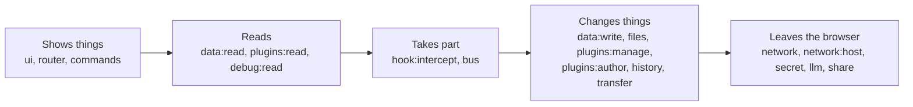

# Permissions

A plugin lists what it needs in its manifest's `permissions`. The kernel refuses everything else and records each refusal in the trace. This page explains each permission in plain words, grouped by how much it lets a plugin do. The [API reference](api.md#capabilities) has the exact list, printed by the kernel from the same table it enforces.

```js
export const manifest = {
  id: "due-soon",
  name: "Due soon",
  permissions: ["ui", "data:read:library"],
};
```

Ask for exactly what you use. The person sees the list in Customize, view source and the plugin editor, and a short list is easier to trust. A trailing `*` grants everything starting with what comes before it (`hook:listen:note:*`), but use it sparingly.



## Showing things

| Permission | Lets a plugin | Notes |
| --- | --- | --- |
| `ui` | Draw views in the page's slots and places, and ask whether a selector matches the page (`page.matches`). | Views are sanitised; see [Views and templates](guide/views-and-templates.md). |
| `router` | Know which screen of the app the tab shows, hear when it changes, and move to another. | Usually with `scope: "tab"`. See [Routes](guide/routes.md). |
| `commands` | List the app's commands and run them. | Each command runs with its own plugin's rights, not the caller's. See [Commands](guide/commands.md). |
| `audio` | Register an AudioWorklet processor and play it, in the tab that runs the plugins. | |
| `routes` | Answer requests for paths in its own folder (`ctx.routes.add`). | See [Routes and the service worker](guide/routes.md). |

No permission is needed for a plugin's own storage and settings (`ctx.storage`, `ctx.settings`), or for adding commands of its own.

## Reading

| Permission | Lets a plugin | Notes |
| --- | --- | --- |
| `data:read:<collection>` | List and get another plugin's records, and hear when they change. | Works before the collection exists: it reads as empty. See [Sharing data between apps](guide/sharing-data-between-apps.md). |
| `plugins:read` | List the plugins the app links, and read their code. | What view source and Ask the page use. |
| `debug:read` | Read the kernel's trace for the app. | The trace names every plugin and what it did. |
| `bus:read:<topic>` | Read the messages posted to a topic. | See [Agents](guide/agents.md). |
| `hook:listen:<hook>` | Hear an `emit` or `parallel` hook: something happened. | It can't change what happened. |

## Taking part

| Permission | Lets a plugin | Notes |
| --- | --- | --- |
| `hook:intercept:<hook>` | Answer a `serial`, `bail` or `waterfall` hook: change a value, or stop the action. | For example `hook:intercept:data:beforeWrite:learning` can stop a note being saved. A listener that doesn't answer in time is skipped or counted as a block, as the hook says. |
| `bus:send:<to>`, `bus:post:<topic>` | Send a message to one agent or plugin, or post to a topic. | |
| `bus:ask`, `bus:board`, `bus:inbox` | Ask the person a question, answer questions, or receive and reply to messages. | |
| `agents:run:<agent>` | Start one of the app's agents. | |

## Changing things

| Permission | Lets a plugin | Notes |
| --- | --- | --- |
| `data:write:<collection>` | Put and delete another plugin's records. | **Each change waits for the person** to accept a review card, unless they chose to always allow it. |
| `files:<folder>` | Read and write text files in one folder of the app's data. | Writes are reviewed. Paths are checked, and the platform's own files are off limits whatever the folder. |
| `history` | Undo and redo the app's most recent data changes. | |
| `transfer` | Export the app's collections, and import into them. | An import is reviewed as a whole. |
| `plugins:manage` | Switch the app's plugins on and off. | What the switchboard and reset use. Switching is saved and applies in every tab. |
| `plugins:author` | Write and remove the person's own plugins for the app. Includes `plugins:read`. | **Every save and removal waits for the person**, on a card showing the code. |

## Leaving the browser

| Permission | Lets a plugin | Notes |
| --- | --- | --- |
| `network` | Use `fetch` and WebSockets to any `https:` host, and show `https:` images. | Its worker runs under a policy that allows the network. Without it, the worker can't connect anywhere. |
| `network:<host>` | Send requests to one host through the kernel (`net.fetch`). | Narrower than `network`, and traced. |
| `secret:<name>` | Use the key the person gave under that name, in requests to the hosts they agreed to. | The plugin never reads the key. See [API keys and web requests](guide/keys-and-requests.md). |
| `llm` | Ask the app's language models, and list them. | The plugin never sees a key or a vendor's address. |
| `provide:llm` | Be a language model: answer the `llm` service's requests for one vendor. | What the plugins in [`/std/llm/`](../std/llm/README.md) ask for, beside their vendor's host and key. |
| `share` | Hand something to the system's share sheet, or take what was shared to the app. | |

## Editor permissions

Plugins written for the Markdown editor can use its older permission names, which stand for capabilities: `post:read` is `hook:listen:note:*`, and `post:write` is `hook:intercept:data:beforeWrite`.
