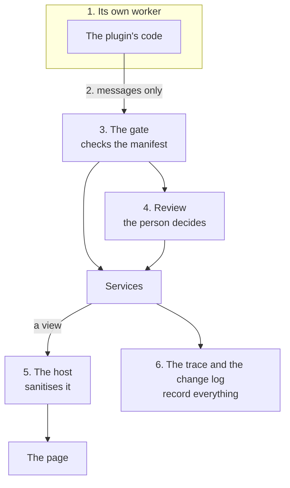

# The security model

An app on this platform runs code that its author didn't write: a plugin a person added, a copy they changed, or one an AI agent wrote for them. So the platform assumes any plugin may be careless or hostile, and gives each one only what its manifest asks for. Then the person can see what that was.

This page says what keeps a plugin in its place, layer by layer. Each layer is enforced by the platform, not left to the plugin's good manners.

## 1. Each plugin runs in its own worker

A plugin is a module in a dedicated Web Worker of its own. It has no `document`, so it can't read or change the page, other plugins' views or what the person types elsewhere. It shares no memory with other plugins either.

The worker's content security policy allows only the plugin's own module (`script-src 'self' blob:`), and no workers of its own (`worker-src 'none'`). It allows no network at all (`connect-src 'none'`). A plugin with the `network` permission runs in a second copy of the runtime that may reach `https:` and `wss:` hosts. The policies are in [`vite.config.ts`](../vite.config.ts) for development and [`public/_headers`](../public/_headers) for the hosted site.

## 2. The manifest is read before the code runs

`export const manifest = { … }` must be the module's first statement, and a plain literal. The kernel reads it from the source text before starting the worker ([`src/kernel/manifest.ts`](../src/kernel/manifest.ts)). That way a manifest can't be computed, hidden in a string, or changed after the fact. When the plugin starts, the manifest it reports must match. One that changes itself is uninstalled.

## 3. The gate checks every message

Everything a plugin does is a message to the kernel: calling a service, listening to a hook, drawing a view. The gate ([`src/kernel/gate.ts`](../src/kernel/gate.ts)) checks each one against the capabilities in the plugin's manifest. A message the manifest doesn't allow is refused, and the refusal is traced.

- A service method that isn't in the kernel's reference can't be called at all, so there is no hidden API.
- Hooks are split in two. `hook:listen:<hook>` hears that something happened. `hook:intercept:<hook>` takes part, and can change or stop it. Most plugins only need to listen.
- Reading a collection (`data:read:<name>`) includes hearing that it changed, and nothing more.

The full list is in [Permissions](permissions.md).

## 4. The person decides about changes to what isn't the plugin's

A plugin owns the collections its manifest declares, and reads and writes them freely. Any write to something else waits for the person: another plugin's collection, a note, a file, the person's own plugins. The kernel shows a card with the plugin's name, its reason and a diff of the change ([`src/kernel/review.ts`](../src/kernel/review.ts)). The person accepts it once, always allows that plugin to make that kind of change, or declines. The call fails if they decline or don't answer within five minutes.

The same goes for a person's own plugins. One saved from the plugin editor waits for a card that shows its code and what it asks for. One added in **Customize** starts off, showing what it asks for, until the person turns it on.

Before that card, a checker may look first. The kernel runs `plugins:beforeAdd` with the plugin's code and permissions whenever one of the person's own is saved or added, and a plugin or agent listening with `hook:intercept:plugins:beforeAdd` may stop it with a reason, which the caller gets as the error. A checker can only stop a plugin, never let one past the card. The homepage's [Security check](../site/home/security-check.js) does it with plain rules, and [`security.agent.md`](../site/home/security.agent.md) with a model.

**Path checks** run before any file is read or written, whatever the plugin's capabilities ([`src/kernel/paths.ts`](../src/kernel/paths.ts)). Paths must be relative and inside a folder, with no `..` or hidden names. They can never touch the platform's own files (its plugins, grants, change log or keys). So a plugin can never install or approve another plugin by writing a file.

## 5. Views are data, sanitised on the page

A plugin describes its view as HTML, and the host keeps only the elements and attributes on its allowlist ([`src/shared/html.ts`](../src/shared/html.ts), [`src/host/sanitize.ts`](../src/host/sanitize.ts)). That means no scripts, no event attributes, no `style` attributes, no frames and no `javascript:` links. Template holes are filled as text, never as HTML. An `https:` image is a request, so only a plugin with `network` may show one. Links to other sites open in a new tab without a referrer.

A plugin's stylesheet is cleaned (no `url()`, `@import` or `!important`) and scoped to its own views ([`src/host/plugin-styles.ts`](../src/host/plugin-styles.ts)). It sits in a layer below the page's own styles, so the app always has the last word, and each view is contained so nothing is drawn outside its box.

A view's actions go back only to the plugin that drew it. A `<ui-table>` or `<ui-form>` acts with the rights of the plugin whose view it sits in, which the host tracks itself, so a plugin can't borrow another's rights with an attribute.

## 6. Keys are never handed to a plugin

A plugin that needs an API key asks for it by name (`secret:<name>`). The person types it into a card drawn by the kernel, which says which hosts the key may be sent to. The plugin then writes `{ secret: name }` in a request header, and the kernel fills it in, only for those hosts ([API keys and web requests](guide/keys-and-requests.md)). The plugin never sees the key. A request to any other host is refused, and the trace names the secret used, never its value.

A plugin that asks a language model through the `llm` service needs only the `llm` permission. It never sees the key, or which vendor's key it is.

## 7. Everything is recorded, and nothing is final

- **The trace** records every message, check and refusal, with timings, grouped by the action that started it. The workbench, the debug console and the hook tracer show it.
- **The change log** records every install, removal, switch, setting, grant and reviewed write, with its outcome ([`src/kernel/changes.ts`](../src/kernel/changes.ts)).
- **Any plugin can be switched off**, which stops its workers at once. Opening any app with `?reset` turns its plugins back on, before any of them runs, so a page can always be recovered.
- **An author's marks.** An app's author can mark parts of the page `review` or `locked`, and a person's plugin that wants to draw there waits for their approval or is refused ([Places](guide/places.md)).

## 8. On a space's server, the same rules and a few more

A space's server runs the same kernel and the same gate, so everything above holds there too ([Servers and spaces](server.md)). On top of it:

- **Only members join a space.** A device joins its kernel only with the session cookie of someone in the space, and the server, not the device, says which member it is. Someone who leaves or is removed is disconnected at once.
- **A member's device says very little to it.** A page talks to its own kernel freely, because that kernel is the person's. A space's kernel is everyone's, so the server lets through only what is on a list ([`signed.ts`](../src/server/signed.ts), the same on Node and Cloudflare): joining and leaving, the space's own sync messages (each marked with the member's role, and checked against it and the collection's rules), and a few kernel commands by role. Any member may run the commands that only read (`changes`, `fetched`, `modules`, `reference`, `sync`, `trace`). Only the owner may start a part of the space's kernel again (`restart-module`, `reload`) or change the plugin files the space's folder keeps (`user:*`). Every other command is refused for everyone, the owner too, with words that say what to do instead: `install`, `uninstall`, `route`, `place:*` and the rest. A command added to the kernel later is refused until someone lists it. Nothing that speaks for a view (a form's record, a button's event, an app opening) is heard at all.
- **Only the author's plugins run there.** The space starts the server plugins of the apps the site serves, read from the site's own files. It never runs code a member's device sent, and a member can't replace a server plugin with their own copy.
- **Each server plugin is in an isolate of its own:** on Node a process under Node's permission model, with no files, no child processes and none of the server's environment; on Cloudflare a Dynamic Worker with no bindings. Without `network` it can't connect anywhere, and with it, it still can't reach the server's own network (loopback, private and metadata addresses are refused where each connection is made).
- **Public routes are public.** Anyone may call a server plugin's route, from any site, and the plugin isn't told who. What it answers is shown with no script.
- **Limits on what costs others.** A plugin sends at most 50 emails a day, to at most 10 addresses each, and a repeating job runs at most once a second.
- **Sign-in keeps nothing that can leak.** Passkeys are checked with WebCrypto, sessions are `HttpOnly` cookies whose hash is all the server keeps, and a provider's token is thrown away once it has said who the person is.

## What it doesn't do yet

- **Limits on a plugin's time or memory.** A plugin can't stall the kernel, because hooks that wait for an answer have time limits, but a busy plugin can slow its own worker. Switching it off stops it.
- **Keys the deployment provides.** A key is always one the person gave, in their browser. A server holding an app's key, behind the same calls, isn't there yet.
- **Delivering email.** A server plugin's mail is written to the space's outbox, not sent. Who a plugin may mail (anyone, or only the space's members) is still open.
- **Signed plugins.** A plugin is trusted for what its manifest says it may do, not for who wrote it.
