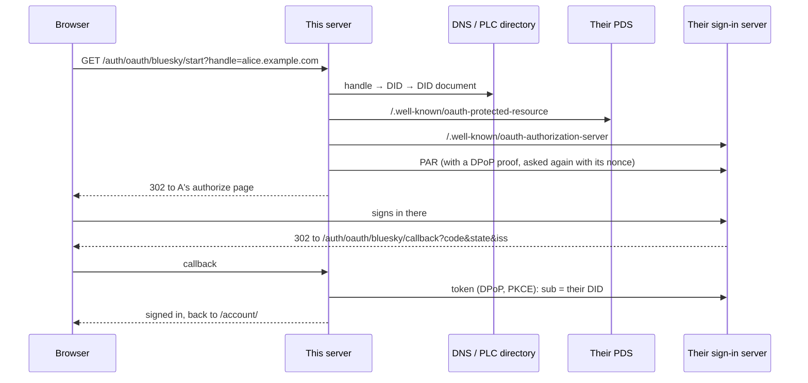

# Servers and spaces

The browser kernel is the source of truth on each device, and an app works with no server at all. A server adds an optional peer: the same kernel, running on a server, one per **space** (a group of people and the data they share). It syncs with each device, runs server plugins, and answers public routes. The design, with the questions still open, is in the [phase 2b design doc](https://claude.ai/artifact/RSBXjYMixAyeLy8msz6yFg). To use spaces and server plugins in an app, start with the guide's [Spaces, and plugins on a server](guide/spaces-and-servers.md); this page says how they are built.

All of it is built, on two hosts:

| Part | Where it is | Below |
| --- | --- | --- |
| **One kernel, everywhere.** The kernel's code is the same in a shared worker, a dedicated worker, a space's copy in a tab and a space's server ([where it runs](kernel.md#where-it-runs)). What differs is the environment an entry sets first ([`src/kernel/env.ts`](../src/kernel/env.ts)): [`browser.ts`](../src/kernel/browser.ts) in the browser, [`src/server/space.ts`](../src/server/space.ts) on Node, and [`src/server/cloudflare/kernel.ts`](../src/server/cloudflare/kernel.ts) on Cloudflare. The kernel keeps its folder through the `files` seam everywhere. | `src/kernel/` | [Seams](#seams) |
| **The Node host**: `npm run serve` | `src/server/serve.ts` | [The Node host](#the-node-host) |
| **The Cloudflare host**: a Durable Object per space, with its kernel in a Dynamic Worker of its own | `src/server/cloudflare/` | [The Cloudflare host](#the-cloudflare-host) |
| **Sign-in and spaces**: passkeys, OAuth providers as configuration (GitHub, Bluesky), spaces with members and invites | `src/server/auth/` | [Sign-in and spaces](#sign-in-and-spaces) |
| **Sync**: a tab in a space keeps a copy, and still works offline | `src/kernel/sync.ts`, `sync-device.ts` | [Sync](#sync) |
| **Server plugins**: `runs`, public routes, `schedule`, `email`, and `data:beforeWrite` on the server | `src/kernel/server-apps.ts`, `isolate-host.ts` | [Server plugins](#server-plugins) |
| **Proof apps**: a survey builder and a feed reader | `demos/survey/`, `demos/feeds/` | [Proof apps](#proof-apps) |

## Seams

Everything a space kernel needs from the machine it runs on is a **seam**: one small interface in [`src/seams/index.ts`](../src/seams/index.ts). Plugins never see a seam. They call services through the gate, and the kernel calls the seams.

Two seams are what the kernel runs on today:

| Seam | What it does | Browser | Node | Cloudflare | Memory (tests) |
| --- | --- | --- | --- | --- | --- |
| `files` | The kernel's folder: collections, the sync log, plugins, their files and settings, scheduled jobs, the outbox | the origin private file system ([`opfs.ts`](../src/seams/opfs.ts)) | a folder ([`node.ts`](../src/seams/node.ts)) | the facet's SQLite ([`durable.ts`](../src/seams/durable.ts)) | a Map |
| `isolates` | Where server plugins run | (tabs start workers instead) | a process each ([`node-isolates.ts`](../src/seams/node-isolates.ts)) | a Dynamic Worker each ([`remote-isolates.ts`](../src/seams/remote-isolates.ts)) | none |

Everything else is kept in that folder by the kernel itself: collections and the sync log as JSON files, jobs in `schedule/jobs.json` (with timers, and a Durable Object alarm on Cloudflare to wake the space), mail in `server/outbox/`, keys in `secrets.json`.

The seams interface also defines `records`, `schedule`, `secrets` and `email`, with memory and Node providers that pass the conformance checks below (a SQLite file with `node:sqlite`, timers with `schedule.json`, an env file, an outbox folder). The kernel doesn't use them yet: they are ready for records in SQLite, mail that is delivered, and keys the deployment provides. Cloudflare has only `files` so far.

### Records and the change log

The `records` seam orders every change the way a space's sync does ([Sync](#sync), which keeps its log in files today). `put(collection, id, value, base)` takes `base`, the version the writer last saw (0 means "it shouldn't exist yet"):

- If `base` is the current version, the write is accepted. It gets the next sequence number, which is also the record's new version.
- If it isn't, the write is refused as `{ ok: false, stale: true, current }`. The writer shows the newer record and keeps its own as a draft.
- `changes(since)` returns every accepted change after a sequence number, so a device that was offline catches up.

Sync works this way until CRDTs come for live editing.

### Checks every provider passes

[`tests/seams/run.mjs`](../tests/seams/run.mjs) runs the same checks against every provider: what is written reads back, paths (and links) can't leave the folder, stale writes are refused, the change log is complete and ordered, jobs run once, survive a restart and catch up once after one, a failing job doesn't stop the rest, and email refuses what isn't an address. Run them with `npm run test:seams`. `npm test` runs them too.

The seams live in `src/seams/`, beside the browser code rather than under `src/server/`, because the browser kernel uses them too: its folder is the `files` seam over the origin private file system. The server's own code (`src/server/`) is TypeScript that Node runs as it is (Node strips the types); the kernel it runs is built by Vite (`npm run build:server`), as the browser's is. Imports name their `.ts` files, and `tsconfig.server.json` checks the server and the seams with Node's types: `npm run typecheck` checks both halves.

## The Node host

`npm run serve` builds the site and a space's kernel, then serves both on this machine:

- The built site (`dist/`), the way Cloudflare's static assets serve it: a folder's `index.html`, and `404.html` for a path that isn't there.
- A kernel for each space a client joins, at `ws://127.0.0.1:8787/s/<space>/kernel`. Each one is the browser's kernel (`src/kernel/kernel.ts`), built for Node by Vite (`npm run build:server`, into `.build/server/space.js`) and started in a worker thread of its own. Its folder is `.spaces/<space>/`, through the Node `files` seam.

Only a space's members may join it: the upgrade must carry the session cookie of someone in the space (see Sign-in and spaces, below). A client speaks the messages a tab speaks to its kernel (`hello`, `command`, `event`, `bye`), as JSON over the WebSocket ([`src/server/websocket.ts`](../src/server/websocket.ts) is the server's side, with no dependency). For example, after `hello`, `{ "t": "command", "id": 1, "name": "user:list", "arg": { "app": "demos/contacts" } }` answers with the plugins the space keeps for that app.

Each space's kernel runs its server plugins in isolates (see [Server plugins](#server-plugins)), and a tab syncs with it when it opens an app at `/s/<space>/…` (see [Sync](#sync)).

Options: `node src/server/serve.ts --port 8787 --host 127.0.0.1 --spaces .spaces --site dist`. Behind a proxy that speaks HTTPS, add `--origin https://your.host` (or set `PUBLIC_ORIGIN`), so sign-in sees the address people use. [`tests/server/run.mjs`](../tests/server/run.mjs) checks it (`npm run test:server`, or `node tests/server/run.mjs node` for this host only), and `npm test` runs those checks too.

## The Cloudflare host

The same site and the same spaces run on Cloudflare: `wrangler.jsonc` points at a Worker, [`src/server/cloudflare/worker.ts`](../src/server/cloudflare/worker.ts), alongside the static assets.

- **Files that exist are served as static assets**, as before. Anything else gets `404.html`.
- **`/s/<space>/kernel` goes to that space's Durable Object, `Space`.** It is the space's supervisor: it holds the clients' WebSockets.
- **The kernel runs in a Dynamic Worker.** The supervisor loads the kernel, built by `npm run build:cloudflare` from [`src/server/cloudflare/kernel.ts`](../src/server/cloudflare/kernel.ts), as a [Dynamic Worker](https://developers.cloudflare.com/dynamic-workers/) under the space's own id. That gives each space an isolate of its own, as a worker thread does on Node.
- **The kernel's storage is a facet.** The supervisor runs the kernel as a [facet](https://developers.cloudflare.com/dynamic-workers/usage/durable-object-facets/), which has its own SQLite database. That database is the space's folder, through the `files` seam in [`src/seams/durable.ts`](../src/seams/durable.ts).

Two things are different from Node:

- **Messages cross by RPC.** Each client is a call to `join` with a function that sends to its socket, then `deliver` for each message and `leave` at the end. Inside the kernel, each client is still a `MessagePort`, as a tab is.
- **Timers wait while the kernel loads.** Cloudflare runs a module's top level outside any request, where timers aren't allowed, so the timers the kernel sets while loading (the trace's batches, say) start once it has loaded.

`npx wrangler dev` runs all of this on this machine, with no account. [`tests/server/run.mjs`](../tests/server/run.mjs) runs the same checks against Node and against `wrangler dev`. The Durable Object's files seam also passes the seams' conformance checks, on Node's SQLite.

## Sign-in and spaces

People sign in with a **passkey**: a key their phone or computer makes for this site and unlocks with a face, a fingerprint or a screen lock. There is no password to remember, reuse or leak. Try it at [`/account/`](/account/) on either host.

- **One module, both hosts.** [`src/server/auth/accounts.ts`](../src/server/auth/accounts.ts) answers every route under `/auth/` with the web's `Request` and `Response`. It keeps accounts on the `files` seam: in `<spaces>/_accounts/` on Node, and in a Durable Object of its own, `Accounts`, on Cloudflare.
- **Passkeys are checked with WebCrypto alone.** [`src/server/auth/webauthn.ts`](../src/server/auth/webauthn.ts) reads what the authenticator sends (a little CBOR), and checks the challenge, the page's origin, the site, and the signature. It accepts ES256, Ed25519 and RS256 keys. It asks for no attestation, so it doesn't care who made the authenticator. No dependency is added.
- **The browser and the server speak WebAuthn's JSON.** The page passes the server's options to `PublicKeyCredential.parseCreationOptionsFromJSON`, and sends back `credential.toJSON()`.
- **A session is a cookie.** It holds a random token that is `HttpOnly` and `SameSite=Lax` (and `Secure` over HTTPS). The server keeps only the token's hash. Every `POST` must come from the site's own origin.

| Route | What it does |
| --- | --- |
| `POST /auth/register/options` | Options for a new passkey. With `{ name }`, it's for a new account; for someone signed in, it's one more passkey on their account. |
| `POST /auth/register` | Checks the new passkey, keeps its public key, and signs in. |
| `POST /auth/signin/options` | Options for signing in with any passkey this site knows. |
| `POST /auth/signin` | Checks the signature (and that the passkey's counter went up, if it keeps one), and signs in. |
| `GET /auth/me` | Who is signed in, or 401. |
| `POST /auth/signout` | Ends this session. |

### Spaces and members

A space holds people and their data (collections and plugins), and any app can open in it. A personal space is a space with one member. The accounts keep each space's members, so both hosts decide who may join a space's kernel in the same place, before the WebSocket opens.

| Route | What it does |
| --- | --- |
| `GET /auth/spaces` | The spaces you're in, with your role (`owner` or `member`). |
| `POST /auth/spaces` | `{ name }` makes a space, with you as its owner. A name is lowercase letters, numbers and dashes, and no one else's. |
| `GET /auth/spaces/<name>` | Its members. To anyone else, it's a space that doesn't exist. |
| `POST /auth/spaces/<name>/invite` | A one-time invite, for a week (its owner only). `/account/?invite=<token>` accepts it once the person signs in or makes an account. |
| `POST /auth/invites/accept` | `{ token }` joins the space the invite is for, and uses the invite up. |
| `POST /auth/spaces/<name>/leave` | Leaves it. Its owner can give `{ user }` to remove someone, and can't leave it. |

Every change under `/auth/` runs one at a time, so a challenge or an invite is used once and a name gets one owner, on both hosts. Someone who leaves a space, or is removed, is disconnected from it at once.

The kernel of a space knows which member each client is: the server adds it to the client's `hello` (a client can't say it itself), and sync records it with every change. Plugins hear it too: a change that came from another device or from the space's server has `by` (the member's id, or `plugin:<id>` for a server plugin) on `data:changed:<collection>`, and a server plugin's `data:beforeWrite:<collection>` hears which member's device sent the change. A device learns which member it is from the space's answer to its hello: `sync.state()` has it as `member`.

### Signing in with another site

People can also sign in with an account they have elsewhere, over OAuth 2 with PKCE. A provider is configuration, not code: [`src/server/auth/providers.ts`](../src/server/auth/providers.ts) has GitHub as a preset, and another provider that speaks plain OAuth 2 is a few URLs. A host turns providers on from its environment (Node's `process.env`, or a Worker's vars and secrets):

| Setting | What it holds |
| --- | --- |
| `AUTH_PROVIDERS` | JSON, such as `[{ "id": "github", "clientId": "Iv1..." }]`. A provider with no preset adds `authorize`, `token` and `user` URLs, and can add `scope` and `name`. |
| `<ID>_CLIENT_SECRET` | Each provider's client secret, such as `GITHUB_CLIENT_SECRET`. Keep it as a secret, never in the JSON. |

At the provider, register the callback URL `https://<your host>/auth/oauth/<id>/callback`. On Cloudflare, `AUTH_PROVIDERS` is a var and the secret is a Worker secret (`npx wrangler secret put GITHUB_CLIENT_SECRET`).

| Route | What it does |
| --- | --- |
| `GET /auth/providers` | The providers that are on: `{ providers: [{ id, name, ask? }] }`. `ask` names a field to type before starting (Bluesky's handle). |
| `GET /auth/oauth/<id>/start` | Sends the browser to the provider, with a state cookie and a PKCE challenge. Only from this site's own pages (a browser's `Sec-Fetch-Site`), so a link on another site can't start a sign-in, or link an account someone else chose to the person signed in. |
| `GET /auth/oauth/<id>/callback` | Checks the state against this browser's cookie, trades the code for a token, and asks the provider who it is. Someone signed out is signed in to the account that identity belongs to, or a new one. Someone signed in links that identity to their account, unless it's already someone else's. It goes back to `/account/`, with `?error=` if something was wrong. |
| `GET /auth/oauth/<id>/<other>` | Anything else a sign-in flow publishes, such as Bluesky's `client-metadata.json`. |

The server keeps only who the person is at the provider (an id that never changes, and a name). It throws the provider's token away.

### Signing in with Bluesky

Bluesky (the AT Protocol) signs in with OAuth too, but its own way, so it's a module of its own, [`src/server/auth/bluesky/`](../src/server/auth/bluesky/). Turn it on with `{ "id": "bluesky" }` in `AUTH_PROVIDERS`. It needs no client id, no secret and nothing registered anywhere. `/account/` shows a field for the person's handle beside its button.

What's different from GitHub, and how each part is checked:

- **The client id is a URL.** On HTTPS it's `https://<host>/auth/oauth/bluesky/client-metadata.json`, which this server publishes and the person's server reads. On `http://127.0.0.1` it's atproto's loopback client id, so it works in development with no setup. A sign-in started at `localhost` moves to `127.0.0.1` first, because the loopback client has to come back there.
- **It finds the person's server** from what they type ([`resolve.ts`](../src/server/auth/bluesky/resolve.ts)): a handle (by DNS TXT `_atproto.<handle>`, or `https://<handle>/.well-known/atproto-did`), a DID, or a server's address such as `https://bsky.social`. A handle counts only if the DID's document names it back. Every URL it fetches came from someone's input or a document someone else wrote, so it only asks public HTTPS servers, not IP addresses or local names. It follows no redirects, and each fetch has a time limit and a size limit. On Node, the connection itself looks each name up and refuses unless every address is public ([`guarded-fetch.ts`](../src/server/auth/bluesky/guarded-fetch.ts)), so a public-looking name that points at the machine's own network, or changes its answer between check and connection, gets nowhere. A Worker's fetch only reaches the public internet anyway.
- **Requests carry DPoP proofs** ([`dpop.ts`](../src/server/auth/bluesky/dpop.ts)). Each sign-in gets a new ES256 key, kept with the sign-in's state for its five minutes and then thrown away. When the server asks for its nonce, the request goes again with it.
- **Who signed in is believed only if it adds up.** The callback's `iss` must be the server the sign-in went to. The token's `sub` (their DID) must be the account they typed, or, when they typed a server's address, that DID's own document must name the same sign-in server. Otherwise any server could say it's anyone.

The identity is the DID, which never changes even when the handle does. A new account is named by its handle. As with GitHub, the tokens are thrown away: this is sign-in only, not posting to Bluesky for the person.

| Setting in its `AUTH_PROVIDERS` entry | What it does |
| --- | --- |
| `name` | What the button says (`Bluesky`). |
| `plc` | The PLC directory, for `did:plc` (`https://plc.directory`). |
| `dns` | A DNS-over-HTTPS server that answers JSON, for handles (`https://cloudflare-dns.com/dns-query`, which works on both hosts). |
| `resolver` | A server that answers `com.atproto.identity.resolveHandle`, to ask instead of DNS and HTTPS. |
| `insecure` | `true` lets `http://` and local servers through. For the server checks only. |

[`tests/server/fake-atproto.mjs`](../tests/server/fake-atproto.mjs) is a small AT Protocol network (a PLC directory, a resolver, a PDS and its sign-in server, which checks PAR, DPoP, nonces, PKCE and the loopback client), and [`tests/server/bluesky.mjs`](../tests/server/bluesky.mjs) signs in through it on both hosts. It also tries a token for another account than the one typed, an account whose DID names another server, and an answer that names another server.

Another way to sign in was looked at, and waits:

- **FedCM** (the browser's own account chooser) is only in Chrome and Edge for now, and providers have to support it (Google does, GitHub doesn't). It's worth adding as a nicer front for providers that offer it, once more browsers have it.

[`tests/server/authenticator.mjs`](../tests/server/authenticator.mjs) is a passkey authenticator in software. The server checks use it on both hosts. They also try a used challenge, another page's origin, another site's passkey, a counter that went back, and a forged signature. They check who may make, open, invite to and leave a space, and sign in with a provider in [`tests/server/fake-oauth.mjs`](../tests/server/fake-oauth.mjs): a sign-in this browser didn't start is refused, and an identity can't be linked to two accounts. [`tests/checks/signin.mjs`](../tests/checks/signin.mjs) uses `/account/` in Chromium, with its virtual authenticator: it signs up, out and in, makes a space, and has a second person join it from the invite link.

## Sync

Each device keeps its own copy of a space's data, and works on it offline. The space orders every change, so all the copies agree. This is how it works until CRDTs come for live editing. The messages are in [`src/shared/sync.ts`](../src/shared/sync.ts), and the space's side is [`src/kernel/sync.ts`](../src/kernel/sync.ts).

1. A device says `{ t: "sync", op: "hello", since }` with the last sequence number it saw (0 the first time). The space answers with every change after it, and from then on sends each change it accepts.
2. A device sends the records it changed: `{ t: "sync", op: "push", id, changes: [{ collection, id, base, after }] }`. `base` is the record's version when the device changed it (0 for a new one), and `after` is the record, or null for a delete.
3. The space takes each change in turn. If `base` is still the record's version, the change gets the next sequence number, which becomes the record's version. The space's own plugins can stop it with `data:beforeWrite`, as a browser's can, and a collection the space knows is checked against its schema. Every device hears the change, with `by`, the member who made it.
4. A change based on an older version is refused as stale, with the record as the space has it, so the device can show the newer one and keep its own as a draft.

The space keeps the log beside its collections (`sync/log/`, a hundred changes to a file) with each record's version (`sync/head.json`), so a device that was away for a while catches up from wherever it was. [`tests/server/run.mjs`](../tests/server/run.mjs) checks all of this on both hosts, with two members' devices.

### A tab in a space

Any app opens in a space: `/s/family/demos/reading-list/` is the reading list, with the family space's data.

- **The page is the app's own.** The service worker answers an address inside a space with the same address outside it, and gives the page a `<base>` inside the space, so its links and screens stay there ([`sw/routes/spaces.js`](../sw/routes/spaces.js)). On a first visit the server's 404 page starts the service worker, as for any screen.
- **The space gets a kernel of its own.** The page names its shared worker after the space (`kernel:family`), so every tab in that space shares one kernel, apart from the person's own. Its data is kept in a folder of its own (`spaces/family/` in the browser's origin private file system), and the person's own plugins for an app are kept per space too.
- **That kernel keeps a copy and syncs it.** [`src/kernel/sync-device.ts`](../src/kernel/sync-device.ts) connects to the space's kernel (with the person's session cookie, so only members can), catches up, and sends each change made here. Changes from other devices are applied without a review, as the person who made them already reviewed them; views and `data:changed` listeners hear them as any write.
- **It works offline.** What changes while the server can't be reached waits in `sync/device.json` and is sent when it's back, trying again less often each time, up to every half minute.
- **Nothing anyone typed is lost.** When the space refuses a change as stale, the space's record replaces it, the tab says so, and this device's version is kept as a draft (`sync/device.json`). Two devices that made the same record (an app's sample data, say, with ids of its own) aren't in conflict.

The `sync` command says where a tab's copy is: `{ seq, member, connected, pending, drafts }`. Plugins ask the `sync` service (`state`, `keep`, `dismiss`, and the `sync:changed` event). The standard plugin [`std/sync.js`](../std/sync.js), which the reading list links, uses it to show whether the page is in step with the space and to list the drafts. Each draft has two buttons: Use mine sends that version to the space as a new change, and Keep theirs lets the draft go. Your spaces on [`/account/`](/account/) each have a link that opens the reading list in them. [`tests/checks/space-sync.mjs`](../tests/checks/space-sync.mjs) checks it in Chromium, with two people's devices, the server going away and coming back, and a record both changed meanwhile.

What isn't there yet: only collections sync (not the person's own plugins for an app, or an app's other files).

## Server plugins

A plugin can run on a space's server as well as, or instead of, in the browser. It says so in its manifest with `runs`: `"browser"` (the default), `"server"`, or `"both"`. It is the same kind of file, read by the same manifest parser and checked by the same gate. A server plugin keeps working with no app open anywhere: it can check every change a device sends with `data:beforeWrite:<collection>`, and what it writes reaches every device as a change made by that plugin.

- **Only an app's own plugins run there.** When a device opens an app in a space, it tells the space (`{ t: "sync", op: "app", app }`). The space reads that app's `app.html` from the site and starts each plugin it links that runs on the server ([`src/kernel/server-apps.ts`](../src/kernel/server-apps.ts)). These are the author's files, which the deployment chose to serve. The space never runs source a member's client sent, whether an app it says it opened or a plugin it added, and a member can't replace a server plugin with their own copy. A person's own plugins stay in their browser. The app's browser plugins don't run there, but the space registers the collections they declare, so a server plugin can read what they keep (a survey a member made, say).
- **They start again by themselves.** The space keeps the apps opened in it (`server/apps.json`) and starts their server plugins when its kernel starts.
- **Each one runs in an isolate,** the host's `Isolates` seam ([`src/seams/index.ts`](../src/seams/index.ts)). On Node, each plugin is a process of its own under Node's permission model ([`src/seams/node-isolates.ts`](../src/seams/node-isolates.ts)), so it can't read or write files, start processes or workers, or load native code. Its runtime ([`src/server/isolate.ts`](../src/server/isolate.ts)) also keeps it from importing Node's own modules, takes away `process`, and takes away `fetch` and `WebSocket` unless it asks for `network`. With `network`, it reaches the internet but not the server's own network: every connection is checked where its socket connects, against the address it actually goes to after DNS, so loopback, private, link-local and metadata addresses are refused however the connection was opened (redirects, WebSocket, or an undici Agent the plugin made itself), and Unix sockets are refused outright ([`src/server/network-guard.ts`](../src/server/network-guard.ts)). So a plugin that fetches an address someone typed, like a feed, can't be pointed at the machine it runs on. A deployment can name private hosts its plugins may reach anyway with `--allow-private` (or `ALLOW_PRIVATE_HOSTS`), comma-separated. A plugin's process has none of the server's environment except `NODE_EXTRA_CA_CERTS`, so its https trusts the certificate authorities the server does. It talks to the kernel as a browser plugin's worker does, through the same runtime ([`src/sandbox/runtime.ts`](../src/sandbox/runtime.ts)).
- **On Cloudflare, each one is a Dynamic Worker of its own,** run as another facet of the space ([`src/server/cloudflare/isolate.ts`](../src/server/cloudflare/isolate.ts)), with the plugin's source beside the runtime as `plugin.js`. It is loaded with no outbound network (`globalOutbound: null`) unless it asks for `network`, nothing in its env (no bindings, no keys), and Node's compatibility turned off, so there's no `process` and no `node:` modules. The kernel reaches it through the space's supervisor, which also reads the app's files from the site's assets ([`src/server/cloudflare/worker.ts`](../src/server/cloudflare/worker.ts), [`src/seams/remote-isolates.ts`](../src/seams/remote-isolates.ts)).
- **The browser leaves out** a plugin that runs only on the server: an app can link it like any other.
- **Its routes are public.** A server plugin adds routes as any plugin does, with `ctx.routes.add(method, path, handler)` and the `routes` permission, and the space's server answers them at `/s/<space>/<path>`: a plugin at `/survey/survey.js` that adds `POST answer` answers `POST /s/<space>/survey/answer` ([`src/server/routes.ts`](../src/server/routes.ts)). Anyone may call one, signed in or not, from any site, so a form elsewhere or a webhook can reach the space with no one's browser open; the plugin isn't told who called. A request wakes the space if it isn't running, and waits for its apps' plugins to start. A form's fields or a JSON body come as `form` (up to 64 KB), and the answer is the same as in a browser: `html` (shown with no script), `json`, `text`, `status`, or a `redirect` to a page in the same space. A path no plugin answers, or a space that doesn't exist, gets the site's files as before.
- **They can run on a schedule.** With the `schedule` permission, `ctx.schedule.every(name, ms, handler)` runs a job again and again (at most once a second), and `ctx.schedule.at(name, when, handler)` once ([`src/kernel/services/schedule.ts`](../src/kernel/services/schedule.ts)). Jobs are kept in the space's folder (`schedule/jobs.json`), so they outlive a restart: one that came due while the space was stopped runs once when it starts, not once per miss. A job starts its space with no one connected: Node starts every space with jobs when the server starts, and on Cloudflare the space's Durable Object sets an alarm for the earliest one. Setting a job again with the same timing (as a plugin does each time it starts) keeps it as it is. In a browser, a job runs only while the kernel does.
- **They can send email.** With the `email` permission, `ctx.call("email", "send", { to, subject, text, html })` sends a message to up to 10 addresses ([`src/kernel/services/email.ts`](../src/kernel/services/email.ts)). Mail goes only to the space's members: each address must be one a member gave on their [account page](../account/index.html) (`POST /auth/me/email`), compared without case, and the host reads them from the accounts for the space (`addresses()` in the kernel's environment). Any other address is refused, so a public route can't be used to mail strangers. The address isn't confirmed yet, since nothing is delivered. The subject is one line and every address is checked. Each plugin sends at most 50 a day (counted in `server/email.json`), so a public route can't be used to send mail without end. Only a space's server sends mail; in a browser the call is refused. Until the deployment sets up delivery, each message is written down in the space's folder as `server/outbox/<time>-<id>.json`, which no plugin can read.

[`tests/fixtures/server-app/`](../tests/fixtures/server-app/) is a small app with a server plugin, and [`tests/server/run.mjs`](../tests/server/run.mjs) checks it on both hosts. It checks that the plugin starts when a device opens the app in a space, that its public routes answer anyone and wake the space, that a scheduled job runs and restarts the space by itself, that it sends email within its limits, that it stops a change, that its writes reach devices, what its sandbox refuses, that a member can't replace it, and that it starts again after a restart.

## Proof apps

[`demos/survey/`](../demos/survey/) is the first proof app. `surveys.js` builds surveys in the browser and shows the answers. `collect.js` runs only on the space's server: it serves each survey as a public form at `answer?survey=<id>`, keeps the answers (each comes to every member's device as a change by `plugin:collect`), and emails a daily digest to the member a survey names. [`tests/server/run.mjs`](../tests/server/run.mjs) checks it on both hosts. A survey a device makes becomes a public form, with what its author typed escaped. Anyone's answers reach the members' devices, a choice the survey doesn't offer is refused, and a closed survey takes nothing.

[`demos/feeds/`](../demos/feeds/) is the second. `feeds.js` keeps the feeds a person follows and shows their stories. `fetch.js` runs only on the space's server, with `network`: it reads each feed when it is added and every half hour, over https only (a feed at http://, or one that redirects there, is refused), and keeps the stories in `items` and what it found out about each feed in `fetched`. It parses RSS and Atom with patterns, since a server plugin has no DOMParser, and keeps only text, so nothing in a feed is shown as HTML. On Node it can't be pointed at the server's own network. [`tests/server/run.mjs`](../tests/server/run.mjs) checks it on Node, against an https server on the machine that the check allows: a feed a device adds is read straight away, its stories reach the device, and http:// is refused.

What isn't there yet: delivering email (the outbox is written, not sent), and confirming a member's address once it is.
